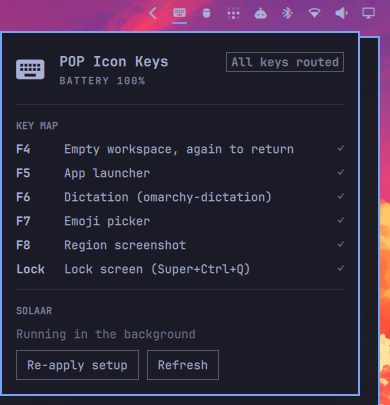

# POP Icon Keys for Omarchy

Makes the Mac-style top row of the **Logitech POP Icon Keys** do the matching
thing on [Omarchy](https://omarchy.org), and puts the keyboard's battery in the bar.

Logitech does not support Linux for this keyboard. Most of its special keys send
Windows or macOS shortcuts, or nothing Linux understands. This plugin uses
[Solaar](https://github.com/pwr-Solaar/Solaar) to catch those keys and run Omarchy
commands instead.



| Key | Does |
|---|---|
| F4 Show Desktop | Switches to an empty workspace; press again to go back |
| F5 Search | Omarchy app launcher |
| F6 Dictation | `omarchy-dictation toggle`, the same as Alt+Space, using whichever dictation backend you chose in Omarchy |
| F7 Emoji | Omarchy emoji picker |
| F8 Screen Capture | Region screenshot |
| Lock (Fn + last key) | Lock screen (`omarchy-system-lock`) |
| F9–F12, brightness, volume | Unchanged: the keyboard's own media keys already work |

The bar icon shows the keyboard's battery. Click it for the key map, whether
Solaar is running, and whether each key is routed. Right-click to refresh. It
turns your theme's urgent colour when the battery is low, a key needs setup, or
the keyboard has dropped keys (below). In the open panel, `r` refreshes, `k`
restores dropped keys and `s` runs setup.

### When the keyboard drops keys

The keyboard forgets which keys go to Solaar when it sleeps or reconnects, and
Solaar does not always send them again. The keys then fall back to the
keyboard's own shortcuts until Solaar is restarted. This is a keyboard and
Solaar limitation, not something setup can fix in a file.

The widget compares what Solaar has saved with what the keyboard reports. A key
that is saved but not active is shown as **dropped**, and the widget sends it
back to Solaar (`bin/pop-icon-keys-restore`). That re-applies Solaar's saved
setting and changes no file. It happens automatically, at most once a minute,
unless you turn off **autoRestore**; the **Restore** button does it by hand.
The widget checks every 2 minutes, so a dropped key can take that long to come
back. Restarting Solaar also fixes it.

### Settings

| Setting | Default | |
|---|---|---|
| `hideWhenDisconnected` | on | Hide the icon while the keyboard is away and nothing needs fixing |
| `showPercentage` | off | Show the battery percentage next to the icon |
| `autoRestore` | on | Send dropped keys back to Solaar automatically |

## Requirements

- Omarchy 4.x
- [Solaar](https://github.com/pwr-Solaar/Solaar) 1.1.20 or later (`omarchy pkg add solaar`). When run in a terminal, setup offers to install it; with `--yes` it stops and asks you to install it first.
- The keyboard on its **Linux** OS mode (the default, and what Solaar's "Set OS" shows), connected by its Logi Bolt receiver or Bluetooth
- `jq` and `python3`, which Omarchy already has

## Install

```bash
omarchy plugin add https://github.com/poornan/omarchy-pop-icon-keys --enable
~/.config/omarchy/plugins/io.github.poornan.pop-icon-keys/setup
```

`setup` lists every file it will change and asks before changing anything.
Add `--dry-run` to see each change as a diff without making it, or `--yes` to
skip the question. It is safe to run again: a file whose content would not
change is not touched. The bar panel's **Re-apply setup** button runs it in a
terminal, so you still get asked.

Setup always stops Solaar while it edits Solaar's settings, then starts it
again (also if setup fails partway). If Solaar will not stop, setup changes
nothing. Exit status: 0 done or declined, 1 error, 2 partly applied (Solaar has
never seen the keyboard, so the keys could not be diverted yet: turn the
keyboard on and run setup again).

What setup changes. A file is backed up only when its content changes, as
`<file>.bak.pop-icon-keys.<date-time>`, and the newest 3 backups of each file are
kept. Files are replaced atomically, CRLF line endings are kept, and a marked
block stays where it is in the file.

| File | Change |
|---|---|
| `~/.config/solaar/rules.yaml` | Adds the key rules in a block marked `# BEGIN pop-icon-keys` / `# END pop-icon-keys`, and removes earlier exact copies of these rules left outside the block. Your other rules stay as they are. |
| `~/.local/bin/pop-icon-keys-show-desktop` | Installs the Show Desktop helper |
| `~/.config/solaar/config.yaml` | Sets Show Desktop, Search, Dictation, Emoji and Screen Capture to *Diverted* for every saved entry of the keyboard, so Solaar receives them. Other keys and devices are kept. Solaar is stopped while this is written, since a running Solaar writes its own settings back over the file. |
| `~/.config/hypr/bindings.lua` | Binds Super+Ctrl+Q (what the Lock key sends) to `omarchy-system-lock`, in a marked block. Skipped if you already bind Super+Ctrl+Q. |
| `~/.config/hypr/autostart.lua` | Starts Solaar hidden at login, in a marked block. Skipped if Solaar already starts there. |

## Remove

```bash
~/.config/omarchy/plugins/io.github.poornan.pop-icon-keys/uninstall
omarchy plugin remove io.github.poornan.pop-icon-keys
```

`uninstall` also asks first, and supports `--dry-run` and `--yes`. It removes the
marked blocks and the helper, and sets the five keys back to *Regular* so they
send the keyboard's own shortcuts again (even keys that were already *Diverted*
before you ran setup). It also removes exact copies of this plugin's rules that
are no longer inside the marked block (see Caveats). Lines and rules you wrote
yourself are left alone. Solaar itself stays installed: remove it with
`omarchy pkg drop solaar` if nothing else needs it.

## Caveats

- The key names (`Show Desktop`, `MultiPlatform Search`, `Dictation`, `Emoji`,
  `Screen Capture`) were checked on Solaar 1.1.20 with one POP Icon Keys. Another
  Solaar version or keyboard revision may name them differently; run
  `solaar show "POP Icon Keys"` to see yours.
- On Wayland, Solaar rules cannot see modifier keys, so the rules match the key
  alone.
- If you already had your own Solaar rules for these keys, setup warns you and
  leaves them: both would run on each press, so remove the old ones.
- Saving rules in Solaar's own rule editor rewrites `rules.yaml` and drops all
  comments, including the `BEGIN`/`END` markers. Setup and uninstall still
  recognise this plugin's rules by their exact key and command and replace or
  remove them. If you changed one of them in Solaar's editor, it no longer
  matches: remove it there by hand.
- If a `BEGIN` or `END` marker line was edited or deleted by hand, setup and
  uninstall stop without changing anything and say which file to fix.
- The Lock key is not one Solaar can remap. It sends Super+Ctrl+Q, the macOS
  lock shortcut, which is why it is bound in Hyprland instead.
- Known limitations: two setups run at the same time (for example two terminals)
  are not locked against each other. In the open panel, `s`, `r` and `k` also
  react with Ctrl or Alt held. The widget polls every 2 minutes even while it is
  hidden, and each read takes a few seconds. The Show Desktop helper's "press
  again to go back" uses Hyprland's previous-workspace focus and has only been
  tried on one setup.

## Development

```bash
omarchy plugin validate .
python3 tests/qml_logic.py     # widget logic, offscreen; needs quickshell
tests/test_setup.sh            # setup, uninstall and the status helper in throwaway HOMEs
./setup --dry-run
```

`bin/pop-icon-keys-status` prints what the widget reads: Solaar installed and
running, keyboard connected, battery, which keys the keyboard is routing now,
which Solaar has saved, and which are missing (need setup) or dropped (need a
restore). File edits live in `lib/edit.py`.

## License

MIT. See [LICENSE](LICENSE).
