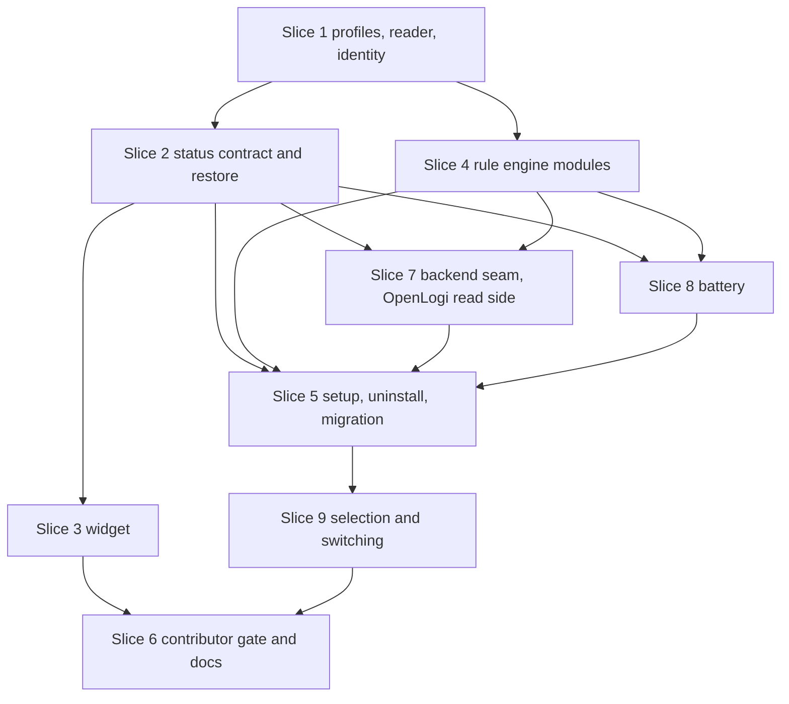

# Plan: Logitech Keys — keyboard profiles (v0.4.0)

**Created**: 2026-11-19 (rewritten the same day for the architect-reviewed design; revised after the five plan-review personas, see Plan Review Summary; extended the same day for the swappable backend, ADR 0008: slices 1 to 4 amended, slices 7 to 9 added, slices 5 and 6 reworked; "Round 2" in the Plan Review Summary; amended again for the owner's decisions D15 to D17, the live OpenLogi 0.9.0 outputs and the Solaar-quits-with-its-window finding: AC49 to AC52, "Round 3" in the Plan Review Summary; amended a fourth time for the owner's finding that plain `solaar show` crashes on this machine, and for two owner rulings on the battery freshness rule and the README's tested claim: AC53 to AC57, "Round 4" in the Plan Review Summary; amended a fifth time for the owner's battery decision D18, "Round 5")
**Branch**: feat/logitech-keys-profiles
**Status**: approved — the owner pre-approved this design ("apply architect must-fix changes"; spec gate PASS after the architect review), so the interactive plan gate is skipped. All five plan-review personas returned needs-revision on the first draft; this revision resolves or explicitly decides every item (Plan Review Summary, Decided list). The backend extension (Round 2) has not been re-reviewed by the five personas yet; they are to be re-run before the build starts. There are no open owner questions: Q1 to Q3 are answered as D15 to D17 (ADR 0008, spec rows 37 to 39); the Round 3 and Round 4 amendments have not been re-reviewed by the personas either.
**Gherkin persistence**: features
**Spec**: [docs/specs/logitech-keys-profiles.md](../docs/specs/logitech-keys-profiles.md) (57 criteria: AC1–AC22, the spec's AC3a which this plan numbers AC23, and AC24–AC57)
**Design review**: `.dev-team-reports/architect-review-2026-11-19.md` (must-fix M1–M9, ADR 0005 additions; "Later" items are README notes only). The spec text fixes of M9 are commit `eff584c` on this branch (checked with `git log`).
**ADRs**: [0005](../docs/adr/0005-device-profiles-for-other-keyboards.md) (accepted, amended four times), [0006](../docs/adr/0006-rename-to-logitech-keys.md), [0007](../docs/adr/0007-battery-from-keyboard-notifications.md) (battery), [0008](../docs/adr/0008-swappable-input-backend.md) (swappable backend; design `.dev-team-reports/architect-backend-design-2026-11-19.md`)

## Goal

Turn the single-keyboard POP Icon Keys plugin (v0.3.0) into **Logitech Keys**
(`io.github.poornan.logitech-keys`, v0.4.0). A keyboard is a data file in
`profiles/` that names *actions* from a reviewed table; one reader validates it
strictly; one identity module matches devices to profiles; status, restore,
setup, uninstall and the bar widget get keyboard knowledge only through those
two. POP Icon Keys (tested on real hardware) and MX Keys for Mac (untested, the
worked example for contributors) ship together; every Solaar rule carries a
`Device` condition; setup records what it applied and migrates a v0.3 install,
including rules Solaar's editor rewrote without markers; the repo gates
contributions with CI, a PR template and code owners.

Two further requirements of the same day are built in: an **accurate battery**
(ADR 0007: Solaar rules observe the keyboard's own notifications and a helper
stores them) and a **swappable backend** (ADR 0008, owner decision D13): a seam
between profiles and the daemon that owns the receiver, with Solaar as the
tested reference and OpenLogi as an **experimental, read-only** second backend
(detection, exact-name matching, battery and status; every key reported as
`unsupportedByBackend`; its configuration never written). One backend is active
per machine, recorded in `applied.json`; setup selects it, refuses when both
daemons run, and can switch with a write-ahead record. The OpenLogi key-mapping
writer is designed (ADR 0008) but **deferred** (see "Deferred" below).

## Plan rules (apply to every slice and every commit)

1. **Green after every slice and every step.** The tree builds, `bash tests/test_setup.sh`
   and every Python test pass, and `omarchy-plugin-validate .` passes after each
   commit. A slice never leaves a half-wired verb or a deleted file the old code
   still reads (design D2).
2. **One PR, kept** (the owner's workflow). It is built so each slice is green on
   its own, and the contributor-gate and documentation slice (6) is last, so a
   reviewer can read the PR slice by slice.
3. **No two argument shapes under one `lib/edit.py` verb.** Slice 4 changes
   library modules only; the v0.3 verbs keep their v0.3 arguments. New verbs
   arrive in Step 5.0 under distinct names and the v0.3 verbs are deleted in
   Step 5.4.
4. **One owner per fact.** Identity matching: `lib/solaarcfg.py`. Profile and
   action data and validation: `lib/profiles.py`. Escaping for YAML, Lua and
   shell: `lib/rules.py`. The v0.3 table: `lib/legacy.py`. The applied record:
   `lib/applied.py`. Plugin version: `manifest.json`, read in one function.
   Keyboard names, key names and key text appear nowhere else.
5. **Solaar-dependent checks never silently skip on the dev machine.** The key
   table is injected into the reader and status; CI uses a pinned snapshot, the
   dev machine uses the installed Solaar, and `LK_REQUIRE_SOLAAR=1` turns any
   skip into a failure (see Step 1.3 and the Pre-PR gate).
6. **Never run against the real `$HOME`.** Sandbox HOMEs with stubs only; the four
   real config files (`~/.config/solaar/{rules,config}.yaml`,
   `~/.config/hypr/{bindings,autostart}.lua`) are checksummed before and after the
   whole build, and so are `~/.config/openlogi/config.toml` and the folder
   `~/.config/systemd/user/`. The developer's OpenLogi agent is never started, stopped, restarted,
   enabled or disabled (the owner's service is installed, disabled and not running,
   and stays so); only the read-only `openlogi api status` and `openlogi api devices`
   may run against the real machine.
7. **Backends.** Bash does process lifecycle and the consent prompt only; Python
   does all reading, parsing, identity, planning and file edits, and only a
   backend's `collect` function does I/O (its `run` is injected). OpenLogi is
   never started, stopped, written, enabled or disabled for real by a test (D15 adds
   a `disable --now` path, built and tested only against the stub): the sandbox
   puts stubs for `openlogi` and `systemctl` on `PATH`, the `systemctl` stub keeps
   the unit's enabled state in a sandbox file and logs every call, and a guard
   fails the run if a stub is missing. Every OpenLogi fixture and stub is labelled `synthetic:
   doc-derived USAGE.md @9ca7ef0` and never counts as verification.
8. **Disjoint files per wave.** Slice `Files` are exactly the union of its steps'
   `Files`; slices that touch one file are ordered by `Depends-on`, and
   `plan_waves.py` must report no collision or scope mismatch.

## Approach stance (decision-defaults axes)

- **Replace vs merge:** merge, preserve existing content. Edits stay in marked
  blocks, user rules and bindings are untouched, files are backed up only when
  they change (all v0.3 safety kept). v0.3 artifacts are *migrated* into the new
  blocks, not left beside them.
- **Migrate vs edit in place:** migrate. The v0.3 id, markers and helper are
  replaced by the new ones; the old plugin is not patched (ADR 0006, no
  deprecation release: v0.3 was never submitted to the marketplace).
- **Partial earlier build work** (uncommitted `lib/profiles.py`, `profiles/*.json`,
  `tests/test_profiles.py`, fixtures, README table, `.gitignore`, `tests/test_setup.sh`
  path edit, staged fixture renames), written before the architect review with
  the old schema (argv in profiles, `tested` boolean, name matching, a profile
  directory read from an environment variable). Each file is inspected and
  marked **REUSED** or **REPLACED**, with the reason, in the table under Slice 1
  ("Partial uncommitted work"). In short: the reader, the two profiles and the
  profile tests are **rewritten** to the architect schema (only small helpers
  and facts carry over); the POP fixtures, the `.gitignore` line and the
  `tests/test_setup.sh` path edit are **reused**; the synthetic MX fixtures are
  **replaced** by the masked real recording; the README table is reused in shape
  and rewritten in Step 6.2 because two lines say "Linux OS mode" (wrong, D10).
  Nothing from the old shape is committed as is.
- **Integration:** feature branch, PR to `main` through `/pr`, release tag on
  `main` after merge. Nothing is pushed by the build.
- **Scope:** the spec. "Later" items (setup-time cid warning, keycap labels vs
  Fn-swap, release batching) are README/plan notes only. No schema-migration
  machinery, no per-user overrides, no mice, no modifier conditions.
- **Fixtures:** one recorded `solaar show` per profile plus variants *derived* by
  a helper; full sandbox setup runs only for POP Icon Keys, the two-keyboard case
  and migration; every other profile gets fast pure-Python checks.
- **Backend:** the seam (`lib/backends/`, ADR 0008) is added as slices 7 to 9
  around the original six; Solaar behaviour is unchanged behind a thin adapter
  (no logic moves); OpenLogi is read-only and experimental; the OpenLogi writer
  is not built (Deferred). Nothing in a test touches the developer's real
  OpenLogi or Solaar processes.
- **Slice shape:** nine slices. The identity module (`lib/solaarcfg.py`) is built
  in Slice 1 and imported read-only by Slices 2 and 4, so the status work and the
  rule engine run side by side without sharing a file. `lib/edit.py` is split
  into modules in Step 4.0 so it stops being the home of five responsibilities.
  Setup (Slice 5) is cut from the engine because the setup tests are the long pole.
  The backend seam and OpenLogi read side (Slice 7) and the battery (Slice 8) run
  beside the widget (Slice 3) once status and the rule engine exist; setup is
  rebuilt through the seam (Slice 5); selection and switching are the last code
  slice (Slice 9) because they edit the same files as Slice 5; the documents and
  the gate (Slice 6) come last.

## Acceptance Criteria

Numbered as in the spec, except that the spec's AC3a carries the plan id AC23
(the plan tooling wants whole-number ids); the spec says so and its new criteria
start at AC24; AC27 to AC34 (OS mode, MX data, battery), AC35 to AC48 (backend) and
AC49 to AC52 (stopped backend and Start Solaar, README, battery persistence) and
AC53 to AC57 (per-device Solaar queries, the `unknown` state, widget copy, the
synthetic truncation fixture, the README known issue) were added after the first
revision. Ticked at PR review after behavioural verification; traceability
to tests is in the tables further down.

- [ ] AC1 Plugin id `io.github.poornan.logitech-keys`, display name "Logitech Keys", README and install commands use `github.com/poornan/omarchy-logitech-keys`
- [ ] AC2 With only the POP Icon Keys known to Solaar, behaviour matches POP spec AC1–AC18, including a fresh install (AC21); every v0.3 test section is kept, moved or deleted with a reason (inventory below)
- [ ] AC3 MX Keys for Mac: 225 Launchpad to `app-launcher`, 191 Print Screen to `region-screenshot`, 111 Screen Lock to `lock`, 10 Calculator to `calculator`; the id set is exactly {225, 191, 111, 10}; 224 and 13 and media/brightness not diverted; marked untested
- [ ] AC4 Both keyboards in one consent-gated setup; each keyboard's keys run its own actions, including a shared key name (checked with a synthetic profile, since the shipped profiles share none)
- [ ] AC5 A keyboard is added by one profile, its one fixture and a README row, no script or QML change; a malformed profile or a missing fixture fails a test; status, `known` and the plan all pick the new keyboard up
- [ ] AC6 One bar icon; popup lists every connected profiled keyboard with battery and per-key routing; icon warns if any keyboard needs setup or dropped keys; untested labelled; `absent` and `unsupportedByBackend` keys never warn
- [ ] AC7 A keyboard that drops diversion is restored without touching the other, using the matched block's exact device name and never writing a config file; restore does nothing when the selector matches more than one device
- [ ] AC8 New setup over v0.3 replaces `pop-icon-keys` blocks, one copy of each rule, user rules intact; uninstall removes old and new; setup after a migration is a no-op
- [ ] AC9 README "Add your keyboard" section with the Fn-swap, cid-naming and release-batching notes, in the fixed README order, with a copy-paste masking command, the exact local test command, an example validator error, a worked diff and a "Test my keyboard" path; rollback is v0.4's own uninstall
- [ ] AC10 All v0.3 safety tests pass (adapted), plus profile, two-keyboard, status, applied-state and migration tests; dev-team review passes before release
- [ ] AC11 Identity by exact model id then exact name in one module; "MX Keys Mini" / "MX Keys S" do not match MX Keys for Mac; a profile named "MX Keys" is refused; status checks each block's `Model ID:` line
- [ ] AC12 Diversion lines parsed in Python with exact name and cid matching (suffixed names correct); `Panel.qml` renders JSON and holds no keyboard or key names (stdlib check run by CI)
- [ ] AC13 Keys and bindings name an action id; unknown id, `command` field, chord outside the regex, unknown field fail; the action table is validated too; rules and Lua generated from `lib/actions.json`; profile and action text reaches YAML, Lua and shell only through the rules module
- [ ] AC14 Every generated rule has a `Device` condition over the profile's names and no `Model`, and fires only for its own keyboard (checked with Solaar's own evaluator); `classify()` treats new and v0.3 shapes as ours and a hand-written rule as "other", flagging overlap only where it can fire on a plugin-handled keyboard
- [ ] AC15 A key in neither diversion line is `absent`: dimmed with a text state, not counted toward the needs-setup warning; the live-by-saved state table is pinned
- [ ] AC16 `setup` writes `applied.json` (before the diversion as a superset, finalised after) and resets a control id a later profile drops (removing its rule); `uninstall` resets every recorded id and deletes it; other keys and user rules untouched
- [ ] AC17 Legacy migration: unmarked v0.3 rules (incl. `pop-icon-keys-show-desktop` path at any home and v0.3 argument lists) replaced not duplicated, a near-miss rule left alone; old helper and old Lua blocks removed; warning if the old plugin is still installed
- [ ] AC18 Reader enforces the schema incl. the Solaar `CONTROL` cross-check (live Solaar, else the pinned snapshot, so CI stays stdlib-only); every shipped profile passes; a test mutates a valid profile into each failure case; the dev gate runs the real-Solaar checks with zero skips
- [ ] AC19 Tested only if `verified` has `solaar`, `date`, `fnSwap` (`osMode` is a required top-level field, AC45); one recorded fixture per profile, first line has the Solaar version (equal to `verified.solaar`), serials, unit ids, MAC addresses and hid paths masked (test-enforced); a synthetic fixture never sets `verified`
- [ ] AC20 CI workflow running the stdlib tests (actions pinned by SHA, `contents: read`), PR template with the checklist, CODEOWNERS (`* @poornan` plus explicit paths), structural repo checks
- [ ] AC21 Fresh install with no Solaar entry for any profiled keyboard: the consent plan lists supported keyboards (tested/untested) and says setup applies whichever Solaar then records; setup is two-phase (resolve the set, then apply idempotently); declining exits 0 with no change; a Solaar that records only a mouse exits 2 with no record
- [ ] AC22 Widget IPC target and QML module name are `logitech-keys`
- [ ] AC23 (the spec's AC3a) Solaar's own names and ids for the POP profile (110, 212, 259, 264, 266) pinned by a test; the v0.3 212/266 swap in `RULES` is gone and `lib/edit.py` holds no name-to-id data
- [ ] AC24 The applied record is robust: written before the diversion (union of old and new ids), finalised after, carries matched names and model ids so uninstall works without the profile file, atomic with no `.bak`, damaged or newer records refused with a message, `XDG_STATE_HOME` unset or relative handled, a dry run writes nothing
- [ ] AC25 The widget states are text first: every key row says Active, Lost, Not set up or Not found (plus a glyph), untested keyboards say so in words, an all-absent keyboard says its profile may not match, warnings and failures say what to do; the popup is keyboard-operable
- [ ] AC26 The consent plan is complete and ordered: per-keyboard blocks (tested or untested, keys, actions), file changes, the Solaar stop and restart notice, migration items, user rules left unchanged (with the still-fires note), the exit-2 text, and for an uninstall without a record the exact v0.3 key names
- [ ] AC27 README states MacOS OS mode is required, that the plugin never changes it, that other modes are untested, and never says "Linux mode"; every profile's `osMode` is `MacOS`
- [ ] AC28 Setup reads each keyboard's Set OS read-only and the consent plan warns, without blocking, when it differs from the profile's `osMode`; unreadable mode (older Solaar, OpenLogi) gives no warning
- [ ] AC29 The MX profile's model id, name, `osMode`, battery feature and four keys (225, 191, 111, 10 with Solaar's names) equal the recorded fixture and Solaar's key table; the recorded, masked fixture replaces the synthetic ones; `note` optional; no `verified`
- [ ] AC30 Battery rules: ten `Device` + `Feature` + `Report` + `TestBytes` bucket rules per profile with a `battery` feature, evaluated by Solaar's own rule code; none without the field; `classify()` counts them as ours; uninstall removes them; setup again changes nothing
- [ ] AC31 `bin/logitech-keys-battery <slug> <percent>` validates slug, integer and 0 to 100, writes the state file atomically under `$XDG_STATE_HOME`, never under `/tmp`
- [ ] AC32 Status `battery` is null or `{value, level, source, at}`; one function, `choose_battery(report, query)` (D18, owner: "Keep last report (Recommended)"), keeps the latest report (`report`, bucket lower bound + 5, with its time) across reconnects and Solaar restarts whatever its age, unless the query value is lower (then the query, `query`); a query equal to or higher never replaces it; a newer report replaces an older one; no report gives the query; no data gives null; OpenLogi gives `backend`; `connected_at` is not an input
- [ ] AC33 The popup shows "≈15%" with age (for example "≈15%, 3 h ago") for a report, the exact figure below 100 for a query or backend figure (no age, including a lower query that beat the report), "Full?" when only a query or backend says full or 100, "Battery unknown" for null; the README says a new report arrives soon after fitting batteries and Restore or Refresh does not force one
- [ ] AC34 Uninstall removes the plugin's state directory (`applied.json` and `battery/`) and nothing else; a dry run removes nothing; the plan lists it
- [ ] AC35 Backend seam: each backend is a `lib/backends/<name>.py` and `.sh` pair; the registry is exactly `solaar` and `openlogi`; the contract members exist; only `collect` does I/O; the Solaar adapter changes no Solaar behaviour
- [ ] AC36 Selection: `--backend` wins (a change is a switch); recorded backend without a flag; only one installed; the running one; neither running gives Solaar with the reason; neither installed gives Solaar via `omarchy pkg add solaar`; both running is refused (exit 1, nothing changed); setup never installs OpenLogi
- [ ] AC37 OpenLogi read side: exact-name matching (profile `names` or `backends.openlogi.names`), ambiguity marking, battery as `backend` source, the backend block, Flatpak counts as not installed
- [ ] AC38 OpenLogi unusable states (`ok: false`, scanning, unknown `schema_version`, non-JSON, exit 2) give `usable: false` with a `problem` code, exit 0 and valid JSON, never a crash
- [ ] AC39 Under OpenLogi every key is `unsupportedByBackend` (`notImplemented`), dimmed, not a warning; `liveKeyState` false means no `dropped`, no restore, `routed` = configured and agent running; the Lock binding still applies
- [ ] AC40 `otherRunning` names the other backend's running daemon and the popup warns that both own the receiver, without stopping anything
- [ ] AC41 Switching: one consent and plan, write-ahead `switching`, ordered steps, Solaar files byte-identical after Solaar to OpenLogi to Solaar, interrupted switch restarts the old daemon and a re-run finishes it; D15: a switch to Solaar lists `systemctl --user disable --now openlogi-agent.service` in the plan and runs it only on y (stub-tested), after the old daemon stops and before Solaar starts
- [ ] AC42 Uninstall removes every recorded backend's artifacts (a half-finished switch included), restarts only what it stopped, disables only what it enabled, never uninstalls packages and never re-enables a service a switch disabled (it prints the command)
- [ ] AC43 The consent plan names the backend, reason, experimental badge, per-key outcomes, every daemon action (including the consented `disable --now` on a switch to Solaar, listed only when it will run), the OpenLogi no-change line and the OS-layout warning (D16: never changed)
- [ ] AC44 The applied record has `backend`, `switching` and per-backend `artifacts`, is read and written with AC24's robustness, and lets uninstall work without the profile files
- [ ] AC45 `osMode` is a required top-level profile field from the closed list (checked against Solaar's table); inside `verified` or missing or unknown fails validation
- [ ] AC46 `backends` is optional and strict (only `openlogi`; `names`; `verified` with `openlogi`, `date`, `keys` subset of cids; a verified block needs a recorded non-synthetic fixture); the shipped profiles have none
- [ ] AC47 `tests/test_backend_contract.py` runs one suite over both backends; synthetic labelled OpenLogi fixtures; stubs for `openlogi` and `systemctl` with a missing-stub guard; selection matrix, switch round trip, interrupted switch and uninstall mid-switch in the sandbox
- [ ] AC48 No code path writes OpenLogi's config or `~/.config/systemd/user/` except the consented `enable` during a switch to OpenLogi and the consented `disable --now` during a switch to Solaar (checksummed in tests, stub only); CLAUDE.md forbids stopping or restarting the real OpenLogi agent and allows only the read-only `api` calls
- [ ] AC49 A backend that is installed but not running is shown prominently: a banner in words, the icon warning, no auto-restore; `backend.canStart` is true only for Solaar installed and not running and gives a Start Solaar button (falsifiers: Solaar running, Solaar not installed, OpenLogi not running)
- [ ] AC50 `bin/logitech-keys-start` starts Solaar hidden (`setsid -f solaar --window=hide`), changes and writes no file, refuses when Solaar already runs or is missing; the widget shows pending and failure lines
- [ ] AC51 The README says closing Solaar's window quits it on Omarchy (no tray), to start it hidden with `solaar --window=hide` and leave it running, and mentions the Start Solaar button (structural test pins the flag against `solaar --help` on the dev machine)
- [ ] AC52 Only keyboard battery reports are persisted, only by `bin/logitech-keys-battery`; a `solaar show` or `openlogi api devices` figure is shown with its source and never written to the battery state directory
- [ ] AC53 Status and restore never run `solaar show all`: one `solaar show "<selector>"` per profiled device (exact selector from the profile `names` and from saved entries matched by model id); each returned block is parsed on its own and its `Model ID:` (or exact name) is checked, a non-matching block is not-this-device and makes the selector ambiguous (restore skips); the Solaar adapter's `collect` allow-list is the per-device selectors only
- [ ] AC54 A non-zero exit, a timeout or empty output from `solaar show` never makes a known keyboard disconnected, not set up or missing: complete blocks keep their states, a known profiled keyboard not read completely has every key `unknown` and a `readProblem`, `no device found matching` is "not present"; `unknown` never warns and is never restored
- [ ] AC55 The widget shows `unknown` rows as "Unknown" with one section line, no icon warning and no restore for them (copy table, once)
- [ ] AC56 A synthetic truncated-output fixture is built in the test from the masked recorded POP fixture plus the traceback text, labelled synthetic, never verification; tests cover the POP block complete with the remainder unknown, the per-device selectors and ambiguity
- [ ] AC57 The README has a known-issues note on Solaar 1.1.20's host-name decode bug that can break plain `solaar show`, the per-keyboard workaround and the "Unknown" state

## Slices

Waves, derived by `plan_waves.py` (never hand-edited):
1, then 2 and 4, then 3, 7 and 8, then 5, then 9, then 6. Slices that touch the same
file are ordered by `Depends-on`, never same-wave: `lib/edit.py` and
`tests/test_edit.py` (4, then 7 and 5, then 9), `lib/status.py`,
`bin/logitech-keys-status`, `bin/logitech-keys-restore` (2, then 7),
`lib/rules.py` (4, then 8, then 5), `lib/fileedit.py` (4, then 7),
`tests/test_setup.sh` (2, then 5, then 9), `lib/solaar-procs.sh` and `lib.sh`
(7, then 5, then 9), `lib/plan.py` and `tests/test_plan.py` (4, then 9),
`setup` and `uninstall` (5, then 9), `Panel.qml`, `manifest.json`, `tests/qml*`
(3 only; it reads Slice 2's `tests/qml/status-sample.json` and
`tests/qml/status-sample-openlogi.json`), `lib/solaarcfg.py` (written in 1,
imported read-only elsewhere), `lib/applied.py` (written in 4 with the
backend-aware shape, imported read-only by 7 and 9), `README.md` (6 only).
Slice 8 is **additive only**: it adds `lib/battery.py`, the helper and battery
rules, and does not touch `lib/status.py` (Slice 2 owns the whole battery status
contract, including reading the report file), so it can share a wave with Slice 7.
Every `# test:` comment under a scenario names the test that proves it
(`path::check group`).

### Slice 1: Profile schema, action table, the single reader and the identity module

**Depends-on:** none
**Files:** `lib/actions.json`, `lib/profiles.py`, `lib/solaarcfg.py`, `profiles/pop-icon-keys.json`, `profiles/mx-keys-mac.json`, `tests/test_profiles.py`, `tests/test_fixture_equality.py`, `tests/fixtures_derive.py`, `tests/solaar_table.py`, `tests/solaar_control_1.1.20.json`, `tests/permanent_slugs.txt`, `tests/fixtures/README.md`, `tests/fixtures/pop-icon-keys/show.txt`, `tests/fixtures/pop-icon-keys/routed.txt`, `tests/fixtures/pop-icon-keys/dropped.txt`, `tests/fixtures/pop-icon-keys/not-setup.txt`, `tests/fixtures/mx-keys-mac/show.txt`, `tests/fixtures/mx-keys-mac/routed.txt`, `tests/fixtures/mx-keys-mac/dropped.txt`, `tests/fixtures/mx-keys-mac/not-setup.txt`, `tests/test_setup.sh`, `.gitignore`

**Partial uncommitted work: reused or replaced, file by file.** Inspected with `git status`, `git diff` and by reading each file on 2026-11-19. The earlier build agent wrote these before the architect review; the tree is at `e2f339f`-plus-ADR/spec commits with these files uncommitted (the three fixture renames are staged). The plan commits nothing from the old shape as is.

| Partial file (state) | Decision | Reason | Where it lands |
|---|---|---|---|
| `lib/profiles.py` (untracked, 244 lines) | **REPLACED** (rewritten) | Old schema: `solaarNames`, single `modelId`, `tested` boolean, `cap`, argv `command`, `hyprBindings`, profile folder from `LK_PROFILE_DIR`, names matched by equality only, `known()` reads a path. Architect M1, M3, M8 need `modelIds`/`names`, action ids, derived `tested`, strict reader, injected paths. Only small pieces carry over: `BAD_CHARS` and the `_text()` hygiene helper, the slug regex, the sorted-listing and JSON-error skeleton of `load_all`, the exit code 4 and `error: profile:` message of the command line | Steps 1.1 to 1.3 and 1.5 |
| `profiles/pop-icon-keys.json` (untracked) | **REPLACED** | Old fields and `"osMode": "Linux"` inside `verified`, which is wrong (D10). Facts reused: display name, the five keys and cids (110, 212, 259, 264, 266), the Lock chord `SUPER + CTRL + Q`, label wording | Step 1.1 |
| `profiles/mx-keys-mac.json` (untracked) | **REPLACED** | Old fields, `modelId` singular, no `modelIds`, `osMode`, `battery` or `note`, argv commands. Facts reused: the four keys and cids (225, 191, 111, 10) | Step 1.1 |
| `tests/test_profiles.py` (untracked, 141 lines) | **REPLACED** | Checks three fixtures per profile, a README row, the `tested` boolean, `solaarNames`. Reused: the `check()` counter and the `refused()` mutation helper shape, the pinned POP pairs and the MX id set as test cases | Steps 1.1 to 1.5 |
| `tests/fixtures/README.md` (untracked) | **REPLACED** | Describes three recorded fixtures per profile, says "Linux OS mode" and that the MX set is synthetic; the rule is now one recorded fixture plus derived variants | Step 1.4 |
| `tests/fixtures/mx-keys-mac/routed.txt`, `dropped.txt`, `not-setup.txt` (untracked) | **REPLACED** (deleted) | Hand-written synthetic variants; the owner's masked recording replaces them (`show.txt`) and variants are derived | Step 1.4 |
| `tests/fixtures/pop-icon-keys/routed.txt`, `dropped.txt`, `not-setup.txt` (staged renames of `solaar-show-*.txt`) | **REUSED** unchanged | `routed.txt` is a real masked `solaar show` of the owner's POP (first line `solaar version 1.1.20`); the other two are the v0.3 recordings. `show.txt` is a byte copy of `routed.txt` (the one recorded fixture); the three files stay as the equality reference until Step 5.4 deletes them | Step 1.4 (committed with the renames), Step 5.4 |
| `tests/test_setup.sh` (modified, one line) | **REUSED** | The v0.3 status-helper section reads `tests/fixtures/pop-icon-keys/$case.txt` instead of `solaar-show-$case.txt`; correct for the new layout and must be committed with the renames so every commit stays green. Later slices (2, 5, 9) edit the same file after Slice 1 | Step 1.4 |
| `README.md` (modified, `Supported keyboards` table) | **REUSED in shape, REPLACED in content, committed in Step 6.2 only** | The section and table shape stay. Two stale lines: row POP says "Linux OS mode" (line 15, wrong, D10) and the MX row says "drafted from Solaar's key table" (now: device data recorded from hardware, key presses untested); line 68 says "The keyboard on its **Linux** OS mode". Slices 1 to 5 do not read the README (their tests are not coupled to it), so it stays uncommitted until Step 6.2 rewrites it | Step 6.2 |
| `.gitignore` (modified, `.dev-team-reports/`) | **REUSED** | Correct as is (the reports stay out of git) | Step 1.4 |

**Behavior:**

```gherkin
Feature: Keyboards are data files checked by one strict reader and matched by one identity module

  Scenario: The shipped profiles are valid and tested only when verified
    # Still passes if: a key's label text reads oddly
    # test: tests/test_profiles.py::shipped_profiles_valid
    Given the profiles folder with the POP Icon Keys and MX Keys for Mac profiles
    When the profile check runs
    Then both profiles pass
    And the POP Icon Keys profile counts as tested because it records where and when it was verified
    And the MX Keys for Mac profile counts as untested because it records no verification

  Scenario: Both shipped profiles run in MacOS mode, declared at the top level
    # Still passes if: the display name of a profile changes
    # test: tests/test_profiles.py::os_mode_macos
    Given the POP Icon Keys and MX Keys for Mac profiles
    Then each has the top-level OS mode MacOS and its verified block, if any, has no OS mode
    And no shipped file says the keyboards run in Linux OS mode

  Scenario Outline: The OS mode is a required top-level value from Solaar's list
    # Still passes if: the profile's other fields change
    # test: tests/test_profiles.py::os_mode_matrix
    Given a valid profile changed so that <defect>
    When the profile check runs
    Then it fails naming that profile file and the field osMode, or accepts it for the rows that say accepted

    Examples:
      | defect                                                     |
      | the OS mode is missing                                     |
      | the OS mode is Ubuntu                                      |
      | the OS mode is lowercase macos                             |
      | the OS mode is an empty string                             |
      | the OS mode is a number                                    |
      | the verified block still holds an OS mode                  |
      | the OS mode is Windows (accepted: it is on Solaar's list)  |

  Scenario: The MX Keys for Mac profile equals the recorded hardware facts
    # Still passes if: the recorded fixture's battery percentage differs
    # test: tests/test_profiles.py::mx_matches_recording
    Given the owner's masked recording of the MX Keys for Mac and Solaar's key table
    Then the profile's model id is B36140920000 and its name is "MX Keys for Mac"
    And its keys are 225 "Dashboard Launchpad/Action Center", 191 "Screen Capture/Print Screen", 111 "Screen Lock" and 10 "Calculator"
    And its OS mode is MacOS and its battery feature is BATTERY STATUS and the recording shows the same Set OS, feature and Unifying receiver
    And it has a note and no verified block
    And the synthetic MX fixture files are gone and the recorded one is masked

  Scenario: Profiles use Solaar's own key names and ids
    # Still passes if: a label differs from the printed keycap
    # test: tests/test_profiles.py::pop_pairs_and_lock_binding
    Given the POP Icon Keys profile
    Then Show Desktop is 110, MultiPlatform Search is 212, Dictation is 259, Emoji is 264 and Screen Capture is 266
    And its Lock binding is the chord SUPER + CTRL + Q running the lock action

  Scenario: MX Keys for Mac maps exactly four keys to named actions
    # Still passes if: the key order inside the profile changes
    # test: tests/test_profiles.py::mx_mapping_exact
    Given the MX Keys for Mac profile
    Then its control ids are exactly 225, 191, 111 and 10
    And 225 runs the app launcher, 191 the region screenshot, 111 the lock action and 10 the calculator
    And Mission Control (224) and Eject (13) are not listed

  Scenario Outline: A malformed profile is refused and the file and field are named
    # Still passes if: the reason text after the file and field names changes
    # test: tests/test_profiles.py::mutation_matrix
    Given a valid profile changed so that <defect>
    When the profile check runs
    Then it fails naming that profile file and the field at fault

    Examples:
      | defect                                                          |
      | it has a field the schema does not know                         |
      | a key has a field the schema does not know                      |
      | the verified block has a field the schema does not know         |
      | a key carries a command instead of an action                    |
      | a key names an action not in the action table                   |
      | a binding names an action not in the action table               |
      | the schema field is missing                                     |
      | the schema field is 2                                           |
      | the model id is lowercase                                       |
      | the model id has eleven digits                                  |
      | the model id has thirteen digits                                |
      | the list of model ids is empty                                  |
      | the list of names is empty                                      |
      | the list of keys is empty                                       |
      | a key has a name but no control id                              |
      | a key has a control id but no name                              |
      | two keys share a control id                                     |
      | two keys share a name                                           |
      | its model id is also listed by another profile                  |
      | its slug does not match its file name                           |
      | the verified block holds an OS mode (it is a top-level field now) |
      | the battery feature is not UNIFIED BATTERY or BATTERY STATUS    |
      | the battery field has a field the schema does not know          |
      | the note has a newline                                          |
      | the verified block lacks the Fn-swap flag                       |
      | the verified Fn-swap flag is a string                           |
      | the verified date is not in the form year-month-day             |
      | the verified Solaar version is not a version number             |
      | a label contains a double quote                                 |
      | a label contains a newline                                      |
      | the file is not valid JSON                                      |
      | the top level of the file is a list                             |

  Scenario Outline: The optional backends section is strict
    # Still passes if: the profile's key labels change
    # test: tests/test_profiles.py::backends_matrix
    Given a valid profile changed so that <defect>
    When the profile check runs
    Then <outcome>

    Examples:
      | defect                                                                       | outcome                                              |
      | it has no backends section                                                   | it passes (v0.4.0 ships none)                        |
      | backends has a key other than openlogi                                       | it fails naming the file and the backends field      |
      | backends.openlogi has a field the schema does not know                       | it fails naming the file and the field               |
      | backends.openlogi.names holds an empty string                                | it fails naming the file and the field               |
      | backends.openlogi.names holds a name with a newline                          | it fails naming the file and the field               |
      | backends.openlogi.verified lists a cid the profile does not map              | it fails naming the file and the field               |
      | backends.openlogi.verified has no recorded openlogi-devices.json fixture      | it fails naming the missing fixture                  |
      | the openlogi-devices.json fixture is marked synthetic                        | it fails saying a synthetic fixture cannot verify    |
      | backends.openlogi.verified has a recorded non-synthetic fixture and listed cids that exist | it passes                              |

  Scenario Outline: A Hyprland chord is accepted only in the fixed form
    # Still passes if: the list of accepted function keys grows
    # test: tests/test_profiles.py::chord_boundary_table
    Given a profile whose binding chord is <chord>
    When the profile check runs
    Then the chord is <verdict>

    Examples:
      | chord                                      | verdict  |
      | SUPER + CTRL + Q                           | accepted |
      | SUPER + F5                                 | accepted |
      | SHIFT + ALT + SUPER + CTRL + A             | accepted |
      | Q alone with no modifier                   | refused  |
      | SUPER + CTRL with no key                   | refused  |
      | SUPER + Q + W with two keys                | refused  |
      | SUPER + SUPER + Q with a repeated modifier | refused  |
      | an empty chord                             | refused  |
      | a chord containing a double quote          | refused  |
      | a chord ending in a newline                | refused  |
      | a chord containing a backslash             | refused  |
      | a chord containing two closing square brackets | refused |
      | super + q in lowercase                     | refused  |
      | SUPER+Q without spaces                     | refused  |
      | SUPER + Q with a trailing space            | refused  |

  Scenario Outline: A malformed action table is refused
    # Still passes if: the action ids are listed in another order
    # test: tests/test_profiles.py::action_table_mutations
    Given the action table changed so that <defect>
    When the profile check runs
    Then it fails naming the action table and the action id at fault

    Examples:
      | defect                                         |
      | an action names a helper the plugin does not ship |
      | an action's argument list holds a number       |
      | an action's argument list is empty             |
      | an action's argument holds a newline           |
      | two actions share an id                        |
      | an action has both an argument list and a helper |

  Scenario: One keyboard's name may not be a substring of another's
    # Still passes if: two profiles share a key name with the same action
    # test: tests/test_profiles.py::substring_name_refused
    Given a second profile named "MX Keys" next to "MX Keys for Mac"
    When the profile check runs
    Then it fails because the name would match both keyboards

  Scenario: Two profiles may not bind one chord to different actions
    # Still passes if: two profiles bind the same chord to the same action
    # test: tests/test_profiles.py::chord_conflict_refused
    Given two profiles that both bind SUPER + CTRL + Q, one to lock and one to the app launcher
    When the profile check runs
    Then it fails naming both profile files

  Scenario Outline: Names and ids are checked against Solaar's own key table
    # Still passes if: the table lists more keys than the profiles use
    # test: tests/test_profiles.py::key_table_cross_check
    Given the key table is <table>
    When the profile check runs
    Then <outcome>

    Examples:
      | table                                                      | outcome                                                                |
      | a supplied table that agrees with every profile            | every profile passes                                                   |
      | a supplied table where one id has another name             | it fails naming the profile, the key and both names                    |
      | the installed Solaar's table                               | every profile passes and the source is reported as Solaar              |
      | the pinned snapshot because Solaar cannot be imported      | every profile passes and the source is reported as the snapshot        |
      | not available at all                                       | the cross-check is skipped with a printed note and nothing else is skipped |
      | not available and LK_REQUIRE_SOLAAR is 1                   | the run fails saying a Solaar check was skipped                        |

  Scenario: A released slug cannot be renamed or dropped
    # Still passes if: a new profile is added
    # test: tests/test_profiles.py::permanent_slugs
    Given the frozen list of shipped slugs
    When a shipped slug has no profile file
    Then the profile check fails naming the slug

  Scenario: A profile without its recorded fixture fails
    # Still passes if: the fixture holds extra devices
    # test: tests/test_profiles.py::fixture_required
    Given a profile with no recorded fixture folder
    When the profile check runs
    Then it fails naming the missing fixture

  Scenario Outline: A fixture must be masked, versioned and honestly labelled
    # Still passes if: the fixture has trailing blank lines
    # test: tests/test_profiles.py::fixture_rules
    Given a recorded fixture where <defect>
    When the fixture check runs
    Then it fails naming the fixture

    Examples:
      | defect                                                          |
      | the first line does not carry the Solaar version                |
      | the Solaar version differs from the profile's verified version  |
      | a serial number is not masked                                   |
      | a unit id is not masked                                         |
      | a MAC address is present                                        |
      | a hid or hidraw device path is present                          |
      | the model id differs from the profile's                         |
      | it is marked synthetic yet its profile has verified             |
      | the first line is a recording header that carries no Solaar version |
      | the profile's OS mode differs from the recording's Set OS line  |
      | the verified keyboard's recording has a profile key missing from both diversion lines |

  Scenario: Fixture variants are derived from the profile and match the recorded ones
    # Still passes if: the derived MX Keys for Mac variants are spaced differently
    # test: tests/test_profiles.py::derived_variants, tests/test_fixture_equality.py::derived_equals_recorded
    Given the recorded fixture of a profile
    When the routed, dropped and not-set-up variants are derived
    Then routed has every mapped key diverted in both lines
    And dropped has them diverted when saved and regular live
    And not-set-up has some keys regular when saved
    And for the POP Icon Keys each derived variant equals the variant recorded in v0.3

  Scenario Outline: A Solaar device is matched to a profile by model id, then by exact name
    # Still passes if: the device's battery level differs
    # test: tests/test_profiles.py::identity_matcher
    Given a device with model id <model id> and name <name>
    When the device is matched against the shipped profiles
    Then it matches <profile>

    Examples:
      | model id                       | name                | profile                  |
      | B38F00000000                   | POP Icon Keys       | POP Icon Keys            |
      | B38F00000000                   | a renamed keyboard  | POP Icon Keys            |
      | all zeros                      | POP Icon Keys       | POP Icon Keys            |
      | the name stored as the model id| POP Icon Keys       | POP Icon Keys            |
      | B36140920000                   | MX Keys for Mac     | MX Keys for Mac          |
      | an unknown model id            | MX Keys S           | no profile               |
      | an unknown model id            | MX Keys Mini        | no profile               |
      | B04200000000                   | MX Master 4         | no profile               |

  Scenario: Bluetooth and Bolt entries of one keyboard both match
    # Still passes if: the entries appear in another order in the file
    # test: tests/test_profiles.py::known_two_entries
    Given Solaar's saved settings hold two entries for one keyboard with different names
    When the saved entries are matched
    Then both entries are returned with their line spans

  Scenario: The reader's command line validates and lists profiles
    # Still passes if: the command line prints profiles in another order
    # test: tests/test_profiles.py::cli_validate_list
    Given the profiles folder with the shipped profiles
    When the reader's validate and list commands run
    Then validate exits 0 and list prints one line per profile with its slug, display name and tested flag
    And a broken profiles folder exits 4 naming the file
```

**Steps:**

#### Step 1.1: Action table, new-schema profiles and the reader's loader

**Complexity**: standard
**IMPLEMENT**: Add `lib/actions.json` (`"schema": 1`, then action id to `{"argv": [...]}` or `{"helper": "<name>"}`; ids `show-desktop` (helper), `app-launcher`, `dictation`, `emoji-picker`, `region-screenshot`, `lock`, `calculator`). Rewrite `lib/profiles.py` as **pure data**: `"schema": 1` profiles with `modelIds`, `names`, `keys` of `{name, cid, label, action}`, required top-level `osMode`, optional `bindings` of `{chord, action, label}`, optional `battery` `{"feature": "UNIFIED BATTERY" | "BATTERY STATUS"}`, optional `note` (single line), optional `backends` (only `openlogi`, Step 1.2), optional `verified` `{solaar, date, fnSwap}`; `load_all(directory)` and `load_actions(path)` take their paths as **arguments** (no environment variable; the default directory is computed from the module's own location by the caller); `tested` is derived from `verified`; `resolve_action(action_id, actions, helper_dir)` returns an argv list (a `{"helper": ...}` entry becomes `<helper_dir>/<helper>` joined as a path, never a shell string). The module is stdlib-only, importable with an explicit `sys.path` (scripts run as `python3 -I`). Rewrite the two shipped profiles in the new schema (POP: model id B38F00000000, 110/212/259/264/266, the Lock binding `SUPER + CTRL + Q` to `lock`, `osMode` `MacOS` (**not** `Linux`, which the partial work wrote), `battery` `UNIFIED BATTERY`, `verified` solaar 1.1.20, 2026-11-19, fnSwap true and no `osMode` inside it; MX: model id B36140920000, names `["MX Keys for Mac"]`, `osMode` `MacOS`, `battery` `BATTERY STATUS`, keys 225 `Dashboard Launchpad/Action Center` (`app-launcher`), 191 `Screen Capture/Print Screen` (`region-screenshot`), 111 `Screen Lock` (`lock`), 10 `Calculator` (`calculator`) from the recording, a `note` ("device data recorded from real hardware 2026-11-19; key actions untested"), no `verified`, no `backends`). Reuse the partial work's text hygiene (`BAD_CHARS`).
**TEST**: `tests/test_profiles.py` (rewritten): shipped profiles load; `tested` derives from `verified`; POP pairs 110/212/259/264/266 pinned and the Lock binding pinned; the MX id set equals exactly {225, 191, 111, 10} with the four actions; 224 and 13 absent; both shipped profiles have top-level `osMode` `MacOS` and no `osMode` in `verified`; the battery features are as above; the MX names and cids equal the recording and Solaar's key table (`mx_matches_recording`); `resolve_action` returns the helper path under a given directory.
**REFACTOR**: Drop the `tested` boolean, `cap`, `command`, `hyprBindings`, `solaarNames` and the environment-variable directory override from the old shape; one `_text()` helper for string fields.
**Files**: `lib/actions.json`, `lib/profiles.py`, `profiles/pop-icon-keys.json`, `profiles/mx-keys-mac.json`, `tests/test_profiles.py`
**Covers**: AC3, AC19, AC23, AC27, AC29, AC45
**Commit**: `Describe keyboards as profiles that name actions`

#### Step 1.2: Strict validation, the chord regex and the mutation matrix

**Complexity**: complex
**IMPLEMENT**: Strict validation in the single reader, errors as `ProfileError(file, field, reason)`: unknown fields fail at every level (profile, key, binding, verified, action); `command` refused; `schema` must be the integer 1; action ids resolved against the action table; the chord is `re.fullmatch` of `(?:(?:SUPER|CTRL|ALT|SHIFT) \+ ){1,4}(?:[A-Z0-9]|F(?:[1-9]|1[0-2]))` with no repeated modifier (`fullmatch`, never `$`, so a trailing newline is refused); model id `[0-9A-F]{12}` exactly; **`osMode` required at the top level and one of `Linux`, `MacOS`, `Windows`, `iOS`, `Android`, `WebOS`, `Chrome`, `WinEmb`, `Tizen` (exact case; an `osMode` inside `verified` is an unknown field); `battery` an object whose only field `feature` is `UNIFIED BATTERY` or `BATTERY STATUS`; `note` a single-line string; `backends` optional, only the key `openlogi` with `names` (non-empty single-line strings) and `verified` `{openlogi (dotted version), date, keys}` where `keys` is a subset of the profile's cids and a `verified` block needs a recorded, non-synthetic `tests/fixtures/<slug>/openlogi-devices.json` (a missing or synthetic fixture is a `ProfileError`); a profile with `backends.openlogi.verified` is the only way a key can ever be reported verified for OpenLogi;** non-empty `modelIds`, `names`, `keys`; cid paired with name, unique cids and names within a profile; label required; `verified.solaar` a dotted version, `date` a real `YYYY-MM-DD`, `fnSwap` a bool; unique slugs, slug equals file name; no model id listed by two profiles; no profile name that is a substring of another profile's name; the same chord in two profiles maps to the same action (a conflict names both files); invalid JSON or a non-object top level is a `ProfileError`, not a traceback. Action table validation: ids unique (duplicate JSON keys detected with `object_pairs_hook`), each entry exactly one of `argv` (non-empty list of strings without control characters) or `helper` (one of the helpers the plugin ships). Quotes, colons, commas, brackets and `#` are **allowed** in an argument: the rules module escapes them (Step 4.1). Boundary table for the chord (all rows are test cases): `SUPER + CTRL + Q` accepted; `SUPER + F5` accepted; `SHIFT + ALT + SUPER + CTRL + A` accepted; `Q` (no modifier) refused; `SUPER + CTRL` (modifier only) refused; `SUPER + Q + W` (two keys) refused; `SUPER + SUPER + Q` refused; empty refused; a double quote refused; a trailing newline refused; a backslash refused; `]]` refused (it closes a Lua long string); lowercase refused; no spaces around `+` refused; trailing space refused.
**TEST**: A table-driven mutation test turns a copy of a valid profile into each defect in the Outline's Examples and asserts the refusal names the file and field; the chord boundary table; the action-table mutation table (its own rows, naming the action id); the substring case; the chord conflict; the `osMode` matrix and the `backends` matrix (rows in the Outlines above); every shipped profile still passes.
**REFACTOR**: One `ProfileError`; the mutation table is the one place failure cases are listed (the Gherkin Examples mirror it).
**Files**: `lib/profiles.py`, `tests/test_profiles.py`
**Covers**: AC11, AC13, AC18, AC45, AC46
**Commit**: `Validate profiles and the action table strictly`

#### Step 1.3: Injected key table, pinned snapshot and the zero-skip switch

**Complexity**: standard
**IMPLEMENT**: The reader takes the key table as a parameter: `check_key_table(profiles, table)` where `table` is `{name: cid}` or `None` (None returns a skip note and checks nothing else away). `tests/solaar_table.py` supplies it: the installed Solaar's `logitech_receiver.special_keys.CONTROL` when importable (source `solaar`), else the committed snapshot `tests/solaar_control_1.1.20.json` (source `snapshot`; name to cid plus the Solaar version, generated once by `python3 tests/solaar_table.py --snapshot` from the installed Solaar 1.1.20; it also holds `osModes`, the names of `Multiplatform.OSS` in Solaar's `settings_templates.py`, so the closed `osMode` list is cross-checked the same way: against the installed Solaar, else the snapshot). With `LK_REQUIRE_SOLAAR=1` a Solaar that cannot be imported raises instead of falling back, and every test file prints a final line `solaar checks: <run> run, <skipped> skipped`; the pre-PR gate fails unless it reads `0 skipped`. A test asserts the snapshot agrees with the installed Solaar for every name the profiles use (and records the version). Add `tests/permanent_slugs.txt` (`pop-icon-keys`, `mx-keys-mac`); `test_profiles.py` fails when a listed slug has no profile or a profile slug is not listed after release (a new profile must append its slug to the file in the same PR).
**TEST**: Fake table that agrees; fake table where 212 is named differently (names profile, key, both names); live Solaar; snapshot (forced by hiding Solaar from `sys.modules`); no table (skip note printed, other rules still enforced); no table with `LK_REQUIRE_SOLAAR=1` (failure); permanent slug missing; the snapshot's `osModes` equals the installed Solaar's `Multiplatform.OSS` names and an `osMode` outside it is refused.
**REFACTOR**: None needed beyond sharing `solaar_table.py` with Slices 2 and 4's tests (they import it read-only).
**Files**: `lib/profiles.py`, `tests/solaar_table.py`, `tests/solaar_control_1.1.20.json`, `tests/permanent_slugs.txt`, `tests/test_profiles.py`
**Covers**: AC18, AC23, AC45
**Commit**: `Cross-check key names against an injected table with a pinned snapshot`

#### Step 1.4: Recorded fixtures, masking and derived variants

**Complexity**: standard
**IMPLEMENT**: Commit the staged renames of the v0.3 recordings (`tests/fixtures/pop-icon-keys/routed.txt`, `dropped.txt`, `not-setup.txt`, **reused unchanged**) together with the existing one-line `tests/test_setup.sh` path edit and the `.gitignore` line (**reused**), so the tree stays green. One fixture per profile: `tests/fixtures/pop-icon-keys/show.txt` (a byte copy of the recorded `routed.txt`: the recorded POP output, first line `solaar version 1.1.20`, masked) and `tests/fixtures/mx-keys-mac/show.txt` (**the owner's masked 2026-11-19 recording**, copied from `.dev-team-reports/mx-keys-mac-recorded-2026-11-19.txt` (uncommitted; the original masked file is `recorded.txt` in the orchestrator's scratchpad; never the unmasked `raw.txt`; if both are gone, ask the owner to re-record with the README masking command). Its first line is a header comment `# solaar 1.1.20 - recorded 2026-11-19 on owner hardware (...)` that carries the Solaar version, followed by Solaar's own `solaar version 1.1.20`; it is a **recorded** fixture, not synthetic, and it is **not** edited except for masking. **Delete the partial synthetic MX files** `tests/fixtures/mx-keys-mac/routed.txt`, `dropped.txt` and `not-setup.txt`). `tests/fixtures_derive.py` derives the routed, dropped and not-set-up variants from the profile and the fixture (command line: `fixtures_derive.py <slug> routed|dropped|not-setup`; also importable). `tests/fixtures/README.md` rewritten to the one-recorded-plus-derived rule. The old variant files (`routed.txt`, `dropped.txt`, `not-setup.txt`) stay until Step 5.4 because the v0.3 `tests/test_setup.sh` still reads them; `tests/test_fixture_equality.py` asserts the derived POP variants equal them byte for byte, so the equivalence is automated, not a one-off hand comparison (the partial synthetic MX variants are deleted in this step; the file list names them so the deletion is part of this commit). The masked MX recording is already masked (serial and unit ids `00000000`, `Device path : None`), but the masking test still runs on it.
**TEST**: Each profile has a fixture; the first line carries a Solaar version (a leading `#` recording header counts when it holds `solaar <version>`) and, for a `verified` profile, equals `verified.solaar`; the fixture's `Set OS` line equals the profile's `osMode` and the MX fixture shows the `BATTERY STATUS` feature, codename `MX Keys Mac`, model id `B36140920000` and `Set OS: MacOS`; no synthetic MX variant file exists; serial numbers and unit ids are `00000000`; no MAC address pattern (six hex pairs with colons or dashes) and no `/dev/hidraw` or `hid` device path; the model id equals one of the profile's `modelIds`; a synthetic fixture never accompanies a `verified` profile; the recorded POP fixture has zero absent keys (every profile key in at least one diversion line); derived variants have the stated states; derived POP variants equal the v0.3 files.
**REFACTOR**: Share the diversion-line rewriter between `fixtures_derive.py` and the tests (no duplicate regex).
**Files**: `tests/fixtures_derive.py`, `tests/fixtures/README.md`, `tests/fixtures/pop-icon-keys/show.txt`, `tests/fixtures/pop-icon-keys/routed.txt`, `tests/fixtures/pop-icon-keys/dropped.txt`, `tests/fixtures/pop-icon-keys/not-setup.txt`, `tests/fixtures/mx-keys-mac/show.txt`, `tests/fixtures/mx-keys-mac/routed.txt`, `tests/fixtures/mx-keys-mac/dropped.txt`, `tests/fixtures/mx-keys-mac/not-setup.txt`, `tests/test_setup.sh`, `.gitignore`, `tests/test_fixture_equality.py`, `tests/test_profiles.py`
**Covers**: AC5, AC19, AC29
**Commit**: `Record one fixture per profile and derive the variants`

#### Step 1.5: The identity module and the reader's command line

**Complexity**: standard
**IMPLEMENT**: `lib/solaarcfg.py` is the **only** place that decides which profile a Solaar device belongs to. `config_entries(text)` parses `config.yaml` into entries `{name (_NAME), model_id (_modelId), first, last}` with line spans for later edits (it **replaces** the partial `config_entries()` in `lib/profiles.py`, which returned `(name, model)` pairs without spans and ignored flow style; the partial regexes for `- _NAME:` and `_modelId:` are the starting point; it handles CRLF and block or flow style, and treats a top-level non-device item as a boundary); Solaar stores the device **name** in `_modelId` when the model id is all zero, so an entry whose `_modelId` is not twelve hex digits is matched on that value as a name. `match_device(profiles, model_id, name)` returns the profile or None: exact model id first, then exact name; never a substring. `known(profiles, config_text)` returns `[(profile, [entries])]` using `match_device` (every Bluetooth and Bolt entry of one keyboard). `ambiguous(selector, other_names)` is the shared test for "this name is contained in another device's name". Reader command line for bash and the status helper: `profiles.py validate [dir]` and `profiles.py list [dir]` (`<slug>\t<displayName>\t<tested 0|1>`); a broken profile exits 4 naming the file. Slices 2 and 4 import `solaarcfg` read-only; nothing else defines matching.
**TEST**: The identity outline (model id match when the name differs; exact name when the model id is all zero; the name stored in `_modelId`; never by substring, so "MX Keys S" and "MX Keys Mini" match nothing; a mouse matches nothing); two entries for one keyboard both returned with spans; the CLI exits 0 on the shipped profiles and 4 on a broken folder; `ambiguous` true for a name contained in another's.
**REFACTOR**: Remove the old `known()`, `matches()` and `cids` command shapes from `lib/profiles.py`; leave no second matcher anywhere.
**Files**: `lib/solaarcfg.py`, `lib/profiles.py`, `tests/test_profiles.py`
**Covers**: AC5, AC11
**Commit**: `Match Solaar devices to profiles in one identity module`

### Slice 2: Status and restore from exact diversion parsing

**Depends-on:** 1
**Files:** `lib/status.py`, `bin/logitech-keys-status`, `bin/logitech-keys-restore`, `bin/logitech-keys-show-desktop`, `bin/logitech-keys-start`, `tests/test_status.py`, `tests/test_setup.sh`, `tests/qml/status-sample.json`, `tests/qml/status-sample-openlogi.json`

This slice owns the **whole status JSON contract** (ADR 0008): the `backend` block, the six key states including `unsupportedByBackend` and `unknown`, the battery object and the `report` source read from the state file. It is Solaar-only in what it produces; the OpenLogi values of the contract reach the JSON in Slice 7 through the seam, and the OpenLogi sample here is **synthetic**. Slice 8 (battery rules and helper) writes the state file this slice reads; it does not touch `lib/status.py`.

**Solaar `show` crash (owner finding, 2026-11-19, AC53 to AC57):** plain `solaar show` (all devices) crashes on the owner's machine partway (`UnicodeDecodeError` in `get_host_names` while printing the MX Master 4, after the POP block and before the Unifying receiver; exit non-zero), so this slice **never runs `solaar show all`**. `lib/status.py status` builds the selector list (`selectors(profiles, config_entries)`: each profile's exact `names` plus the names of saved `config.yaml` entries that `solaarcfg.known` matches to the profile by model id), runs `solaar show "<selector>"` once per selector through an **injected** `run(argv, timeout)` (the command line wires a real runner; Slice 7 moves the call into the Solaar adapter's `collect`), parses every returned device block on its own and treats a block whose `Model ID:` (or exact name, for an all-zero model id) is not the profile's as not-this-device. Because `solaar show "<name>"` still matches by name substring, such a block also marks the selector ambiguous (restore skips it, AC7). A call that exits non-zero, times out or prints nothing is **not** read as "disconnected": its complete blocks (a block is complete when the next device header follows it, or the call exited 0) keep their states and a profiled keyboard that Solaar knows (a saved entry) but that was not read completely gets every key `unknown` (a sixth key state, a read fact, beside `absent` and `unsupportedByBackend`) and a keyboard-level `readProblem` (`solaarCrashed`, `timeout`, `noOutput`, else null). `no device found matching '<name>'` is a clean "not present" (no section). `unknown` never warns and is never restored.

**Behavior:**

```gherkin
Feature: The status helper reports each profiled keyboard exactly

  Scenario: A routed POP Icon Keys
    # Still passes if: the battery percentage differs
    # test: tests/test_status.py::routed_pop
    Given Solaar shows a POP Icon Keys with all five mapped keys diverted live and saved
    When the status is read
    Then one keyboard section appears with its battery, its display name and the tested flag
    And every mapped key is routed with its label
    And its Lock binding is listed as SUPER + CTRL + Q

  Scenario Outline: The live and saved diversion lines decide each key's state
    # Still passes if: the key is the first or the last in the line
    # test: tests/test_status.py::state_table
    Given a mapped key that is <live> in the live line and <saved> in the saved line
    When the status is read
    Then the key's state is <state>

    Examples:
      | live      | saved         | state    |
      | diverted  | diverted      | routed   |
      | diverted  | regular       | notSetUp |
      | diverted  | not listed    | notSetUp |
      | diverted  | no saved line | routed   |
      | regular   | diverted      | dropped  |
      | regular   | regular       | notSetUp |
      | regular   | not listed    | notSetUp |
      | regular   | no saved line | notSetUp |
      | not listed| diverted      | dropped  |
      | not listed| regular       | notSetUp |
      | not listed| not listed    | absent   |
      | not listed| no saved line | absent   |

  Scenario: Older Solaar with no saved line reports from the live line only
    # Still passes if: the live line lists the keys in a different order
    # test: tests/test_status.py::older_solaar_live_only
    Given Solaar prints a live diversion line and no saved line
    When the status is read
    Then diverted keys are routed and regular keys are not set up and no key is dropped

  Scenario: Derived variants read back as the states they were derived for
    # Still passes if: the derived text lists the keys in a different order
    # test: tests/test_status.py::derived_round_trip
    Given the routed, dropped and not-set-up variants derived for every shipped profile
    When each variant is read
    Then routed gives every mapped key routed, dropped gives every key dropped, and not-set-up gives the intended mix

  Scenario Outline: Suffixed Solaar key names are matched exactly
    # Still passes if: Solaar prints the lines with different spacing
    # test: tests/test_status.py::suffixed_names
    Given a diversion line for <profile> where <regular key> is regular and <diverted key> is diverted
    When the status is read
    Then <diverted key> is routed and <regular key> does not change any other key

    Examples:
      | profile         | regular key  | diverted key                   |
      | POP Icon Keys   | Search       | MultiPlatform Search           |
      | MX Keys for Mac | Print Screen | Screen Capture/Print Screen    |

  Scenario: Control ids are not confused between keys
    # Still passes if: the other three keys are routed or not
    # test: tests/test_status.py::regression_212_266
    Given id 212 is diverted and id 266 is regular in the POP Icon Keys diversion lines
    When the status is read
    Then MultiPlatform Search is routed and Screen Capture is not set up

  Scenario Outline: Solaar's own key table decides which name a control id has
    # Still passes if: the table lists more keys than the profiles use
    # test: tests/test_status.py::key_table_injection
    Given the key table is <table>
    And the diversion line names the key for id 212 as <printed name>
    When the status is read for the POP Icon Keys
    Then the key for id 212 is <state> and the status notes that the table was <note>

    Examples:
      | table                                    | printed name                | state    | note        |
      | a supplied table that agrees with the profile | MultiPlatform Search   | routed   | used        |
      | a supplied table naming id 212 "Search X"| Search X                    | routed   | used        |
      | not available                            | Search X                    | absent   | unavailable |
      | not available                            | MultiPlatform Search        | routed   | unavailable |

  Scenario: A key in neither line is absent
    # Still passes if: the absent key's label changes
    # test: tests/test_status.py::absent_key
    Given a profile key that appears in neither diversion line
    When the status is read
    Then that key is absent and the rest of the keyboard's keys keep their states

  Scenario: A new keyboard needs data only
    # Still passes if: the third profile's label wording changes
    # test: tests/test_status.py::new_keyboard_data_only
    Given a third profile and its recorded fixture added to a temporary profiles folder
    When the status is read for a Solaar that shows that keyboard
    Then the status has a section for it, marked untested, with its keys, and no code changed

  Scenario Outline: Look-alike devices are not the profiled keyboard
    # Still passes if: the look-alike has the same battery level
    # test: tests/test_status.py::lookalike_models
    Given Solaar shows a real MX Keys for Mac and a device named <look-alike> with another model id
    When the status is read
    Then only the real device gets the MX Keys for Mac section

    Examples:
      | look-alike     |
      | MX Keys Mini   |
      | MX Keys S      |
      | MX Keys for Mac Plus |
      | MX Master 4    |

  Scenario: Two keyboards at once
    # Still passes if: the receiver lists the keyboards in another order
    # test: tests/test_status.py::two_keyboards
    Given the POP Icon Keys and the MX Keys for Mac are both connected
    When the status is read
    Then there is one section per keyboard sorted by slug, each with its own keys in profile order and its own tested flag

  Scenario: A keyboard paired but switched off is not listed
    # Still passes if: Solaar prints the offline device's last battery level
    # test: tests/test_status.py::offline_not_listed
    Given Solaar lists a paired POP Icon Keys that is offline and prints no live diversion line for it
    When the status is read
    Then no section appears for it

  Scenario Outline: The battery is an object from the keyboard's report, the query, or null
    # Still passes if: the battery line carries an extra status word
    # test: tests/test_status.py::battery_values
    Given the report file holds <report> and Solaar prints <query>
    When the status is read
    Then the battery is <battery>

    Examples:
      | report                                                  | query                      | battery                                         |
      | a report at 10:00 in the 10 to 19 bucket                | Battery: 100%              | value 15, source report, at 10:00               |
      | a report from before the keyboard's last connect, in the 10 to 19 bucket | Battery: 100% | value 15, source report (the report is kept: D18) |
      | a report in the 10 to 19 bucket                         | Battery: 12%               | value 12, source query (the lower query wins)   |
      | a report in the 10 to 19 bucket                         | Battery: 15%               | value 15, source report (equal: the report stays) |
      | a report in the 10 to 19 bucket                         | Battery: 16%               | value 15, source report                         |
      | a report in the 90 to 100 bucket                        | Battery: 20%               | value 20, source query                          |
      | the helper wrote the 10 to 19 bucket at 08:00, then the 20 to 29 bucket at 10:00 | Battery: 100% | value 25, source report, at 10:00 (the newer report wins) |
      | no report file                                          | Battery: 100%              | value 100, source query                         |
      | no report file                                          | Battery: 80%               | value 80, source query                          |
      | no report file                                          | Battery: 0%                | value 0, source query                           |
      | no report file                                          | no battery line            | null                                            |
      | a damaged report file                                   | Battery: 80%               | value 80, source query                          |
      | a report with a bucket above 100                        | Battery: 80%               | value 80, source query                          |
      | a report at 10:00 in the 0 to 9 bucket                  | no battery line            | value 5, source report, at 10:00                |

  Scenario: The report file is read for the right keyboard only
    # Still passes if: the other keyboard's file holds an older report
    # test: tests/test_status.py::battery_per_slug
    Given a report file for the MX Keys for Mac and none for the POP Icon Keys
    When the status is read for both
    Then only the MX Keys for Mac shows a report and the POP Icon Keys falls back to its query

  Scenario Outline: The battery choice is one function and ignores connect times
    # Still passes if: the report's age or the query's level differs
    # test: tests/test_status.py::choose_battery_rule
    Given choose_battery is called with <report> and <query>
    Then it returns <result>
    And battery_for uses that function and no other comparison of a report and a query
    And no connect time is an input of battery_for or choose_battery

    Examples:
      | report                  | query                   | result                                         |
      | report 15 (any age)     | query 100               | the report (the owner's case, an old report still wins) |
      | report 15               | query 12                | the query, source query                        |
      | report 15               | query 15                | the report (equal)                             |
      | report 15               | query 16                | the report                                     |
      | report 95               | query 20                | the query, source query                        |
      | report 15               | none                    | the report                                     |
      | none                    | query 100               | the query, source query (the widget says Full?) |
      | none                    | query 80                | the query, source query                        |
      | none                    | none                    | null                                           |

  Scenario Outline: The status carries a backend block and only known key states
    # Still passes if: the backend's label text changes
    # test: tests/test_status.py::status_contract
    Given the status built for <backend> in <situation>
    When the contract check runs
    Then the JSON has schema 1, a backend block with name, experimental, installed, running, usable, problem, liveKeyState, otherRunning and canStart, and every key state is one of routed, dropped, notSetUp, absent, unsupportedByBackend or unknown
    And <rule>

    Examples:
      | backend  | situation                              | rule                                                                  |
      | Solaar   | the POP Icon Keys, all keys routed     | liveKeyState is true and experimental is false                        |
      | Solaar   | both daemons running                   | otherRunning is null for Solaar when OpenLogi's agent is not running  |
      | OpenLogi | the synthetic OpenLogi sample          | liveKeyState is false and no key is dropped                           |
      | OpenLogi | the synthetic OpenLogi sample          | every key is unsupportedByBackend with reason notImplemented          |
      | OpenLogi | the synthetic OpenLogi sample          | the battery source is backend and level may be null                   |
      | any      | a status with dropped under liveKeyState false | the contract check fails naming the key                       |

  Scenario: The committed samples match the builder and the OpenLogi one is labelled synthetic
    # Still passes if: the sample keyboards' battery numbers change
    # test: tests/test_status.py::samples_match_builder
    Given tests/qml/status-sample.json and tests/qml/status-sample-openlogi.json
    Then each equals the builder's output for its fixed input
    And the OpenLogi sample carries the label "synthetic: doc-derived USAGE.md @9ca7ef0" and no real device name

  Scenario Outline: The keyboard's Set OS value is read without any write
    # Still passes if: Solaar prints the OS list in another order
    # test: tests/test_status.py::os_mode_read
    Given the keyboard's block has <lines>
    When its OS mode is read
    Then the mode is <mode>

    Examples:
      | lines                                  | mode      |
      | Set OS (saved): MacOS and Set OS: MacOS | MacOS     |
      | only Set OS: Windows                   | Windows   |
      | Set OS (saved): MacOS and Set OS: Linux | Linux (the live line wins) |
      | no Set OS line (older Solaar)          | unknown   |

  Scenario Outline: Solaar not usable, or nothing profiled connected
    # Still passes if: the helper takes a little longer to run
    # test: tests/test_status.py::solaar_states
    Given <situation>
    When the status helper runs
    Then it exits 0 and prints valid JSON with backend installed <installed>, running <running> and <keyboards> keyboards

    Examples:
      | situation                                              | installed | running | keyboards |
      | Solaar is not installed                                | false     | false   | no        |
      | Solaar is installed and its background process is not running | true | false   | no        |
      | Solaar runs with no profiled keyboard connected        | true      | true    | no        |
      | Solaar runs and records only a mouse                   | true      | true    | no        |
      | a one-off solaar show runs beside the background process | true   | true    | no        |
      | solaar show takes longer than twenty seconds and Solaar has no saved entry for a profiled keyboard | true | true | no |
      | solaar show takes longer than twenty seconds and Solaar has a saved entry for the POP Icon Keys | true | true | one, with unknown keys |

  Scenario Outline: Status queries each profiled device on its own and never runs solaar show all
    # Still passes if: the selectors are queried in another order
    # test: tests/test_status.py::per_device_queries
    Given Solaar has saved entries for <saved> and the profiles are the shipped ones
    When the status is read with a recording run function
    Then the commands run are exactly <commands>
    And no command is solaar show all

    Examples:
      | saved                                                  | commands                                                        |
      | the POP Icon Keys and the MX Keys for Mac              | solaar show "POP Icon Keys" and solaar show "MX Keys for Mac"   |
      | only the POP Icon Keys                                 | solaar show "POP Icon Keys" and solaar show "MX Keys for Mac"   |
      | a POP Icon Keys saved under another name, same model id | the profile names and that saved name, each once               |
      | a mouse only                                           | the two profile names, each once                                |

  Scenario Outline: A returned block must be the profiled device
    # Still passes if: the other block is printed before the profiled one
    # test: tests/test_status.py::per_device_identity
    Given the call for the selector "POP Icon Keys" prints <blocks>
    When the status is read
    Then <result>

    Examples:
      | blocks                                                                    | result                                                                                  |
      | the POP Icon Keys block with Model ID B38F00000000                         | the POP Icon Keys section has its states and the selector is not ambiguous               |
      | a block named POP Icon Keys with another Model ID                           | no section appears for it and the selector is ambiguous                                  |
      | the POP Icon Keys block and a block named POP Icon Keys Mini                | the POP Icon Keys section has its states and the selector is ambiguous, so restore sends nothing |
      | a block with the POP Icon Keys model id and another printed name            | the POP Icon Keys section appears (matched by model id)                                  |
      | a block with an all-zero model id and the exact name POP Icon Keys          | the POP Icon Keys section appears (matched by exact name)                                |

  Scenario: A complete POP block is kept when the output is truncated after it
    # Still passes if: the traceback text is a different exception
    # test: tests/test_status.py::truncated_after_complete_block
    Given the synthetic truncated output of the recorded POP Icon Keys block, a second device header and a UnicodeDecodeError traceback, exit status 1
    When the status is read for the POP Icon Keys and the MX Keys for Mac, both saved in Solaar
    Then the POP Icon Keys keys have the states of its block
    And the MX Keys for Mac has every key unknown and the readProblem solaarCrashed
    And no key of either keyboard is dropped, notSetUp or absent because of the truncation

  Scenario Outline: A failed call is unknown for a known keyboard and silent for an unknown one
    # Still passes if: the failing call also printed a warning line
    # test: tests/test_status.py::failed_call_unknown
    Given the call for a profiled keyboard <failure> and <saved>
    When the status is read
    Then <result>

    Examples:
      | failure                                                         | saved                       | result                                                              |
      | exits 1 with a UnicodeDecodeError traceback and no block         | a saved entry for it        | a section with every key unknown and readProblem solaarCrashed       |
      | exits 1 with a traceback after printing its header only          | a saved entry for it        | a section with every key unknown (the half block is not complete)    |
      | times out                                                        | a saved entry for it        | a section with every key unknown and readProblem timeout             |
      | exits 0 with no output                                           | a saved entry for it        | a section with every key unknown and readProblem noOutput            |
      | exits 1 with no device found matching its name                   | a saved entry for it        | no section (not present)                                             |
      | exits 1 with a traceback and no block                            | no saved entry              | no section                                                           |

  Scenario: An unknown keyboard never warns and is never restored
    # Still passes if: the other keyboard has a different battery level
    # test: tests/test_status.py::unknown_not_warning_not_restored
    Given the MX Keys for Mac is unknown and the POP Icon Keys is routed
    When the status is built, validated and the restore plan is made for each keyboard
    Then validate_status accepts it, the unknown keys carry no reason and the keyboard has readProblem set
    And the restore plan for the MX Keys for Mac sends nothing and exits 0 saying it could not read the keyboard

  Scenario: The synthetic truncation fixture is built from the recording and labelled
    # Still passes if: the recorded POP fixture is re-recorded with other battery numbers
    # test: tests/test_status.py::synthetic_truncation_fixture
    Given the test that builds the truncated output
    Then it is the recorded masked POP fixture text followed by a second device header and the traceback text
    And it is labelled synthetic with the date and the source of the traceback and no profile uses it as verification

  Scenario: Restore sends back only the dropped keys of one keyboard
    # Still passes if: the confirmation text changes
    # test: tests/test_status.py::restore_one_keyboard
    Given the POP Icon Keys dropped Dictation and Emoji while the MX Keys for Mac is fine
    When the restore helper runs for the POP Icon Keys
    Then only those two keys are re-sent to that keyboard and nothing is sent for the other

  Scenario: Both keyboards dropped keys and each is restored once
    # Still passes if: the helper handles the two keyboards in the other order
    # test: tests/test_status.py::restore_both_once
    Given both keyboards dropped some keys
    When the restore helper runs once for each
    Then each dropped key is re-sent exactly once, to its own keyboard

  Scenario: Restore addresses the keyboard by the exact name Solaar printed
    # Still passes if: the profile lists the same name too
    # test: tests/test_status.py::restore_exact_name
    Given a keyboard matched by model id whose name differs from the profile's name
    When the restore helper runs for its profile
    Then the commands to Solaar use that device's exact printed name

  Scenario: Restore changes no file
    # Still passes if: Solaar rewrites its own file with identical content
    # test: tests/test_status.py::restore_writes_nothing
    Given a sandbox Solaar configuration with a recorded checksum
    When the restore helper runs
    Then the configuration file's checksum is unchanged

  Scenario Outline: Restore skips an ambiguous selector
    # Still passes if: the refusal is printed to standard error
    # test: tests/test_status.py::restore_ambiguous
    Given Solaar shows a device named <matched> and another device named <other>
    When the restore helper runs for the profile that matches the first
    Then <result>

    Examples:
      | matched       | other                | result                                                        |
      | POP Icon Keys | POP Icon Keys Mini   | nothing is sent, it exits 1 and says the name also matches the other device |
      | POP Icon Keys | MX Keys for Mac      | the dropped keys are sent and it exits 0                      |

  Scenario Outline: Restore reports what went wrong
    # Still passes if: the failed key is listed first
    # test: tests/test_status.py::restore_failures
    Given <situation>
    When the restore helper runs
    Then it exits <exit> and says <message>

    Examples:
      | situation                                  | exit | message                                           |
      | Solaar is not installed                    | 1    | Solaar is not installed                           |
      | Solaar is not running                      | 1    | Solaar is not running and how to start it         |
      | one key's command fails                    | 1    | failed with that key's name                       |
      | a command takes longer than twenty seconds | 1    | failed with that key's name                       |
      | the profile name is unknown                | 1    | no profile of that name                           |
      | the keyboard is not connected              | 0    | nothing to restore                                |

  Scenario Outline: The status says whether the backend can be started
    # Still passes if: the backend's label text changes
    # test: tests/test_status.py::can_start
    Given <backend> is <install> and <running>
    When the status helper runs
    Then backend.canStart is <canStart> and backend.running is <running value>

    Examples:
      | backend  | install       | running       | canStart | running value |
      | Solaar   | installed     | not running   | true     | false         |
      | Solaar   | installed     | running       | false    | true          |
      | Solaar   | not installed | not running   | false    | false         |
      | OpenLogi | installed     | not running   | false    | false         |
      | OpenLogi | installed     | running       | false    | true          |

  Scenario Outline: The Start Solaar helper starts Solaar hidden and changes nothing else
    # Still passes if: the helper's one-line message is reworded
    # test: tests/test_status.py::start_helper
    Given <situation> in a sandbox with stub solaar, pgrep and setsid
    When bin/logitech-keys-start runs
    Then it exits <exit> and <effect>
    And the sandbox Solaar and Hyprland config files and the state directory are byte-identical to before

    Examples:
      | situation                              | exit | effect                                                              |
      | Solaar is installed and not running    | 0    | the stub is started once through setsid with --window=hide          |
      | Solaar is already running              | 1    | nothing is started and the line says Solaar is already running      |
      | Solaar is not installed                | 1    | nothing is started and the line says Solaar is not installed        |
      | setsid cannot start Solaar             | 1    | the line says it could not start Solaar and the command to try      |

  Scenario Outline: A query or backend battery figure is never written to the state directory
    # Still passes if: the figure shown differs by a percent
    # test: tests/test_status.py::battery_not_persisted
    Given a battery state directory and a <source> figure of <value> and no report file
    When the status is built and printed
    Then the battery shows source <source> and no file under the state directory was created or changed

    Examples:
      | source  | value |
      | query   | 100   |
      | query   | 73    |
      | backend | 100   |

  Scenario Outline: The Show Desktop helper toggles, or says Hyprland is missing
    # Still passes if: the helper prints a confirmation
    # test: tests/test_status.py::show_desktop_helper
    Given hyprctl reports <windows> windows on the active workspace
    When the helper runs
    Then it dispatches <dispatch>

    Examples:
      | windows                  | dispatch                               |
      | 3                        | a focus to the empty workspace         |
      | 0                        | a focus back to the previous workspace |
      | no hyprctl on the path   | nothing, and it exits 1 saying Hyprland is missing |
```

**Steps:**

#### Step 2.1: Per-device split, identity, the state table and exact diversion parsing

**Complexity**: complex
**IMPLEMENT**: `lib/status.py`: **never `solaar show all`** (owner finding, Solaar crash, AC53 to AC57; see the slice introduction). `selectors(profiles, config_entries)` returns the exact selectors (profile `names` plus saved-entry names matched by model id through `solaarcfg.known`); `read_devices(selectors, run)` runs `solaar show "<selector>"` once per selector through the injected `run(argv, timeout)` and returns, per selector, `{blocks, complete, problem}`. `split_blocks(text, exit_status)` splits one call's output into device blocks (header `N: <name>`); a block is complete when the next header follows it or the call exited 0, so the block being printed when a traceback starts is incomplete; `problem` is null, `solaarCrashed` (non-zero exit with a traceback other than `no device found matching`), `timeout`, `noOutput`, or `notPresent` for `no device found matching`. Read each complete block's `Model ID:` and name, match profiles with `solaarcfg.match_device` (read-only import; no matcher is written here); a returned block whose identity is not the profile's is **not-this-device** and marks that selector ambiguous (`solaarcfg.ambiguous`); a profiled keyboard that `solaarcfg.known` finds in the saved entries and that no complete block matched, while some call for it had a problem other than `notPresent`, is `unknown` (every key `unknown`, `readProblem` the first such problem, `battery` from a report file only); a keyboard with no saved entry and a failed call is not listed; parse both `Key/Button Diversion` lines into a name-to-state map by splitting the `{...}` list exactly. Resolve each profile key to the name Solaar printed: through the **injected** key table (`{name: cid}`, passed as a parameter; the cid's name in the table wins when it differs from the profile's name) and, with no table, by the profile's own name; the result carries `keyTable: used|unavailable`. Pure functions over text, no file or process access. State per key (the table below is the contract; "not listed" = the key is absent from that line):

| live \ saved | diverted | regular | not listed | no saved line (older Solaar) |
|---|---|---|---|---|
| diverted | routed | notSetUp | notSetUp | routed (live only) |
| regular | dropped | notSetUp | notSetUp | notSetUp (live only) |
| not listed | dropped | notSetUp | absent | absent |

`os_mode(block)` returns the keyboard's `Set OS` value (the live line wins over the saved line, `None` when neither is printed); it is read-only and is what setup passes to the plan (Step 4.5) for the OS mode precondition. `unknown` is not in the table: it is a read fact set from the call outcome, never derived from the diversion lines, and it never turns the icon warning. A keyboard whose only problem is `dropped` keys **turns the bar icon warning** (as in v0.3: `needsRestore` is urgent until the keys are restored); `absent` never does. The rest of the old v0.3 rule stands: a key not saved as diverted needs setup, a saved key the keyboard dropped needs a restore.
**TEST**: `tests/test_status.py`: `os_mode` rows (saved only, live only, both, none); the twelve-cell state table; older Solaar live-only; derived routed/dropped/not-setup variants for both profiles read back as the intended states (the round trip, using Slice 1's `fixtures_derive.py`); the Search / MultiPlatform Search and Print Screen / Screen Capture/Print Screen cases built **in the test** from the derived fixture text (no extra fixture file); the 212/266 regression; the fake key table (agrees, renames id 212, absent) with the table present and absent; the absent case; MX Keys Mini, MX Keys S, MX Keys for Mac Plus (model id edited, name edited) never match; model-id match when the name differs; exact name when the model id is all zero; a paired but offline keyboard is not listed; a third profile in a temporary profiles folder (data only) gets its own section. **Solaar crash (AC53, AC54, AC56):** `per_device_queries` (a recording `run` sees exactly the selector commands, never `show all`, for the four saved-entry rows); `per_device_identity` (the five block rows, including a selector that returns the POP block and a POP Icon Keys Mini block, and a model-id match with another printed name); `truncated_after_complete_block` (the synthetic output **built in the test** from the recorded masked POP fixture, a second device header such as `  2: MX Master 4` and the traceback text `UnicodeDecodeError: 'utf-8' codec can't decode byte 0xe2 in position 13` in `hidpp20.py` `get_host_names`, labelled synthetic in the test: POP states preserved, the MX Keys for Mac unknown); `failed_call_unknown` (the six failure rows: crash, header-only, timeout, empty, no device found, no saved entry); `synthetic_truncation_fixture` (built from the recording, labelled, never verification).
**REFACTOR**: One diversion-line parser used by status and restore; no regex that matches a key name as a substring.
**Files**: `lib/status.py`, `tests/test_status.py`
**Covers**: AC23, AC11, AC12, AC15, AC28, AC53, AC54, AC56
**Commit**: `Parse Solaar diversion lines exactly and match keyboards by model id, one device at a time`

#### Step 2.2: JSON status with a schema field

**Complexity**: standard
**IMPLEMENT**: `lib/status.py status` prints JSON, keys sorted so the output is stable: `schema` (1), `backend` (`name`, `experimental`, `installed`, `running`, `usable`, `problem` (null or one of `agentUnavailable`, `versionMismatch`, `inventoryNotReady`, `unknownSchema`), `liveKeyState`, `otherRunning` (the other backend's name or null), `canStart` (true only for Solaar when it is installed and not running; always false for OpenLogi, whose agent this plugin never starts outside a consented switch)), and `keyboards`, one per connected profiled keyboard, **sorted by slug**: `slug`, `name` (the profile's display name), `tested`, `connected`, `identity` (`modelId` or `name`: how it matched), `battery` (null or `{value, level, source, at}`: see below), `readProblem` (null, or `solaarCrashed`, `timeout`, `noOutput` for a keyboard whose `solaar show` call did not read completely), `keys` in **profile order** (`cid`, `name` = Solaar's key name, `label`, `state`, and `reason` only for `unsupportedByBackend`) and `bindings` in profile order (`chord`, `label`; informational, for keys Solaar cannot divert; POP: `SUPER + CTRL + Q`, `Lock screen`), plus `keyTable` (`used`/`unavailable`). Key states are the six of ADR 0008 (`unknown` for a keyboard that was not read completely, with every key `unknown` and `readProblem` set; it is dimmed and counts toward nothing). **`absent` is a profile fact** (the keyboard does not report the cid); **`unsupportedByBackend` is a backend fact** (never produced by the Solaar path; produced by the OpenLogi read side in Slice 7); both are dimmed and neither counts toward the warning. A keyboard that is paired but off is not listed. The JSON carries **states only**; the words the widget shows are defined in the widget (Step 3.1). **Battery** (ADR 0007, spec AC32, owner decision D18 "Keep last report (Recommended)"): `choose_battery(report, query)` is the **single function that holds the battery selection rule**: with no report it returns the query figure (or null); with a report and no query it returns the report; with both it returns the query only when the query value is **lower** than the report's value, else the report (a query equal to or higher never replaces it). A report is kept whatever its age, across reconnects and Solaar restarts; a newer report replaces an older one only because the helper overwrites the one state file. **`connected_at` is no longer an input** of the status builder, `battery_for` or `choose_battery` (it was only the old freshness rule's input) and is removed from the builder, so nothing compares times and the Solaar adapter needs no source for the last connect. `battery_for(slug, report_text, query_percent)` parses the report file and the query and returns `choose_battery`'s result as `{value, level, source, at}`: a report has `source` `report`, `value` = the stored bucket lower bound + 5 and `at` the stored epoch time; a query has `source` `query` and `at` null; a damaged or out-of-range report file is ignored; `level` is null for Solaar. The widget shows "Full?" for a query that says full or 100 (Step 3.1). The report file is `$XDG_STATE_HOME/logitech-keys/battery/<slug>` (two lines: the bucket lower bound and the epoch time, as written by the Slice 8 helper; the path is a function argument). `validate_status(obj)` is the contract check: schema, backend block, states in the enum (`unknown` allowed only with `readProblem` set, and `readProblem` set only when every key is `unknown`), no `dropped` when `liveKeyState` is false, `unsupportedByBackend` carries a reason, battery shape; the OpenLogi sample must pass it. The pure builder `build_status(...)` takes the backend descriptor as data and writes `tests/qml/status-sample.json` (two keyboards, all routed, Solaar) and `tests/qml/status-sample-openlogi.json` (one synthetic OpenLogi keyboard, keys all `unsupportedByBackend`, battery source `backend`, labelled `synthetic: doc-derived USAGE.md @9ca7ef0`) so Slice 3 reads committed samples and never the per-variant fixtures that Step 5.4 deletes; `test_status.py` fails if a committed sample differs from the builder's output.
**TEST**: JSON shape and schema value; the backend block for both backends; every state in the enum and the `validate_status` failure cases (`dropped` under `liveKeyState` false, a bad state, a missing reason); keyboards sorted by slug, keys in profile order; the battery table (a report with a higher query, a report from before the last connect with a higher query, a lower query, an equal query, a newer report written over an older one, no report, damaged, out of range, per-slug files); `choose_battery_rule` pins the D18 table (report with query 100 gives the report, lower query gives the query, equal and higher give the report, no report gives the query, nothing gives null) and a source check that `battery_for` is the only caller and that neither function takes a connect time or compares report and query times; the owner's case (report bucket 10 to 19, query 100 gives 15 and `report`); the bindings entry pinned to `SUPER + CTRL + Q`; two-keyboard run; offline keyboard omitted; both sample files equal the builder output and the OpenLogi one is labelled synthetic.
**REFACTOR**: The JSON builder is a pure function over parsed blocks.
**Files**: `lib/status.py`, `tests/test_status.py`, `tests/qml/status-sample.json`, `tests/qml/status-sample-openlogi.json`
**Covers**: AC6, AC12, AC15, AC32, AC39, AC49, AC54
**Commit**: `Print the keyboard status as JSON with a backend block and the battery object`

#### Step 2.3: New bash helpers

**Complexity**: standard
**IMPLEMENT**: `bin/logitech-keys-status` only locates Solaar state (`solaar_daemon_pids` from `lib/solaar-procs.sh`, read-only), and runs `python3 -I lib/status.py status`, which makes the per-device `solaar show "<selector>"` calls itself through its injected runner (a real runner with a 20 second timeout per call; bash knows no keyboard or selector, and runs no `solaar show all`); it always exits 0 with valid JSON (not installed, not running, no keyboard, a crashed or timed-out `solaar show` all give JSON, not an error: a known keyboard that could not be read is `unknown`, AC54); it passes the Solaar backend descriptor (`installed`, `running`) as data, and Slice 7 later adds the second backend's lifecycle results (`otherRunning`). `bin/logitech-keys-show-desktop` is the v0.3 helper under its new name, and exits 1 with a one-line message when `hyprctl` is not on the path. **`bin/logitech-keys-start`** (AC50) is the widget's Start Solaar action: it sources `lib/solaar-procs.sh` read-only, exits 1 with a one-line reason when Solaar is not installed (`command -v solaar`) or a daemon already runs (`solaar_daemon_pids`, so no second instance), otherwise runs `setsid -f solaar --window=hide` (the flag `-w, --window {show,hide,only}` was read from `solaar --help` on 1.1.20 and is the one `lib.sh`'s `start_solaar` already uses), exits 0, and on a failure to start prints `could not start Solaar; start it with: solaar --window=hide` and exits 1. It reads and writes no configuration or state file and asks nothing (the click is the consent); no `/tmp` state. It is a bash helper with no backend knowledge beyond Solaar; the widget only shows its button when `backend.canStart` is true. The old `bin/pop-icon-keys-*` helpers stay until Step 5.4 retires them (the widget still calls them until Slice 3).
**TEST**: Through a stub `solaar` and a stub `hyprctl` on `PATH` in `tests/test_status.py` (no real Solaar): the v0.3 status-helper cases (connected, not connected, Solaar missing, daemon running versus a one-off `solaar show`) produce the same facts as JSON; a `solaar show` stub that sleeps past 20 seconds yields the same JSON as "no keyboard" when Solaar has no saved entry, and an `unknown` keyboard with `readProblem` `timeout` when it has one, within about 21 seconds per selector (one real 20-second case; the other timeout cases use a stubbed clock); the stub `solaar` refuses `show all` (exit 99 and a log line) so a call to it fails the test; a stub whose `show "MX Keys for Mac"` call crashes with the `UnicodeDecodeError` text while `show "POP Icon Keys"` works gives a routed POP section and an unknown MX section; the Show Desktop helper with a stub `hyprctl` reporting 0 and 3 windows (dispatch strings recorded) and with `hyprctl` missing; the start helper table above (stub `solaar`, `pgrep` and `setsid`; the `setsid` stub records its arguments, so `--window=hide` is asserted; the sandbox config and state files are checksummed before and after); `can_start` for each backend and install and run state; `battery_not_persisted` (status with a query figure and an OpenLogi-style backend figure leaves a checksummed state directory untouched; a source check that no module other than `lib/battery.py` opens a path under the battery directory for writing).
**REFACTOR**: One stub writer shared with Step 2.4.
**Files**: `bin/logitech-keys-status`, `bin/logitech-keys-show-desktop`, `bin/logitech-keys-start`, `tests/test_status.py`
**Covers**: AC2, AC12, AC49, AC50, AC52, AC53, AC54
**Commit**: `Add the logitech-keys status, show-desktop and start helpers`

#### Step 2.4: Restore per keyboard, ambiguity-safe, and the v0.3 test inventory

**Complexity**: complex
**IMPLEMENT**: `lib/status.py restore-plan <slug>` prints, as tab-separated lines for bash, the **matched device block's exact printed name** (`device\t<name>`), each key to restore (`key\t<name>`, state `dropped` only) and, when the selector is ambiguous, `skip\t<reason>`. The selector is ambiguous when that exact name is contained in **any other** device block's name (`solaar config` matches by substring): the matched name is tested against every other block **returned for that selector** (the blocks of the same per-device `solaar show` call, which is exactly the set of devices whose name contains the selector) via `solaarcfg.ambiguous`; a keyboard that is `unknown` prints `skip\tcould not read the keyboard's status` and restores nothing (exit 0, AC54). `bin/logitech-keys-restore <slug> [KEY...]` restores those keys with `solaar config "<exact name>" divert-keys <key> Diverted` (20 s timeout each), keeps the v0.3 messages and exit codes (stdout `restored: <key>`; stderr `failed: <key>` or `error: <text>`; exit 1 for Solaar not installed, not running, a failed key, an unknown profile, an ambiguous selector), exits 0 with "nothing to restore" when the keyboard is not connected, and **never writes a config file**. Decision kept from AC7: an ambiguous selector is skipped, not worked around.
**TEST**: Stub `solaar` records calls: POP dropped keys restored with the other keyboard untouched; both keyboards dropped each restored once; exact device name used when the model id matched but the name differs; ambiguous selector sends nothing (exit 1, message; the other block comes from the same per-device call); an unknown keyboard sends nothing (`unknown_not_warning_not_restored`); the sandbox `config.yaml` checksum is unchanged by a restore; the failure table (not installed, not running, failing key, 20-second command via a slow stub, unknown profile, keyboard away). **Moved from `tests/test_setup.sh`** (the old sections are deleted there in this step; counts below): the status-helper section's v0.3 cases become the Step 2.3 and 2.1 tests; the "restore helper" section (2 checks) becomes the restore tests; lines 313-314 of the current file (`status counts only the daemon`, `status: show command alone is not 'running'`, in the "a 'solaar show' running alongside the daemon" section) move to `test_status.py` while the three setup checks of that section stay in `test_setup.sh`; the "one key list everywhere" section (the `Panel.qml` grep) is **not ported**: it is replaced by a check that every profile key name appears in the status output built from the profiles, and `test_status.py` references neither `Panel.qml` nor `lib/edit.py` keys. Record the v0.3 check count first (119 at baseline: `ALL OK (119 checks)`).
**REFACTOR**: (Slice 1, Step 1.4 already committed the one-line fixture path edit in `tests/test_setup.sh`; this step moves the section it belongs to.) Remove the moved sections from `tests/test_setup.sh`; `test_setup.sh` is free of `Panel.qml` and status-helper coupling for Slices 3 and 5.
**Files**: `lib/status.py`, `bin/logitech-keys-restore`, `tests/test_status.py`, `tests/test_setup.sh`
**Covers**: AC7, AC11, AC10, AC53, AC54
**Commit**: `Restore dropped keys per keyboard and skip ambiguous selectors`

### Slice 3: The bar widget renders JSON only, in words

**Depends-on:** 2
**Files:** `Panel.qml`, `manifest.json`, `tests/qml_logic.py`, `tests/qml/shell.qml`, `tests/qml/KeyboardPanel.qml`, `tests/qml/decisions.json`

The widget reads two committed samples from Slice 2: `tests/qml/status-sample.json` (Solaar) and `tests/qml/status-sample-openlogi.json` (synthetic OpenLogi). It still knows no keyboard, key or backend behaviour beyond what the JSON states: `backend.name` is shown as the backend's label, and the problem and state words below live in `Panel.qml` once.

User vocabulary (the widget, the consent plan and the README use these words; internal names stay in the JSON and the code):

| Internal name | What the user reads |
|---|---|
| profile | keyboard (the word "profile" appears only in the all-absent message and in contributor docs) |
| routed | Active |
| dropped | Lost (Lost, restoring... while a restore runs) |
| notSetUp | Not set up |
| absent | Not found |
| unknown | Unknown |
| unsupportedByBackend | Not supported by `<backend>` |
| experimental backend | experimental, keys not mapped |
| tested / untested | Tested (no badge) / Untested - may not match your keys |
| setup | Re-apply setup (all keyboards) |
| restore | Restore (lost keys only) |

Copy table (strings defined once, in `Panel.qml`; the status JSON carries states only):

| Situation | Text |
|---|---|
| Section line, nothing wrong | All keys active |
| Section line, keys not set up | `<n>` keys not set up |
| Section line, keys lost | `<n>` keys lost / Restoring `<n>` keys... |
| Every key of a keyboard absent | None of this keyboard's keys were found. Its Logitech Keys profile may not match your model or Solaar version. Report it at https://github.com/poornan/omarchy-logitech-keys/issues. |
| More than half absent, not all | Many of this keyboard's keys were not found. Its Logitech Keys profile may not match your model or Solaar version. Report it at https://github.com/poornan/omarchy-logitech-keys/issues. |
| Icon tooltip, all fine | Logitech Keys: `<n>` keyboard(s), all keys active |
| Icon tooltip, attention | One line per affected keyboard: `<name>: <section line>`; then "Open the menu to fix it." |
| Checking | Checking... |
| Battery, a report | ≈`<n>`% (`<age>` ago) |
| Battery, a query or backend figure below 100 | `<n>`% |
| Battery, a query or backend figure of 100 | Full? |
| Battery, none | Battery unknown |
| Both backends running | Both Solaar and OpenLogi are running and both own the receiver. Quit one of them. |
| Backend problem `agentUnavailable` | OpenLogi's agent is not responding. Start it with: systemctl --user start openlogi-agent.service |
| Backend problem `versionMismatch` | OpenLogi and its agent are different versions. Restart the agent or update OpenLogi. |
| Backend problem `inventoryNotReady` | OpenLogi is still scanning for keyboards. Choose Refresh in a moment. |
| Backend problem `unknownSchema` | This widget cannot read OpenLogi's reply. Update Logitech Keys. |
| OpenLogi section line | Keys are not mapped by OpenLogi in this version |
| Key row, state `unknown` | Unknown |
| Section line, keyboard not read (`readProblem` set) | Could not read this keyboard's status. Choose Refresh. |
| Solaar not installed | Solaar is not installed. Re-apply setup to install it. |
| Solaar not running (banner, leads the popup) | Solaar is not running, so these keys do nothing. Closing Solaar's window quits it. |
| Solaar not running, no start button (`canStart` false) | Start it hidden with: solaar --window=hide (setup also adds it to autostart). |
| Start Solaar button (`canStart` true) | Start Solaar |
| Start requested | Starting Solaar... until the next status read |
| Start failed | the start helper's line as printed |
| Restore failed | Could not restore `<key>`. Check that Solaar is running, then choose Restore. (the key comes from the helper's `failed:` line; a `skipped:` or `error:` line is shown as printed) |
| Status unreadable | Could not read the keyboard status. Choose Refresh, or Re-apply setup. |
| Unknown status schema | This widget does not understand the status it received. Reload the shell to finish updating Logitech Keys. |
| Setup requested | Waiting for setup to finish in the terminal... until the next status read |
| Re-apply setup popup note | Opens a terminal, shows what setup will change for all keyboards, and asks first. |

**Behavior:**

```gherkin
Feature: One bar icon shows every connected profiled keyboard, in words

  Scenario: Two keyboards, one icon, one header line each
    # Still passes if: the sections appear in another order
    # test: tests/qml/shell.qml::two_keyboards_one_icon
    Given the sample status lists the POP Icon Keys and the MX Keys for Mac, all keys active
    Then the bar shows one icon
    And the popup has one section per keyboard, ordered by slug
    And each section starts with one header line holding the keyboard's name, its battery and its one-line status

  Scenario Outline: Every key row says its state in words as well as with a glyph
    # Still passes if: the glyph for a state changes
    # test: tests/qml/shell.qml::key_row_text
    Given a key whose state is <state> and a restore running is <restoring>
    Then its row reads <text> and has a glyph
    And its row has the dimmed flag set to <dimmed>

    Examples:
      | state    | restoring | text                  | dimmed |
      | routed   | no        | Active                | no     |
      | dropped  | no        | Lost                  | no     |
      | dropped  | yes       | Lost, restoring...    | no     |
      | notSetUp | no        | Not set up            | no     |
      | absent   | no        | Not found             | yes    |
      | unknown  | no        | Unknown               | yes    |

  Scenario Outline: An untested keyboard is labelled in words
    # Still passes if: the badge colour changes
    # test: tests/qml/shell.qml::untested_label
    Given a keyboard whose status says tested is <tested>
    Then its header shows <badge>

    Examples:
      | tested | badge                                        |
      | false  | the words "Untested - may not match your keys" |
      | true   | no badge                                     |

  Scenario Outline: The icon warns for any keyboard that needs attention
    # Still passes if: the warning also shows a count
    # test: tests/qml/decisions.json (rows "icon"), tests/qml/shell.qml::icon_warning, tests/qml_logic.py::pure_decisions
    Given the first keyboard has <first> and the second keyboard has <second>
    Then the icon is <icon> and the popup offers <offer>

    Examples:
      | first               | second                    | icon    | offer                           |
      | all keys active     | all keys active           | normal  | nothing extra                   |
      | all keys active     | two keys not set up       | warning | Re-apply setup (all keyboards)  |
      | all keys active     | two keys lost, no setup needed | warning | Restore (lost keys only)   |
      | all keys active     | one key not found         | normal  | nothing extra                   |
      | all keys active     | every key unknown (not read) | normal | nothing extra, no Restore button for it |
      | one key lost        | two keys not set up       | warning | both buttons                    |

  Scenario: An absent key is dimmed and is not a warning
    # Still passes if: the opacity value used for dimming changes
    # test: tests/qml/shell.qml::absent_dimmed
    Given a key whose state is absent and every other key of the keyboard active
    Then the key's row exists and carries the dimmed flag
    And the icon does not ask for setup

  Scenario: A keyboard that could not be read says so and does not warn
    # Still passes if: the other keyboard has lost keys
    # test: tests/qml/shell.qml::unknown_keyboard
    Given the MX Keys for Mac has every key unknown with a readProblem and the POP Icon Keys is all active
    Then the MX Keys for Mac section shows its keys as Unknown and the line "Could not read this keyboard's status. Choose Refresh."
    And the icon does not warn, no Restore button is offered for it and no automatic restore runs for it
    And the POP Icon Keys section is unchanged

  Scenario: A keyboard with every key absent says so in words
    # Still passes if: the other keyboard is fine or not
    # test: tests/qml/shell.qml::all_absent_message
    Given a keyboard whose keys are all not found
    Then its section shows the all-absent message with the issue address in plain text rather than a red warning
    And the icon does not ask for setup

  Scenario: A keyboard with more than half its keys absent says so in words
    # Still passes if: the absent keys are not the first ones listed
    # test: tests/qml/shell.qml::mostly_absent_message
    Given a keyboard with three of its five keys not found and two active
    Then its section shows the many-keys-not-found message
    And the two active keys are still listed as Active

  Scenario: Dropped keys are restored for that keyboard only
    # Still passes if: the restore is attempted a little later
    # test: tests/qml/shell.qml::restore_one_keyboard
    Given the MX Keys for Mac has lost keys and the POP Icon Keys has none and auto-restore is on
    Then one restore runs, for the MX Keys for Mac, with its lost keys
    And none is run for the POP Icon Keys

  Scenario: Two keyboards with lost keys are restored once each
    # Still passes if: the two restores run in the other order
    # test: tests/qml/shell.qml::restore_two_keyboards
    Given both keyboards have lost keys and auto-restore is on
    Then one restore runs for each keyboard with its own lost keys and no restore runs twice for one keyboard

  Scenario Outline: Automatic restore follows the setting and the restore in progress
    # Still passes if: the restore button label changes
    # test: tests/qml/decisions.json (rows "restore"), tests/qml/shell.qml::auto_restore_rules
    Given a keyboard has lost keys, auto-restore is <setting> and a restore is <progress>
    Then an automatic restore <starts> and the popup offers the Restore button <offered>

    Examples:
      | setting | progress    | starts         | offered |
      | on      | not running | starts         | yes     |
      | off     | not running | does not start | yes     |
      | on      | running     | does not start | yes, showing Restoring... |

  Scenario Outline: The icon is shown or hidden by what Solaar and the keyboards are doing
    # Still passes if: the tooltip wording changes
    # test: tests/qml/decisions.json (rows "visibility"), tests/qml/shell.qml::visibility_table, tests/qml_logic.py::pure_decisions
    Given Solaar is <install>, its background process is <running>, <keyboards> keyboards are connected and hide-when-disconnected is <hide>
    Then the icon is <icon> and setup is <setup>

    Examples:
      | install       | running     | keyboards | hide | icon    | setup     |
      | not installed | not running | no        | on   | shown   | requested |
      | installed     | not running | no        | on   | hidden  | not requested |
      | installed     | not running | one       | on   | shown   | requested |
      | installed     | running     | no        | on   | hidden  | not requested |
      | installed     | running     | no        | off  | shown   | not requested |
      | installed     | running     | one       | on   | shown   | not requested |

  Scenario Outline: A stopped backend is shown prominently and Solaar can be started with one click
    # Still passes if: the banner wording changes
    # test: tests/qml/decisions.json (rows "backend stopped"), tests/qml/shell.qml::backend_stopped_banner, tests/qml_logic.py::pure_decisions
    Given the status says <backend> installed <installed>, running <running> and canStart <canStart>, with a keyboard whose keys look lost
    Then the popup <banner>, the icon is <icon>, the Start Solaar button is <button> and automatic restore <auto>

    Examples:
      | backend  | installed | running | canStart | banner                                                        | icon    | button | auto            |
      | Solaar   | true      | false   | true     | leads with "Solaar is not running, so these keys do nothing"   | warning | shown  | does not run    |
      | Solaar   | true      | true    | false    | has no banner                                                  | as before | hidden | follows the setting |
      | Solaar   | false     | false   | false    | says Solaar is not installed and to re-apply setup             | as before | hidden | does not run    |
      | OpenLogi | true      | false   | false    | shows the agent problem copy and no Solaar wording             | as before | hidden | does not run    |

  Scenario: Start Solaar runs the helper once, shows a pending line and then the next status
    # Still passes if: the pending line stays a moment longer
    # test: tests/qml/shell.qml::start_solaar_action
    Given the banner shows a Start Solaar button
    When the button is chosen
    Then bin/logitech-keys-start runs once and the popup shows "Starting Solaar..." until the next status read
    And when the helper exits non-zero its line is shown as printed and the button stays available
    And no setup, no consent prompt and no file write is involved

  Scenario Outline: Unreadable or unfamiliar status is reported in words
    # Still passes if: the widget reads the status a little later
    # test: tests/qml/shell.qml::status_errors
    Given the status helper prints <output>
    Then the popup says <message>

    Examples:
      | output                              | message                                                  |
      | nothing yet                         | Checking...                                              |
      | text that is not JSON               | Could not read the keyboard status                       |
      | JSON with schema 2                  | This widget does not understand the status ... Reload the shell |
      | JSON with no keyboards, Solaar not running | Solaar is not running, with how to start it       |

  Scenario Outline: A failed restore names the key or says what happened
    # Still passes if: the failed key is listed first
    # test: tests/qml/shell.qml::restore_failure_copy
    Given the restore helper prints <line> and exits 1
    Then the tooltip and popup say <message>

    Examples:
      | line                                     | message                                  |
      | failed: Emoji                            | Could not restore Emoji                  |
      | error: Solaar is not running; start it with: solaar --window=hide | the helper's line as printed |
      | skipped: the name also matches another device | the helper's line as printed          |

  Scenario: Re-apply setup opens a terminal and waits for the next read
    # Still passes if: the terminal program differs
    # test: tests/qml/shell.qml::reapply_setup
    Given any keyboard state
    When Re-apply setup (all keyboards) is chosen
    Then a terminal runs setup, which shows its plan and asks y/N
    And the popup says it covers all keyboards and shows "Waiting for setup to finish in the terminal..." until the next status read

  Scenario: The popup can be used from the keyboard
    # Still passes if: the shortcut letters change
    # test: tests/qml/shell.qml::keyboard_use
    Given the popup is open
    Then Escape closes it and a focused button is activated by Enter or Space
    And the single-key shortcuts for refresh, setup and restore are named in the buttons' tooltips
    And every state is also stated as text, so no state depends on colour or dimming

  Scenario Outline: The battery reads as a figure, a report age, Full? or unknown
    # Still passes if: the age wording changes from minutes to a time of day
    # test: tests/qml/shell.qml::battery_forms, tests/qml_logic.py::pure_decisions
    Given a keyboard whose battery is <battery>
    Then the header shows <text>

    Examples:
      | battery                                       | text                    |
      | a report of 15 taken five minutes ago         | ≈15% with the report's age |
      | a report of 15 taken three hours ago, no newer figure | ≈15% with "3 h ago" (the old report is kept) |
      | a query figure of 12 that was lower than the report | 12%, no age         |
      | a query figure of 80                          | 80%                     |
      | a query figure of 100                         | Full?                   |
      | a backend figure of 100                       | Full?                   |
      | a backend figure of 42 with no level          | 42%                     |
      | null                                          | Battery unknown         |

  Scenario: Keys the backend cannot route are dimmed and are not a warning
    # Still passes if: the dimming opacity changes
    # test: tests/qml/shell.qml::unsupported_by_backend
    Given the synthetic OpenLogi sample where every key is unsupportedByBackend
    Then each key row reads "Not supported by OpenLogi" and carries the dimmed flag
    And the icon does not ask for setup or restore and the section shows the experimental badge
    And battery and connection are still shown

  Scenario Outline: A backend without live key state offers no restore
    # Still passes if: the restore button label changes
    # test: tests/qml/shell.qml::no_restore_without_live_state, tests/qml/decisions.json (rows "restore")
    Given a backend whose liveKeyState is <live> and a keyboard whose keys are <keys>
    Then the popup offers the Restore button <offered> and an automatic restore <auto>

    Examples:
      | live  | keys                    | offered | auto           |
      | true  | lost                    | yes     | starts         |
      | false | routed                  | no      | does not start |
      | false | unsupportedByBackend    | no      | does not start |

  Scenario: Both backends running is shown as a warning that stops nothing
    # Still passes if: the warning is shown above or below the keyboards
    # test: tests/qml/shell.qml::other_backend_running
    Given the status says the other backend is running
    Then the popup says both programs own the receiver and to quit one of them
    And the widget starts no process and the icon state is decided only by the keys

  Scenario Outline: An unusable backend says what to do in words
    # Still passes if: the Refresh button is renamed
    # test: tests/qml/shell.qml::backend_problems
    Given the backend is not usable with problem <problem>
    Then the popup says <message>

    Examples:
      | problem             | message                                                   |
      | agentUnavailable    | OpenLogi's agent is not responding, with the start command |
      | versionMismatch     | OpenLogi and its agent are different versions              |
      | inventoryNotReady   | OpenLogi is still scanning, choose Refresh in a moment     |
      | unknownSchema       | the widget cannot read OpenLogi's reply, update the plugin |

  Scenario: The widget knows no keyboard
    # Still passes if: the popup spacing changes
    # test: tests/test_repo.py::panel_has_no_names, tests/qml_logic.py::no_names
    Given the widget source and the shipped profiles
    Then the widget source contains none of their keyboard names, key names or key labels

  Scenario: The plugin identity is Logitech Keys
    # Still passes if: the manifest description is reworded
    # test: tests/qml_logic.py::identity, omarchy-plugin-validate .
    Given the manifest and the widget
    Then the id is io.github.poornan.logitech-keys, the name is Logitech Keys and the version is 0.4.0
    And the IPC target and QML module name are logitech-keys
    And the manifest validates
```

**Steps:**

#### Step 3.1: Parse the status JSON and render sections in words

**Complexity**: complex
**IMPLEMENT**: Rewrite `Panel.qml` to run `bin/logitech-keys-status`, parse the JSON (`schema` checked; an unknown schema shows the schema-mismatch copy, unreadable JSON the unreadable copy, nothing yet "Checking..."), keep one bar icon, and render one popup section per keyboard sorted by slug: a header line (name, `Untested - may not match your keys` badge when untested, battery or `Battery unknown`, the one-line status from the copy table), then one row per key with a glyph **and** its text state (Active / Lost / Not set up / Not found; Lost reads `Lost, restoring...` while a restore runs), the dimmed flag set only for Not found and Unknown, and bindings as an informational row. **Unknown (AC55):** a keyboard whose keys are `unknown` (its `readProblem` is set) shows each row as Unknown, one section line "Could not read this keyboard's status. Choose Refresh.", no Restore button and no auto-restore for it, and it never turns the icon warning (a `dropped` key of another keyboard still does). **Backend-aware rendering:** an `unsupportedByBackend` row reads "Not supported by `<backend.name label>`" and is dimmed; an `experimental` backend shows the badge and the OpenLogi section line; `backend.otherRunning` shows the both-own-the-receiver warning (and stops nothing); a `usable` false backend shows the copy for its `problem`; the battery follows the copy table (report with age, figure, "Full?", unknown); with `liveKeyState` false no Restore button is offered and no auto-restore runs. **Stopped backend (AC49):** when `backend.installed` and not `backend.running`, a banner leads the popup with the "Solaar is not running" copy (the program's label comes from `backend.name`), the icon takes its warning state, and no auto-restore runs (restore would fail); when `backend.canStart` is true the banner carries a **Start Solaar** button that runs `bin/logitech-keys-start` (Slice 2) and shows `Starting Solaar...` until the next status read, or the helper's line when it exits non-zero; without `canStart` the banner says how to start it (`solaar --window=hide`). The widget does not decide `canStart`; it reads it. The strings live in one place in `Panel.qml` (the copy table); no collapsing of sections (decided: two keyboards fit). Where Qt supports it each key row and button carries an `Accessible.name` with the text state. Delete `keyMap`, `keyRouted(name)` and every hard-coded title and name. Keyboard use: Escape closes (the existing `PanelKeyCatcher`), Enter and Space activate a focused button, the existing `r`, `s`, `k` shortcuts stay and are named in the button tooltips. Whether Tab reaches the buttons depends on Omarchy's `PanelKeyCatcher`, which claims Tab to switch panels: **verify at build time**; if it is claimed, the shortcut letters are the keyboard path and the README says so (Risk).
**TEST**: `tests/qml/shell.qml` drives `tests/qml/status-sample.json` (Slice 2's output) and states derived from it by editing JSON states in the harness, through the real `Panel.qml`: two sections, one icon, header lines, per-key text states and glyphs, the dimmed flag, battery and `Battery unknown`, empty, malformed and schema-2 JSON; `Accessible.name` strings read back where the harness can. `tests/qml_logic.py` gains a text check that the widget source holds no key or keyboard names and labels (derived from the profiles, not hand-listed).
**REFACTOR**: Replace the per-key properties (`divertedKeys`, `savedKeys`, `missingKeys`, `inactiveKeys`) with one `keyboards` model.
**Files**: `Panel.qml`, `tests/qml_logic.py`, `tests/qml/shell.qml`, `tests/qml/KeyboardPanel.qml`
**Covers**: AC6, AC12, AC25, AC33, AC39, AC40, AC49, AC55
**Commit**: `Render keyboards from the status JSON in the bar widget`

#### Step 3.2: Untested, absent, warnings and per-keyboard restore

**Complexity**: standard
**IMPLEMENT**: Untested badge; absent keys dimmed and excluded from `needsSetup`; the all-absent and more-than-half-absent section messages (plain text, not the urgent colour); `needsSetup` and `needsRestore` over all keyboards (a keyboard with only lost keys turns the icon warning, as in v0.3); the icon tooltip lists the affected keyboards; auto-restore runs `bin/logitech-keys-restore <slug> <lost keys...>` once per keyboard that has lost keys, guarded by the existing 8 s recheck and the `autoRestore` setting; the restore process's stdout and stderr are read so a `failed:`, `skipped:` or `error:` line reaches the tooltip and popup; `Re-apply setup (all keyboards)` opens a terminal running `setup` (plan, then y/N) and shows the pending line until the next status read; the Restore button reads `Restore (lost keys only)`. The decision rows (visibility, `needsSetup`, `needsRestore`, absent exclusion, auto-restore rules) live in `tests/qml/decisions.json`; the QML harness runs each row against the real `Panel.qml` and `tests/qml_logic.py --pure` (stdlib only, no quickshell, run by CI) runs the same rows against a Python mirror of the decision functions, so a drift fails on the dev machine and the table cannot silently diverge.
**TEST**: Both committed samples through the real `Panel.qml` (the OpenLogi one: all rows unsupported, badge, no restore); the battery forms table; the both-running warning; each backend problem; canned JSON for each Gherkin scenario (unknown keyboard beside a routed one, absent, all absent, mostly absent, untested, one keyboard fine and one not, lost keys only on the second, **both keyboards with lost keys restored once each**, auto-restore off, restoring in progress, hide when disconnected, Solaar missing or not running, restore failure copy for a key, an `error:` line and a `skipped:` line, Re-apply pending state); the decision table through the real widget and through the stdlib mirror; the stopped-backend rows (Solaar stopped with `canStart`, Solaar running, Solaar missing, OpenLogi stopped) and the Start Solaar action (one helper run, pending line, failure line, button kept) through the real `Panel.qml` with a stub helper.
**REFACTOR**: Fold the v0.3 widget logic checks (visibility, low battery, setup retry counter) into the new harness; delete checks that tested the removed key list.
**Files**: `Panel.qml`, `tests/qml/shell.qml`, `tests/qml/KeyboardPanel.qml`, `tests/qml/decisions.json`, `tests/qml_logic.py`
**Covers**: AC6, AC7, AC15, AC25, AC49
**Commit**: `Show untested and absent keys and restore per keyboard`

#### Step 3.3: Plugin identity

**Complexity**: trivial
**IMPLEMENT**: `manifest.json`: id `io.github.poornan.logitech-keys`, name and `barWidget.displayName` "Logitech Keys", description and widget description for several keyboards, version `0.4.0`; `Panel.qml`: `moduleName` and `ipcTarget` `logitech-keys`, tooltip and title text from the copy table, not per keyboard.
**TEST**: `omarchy-plugin-validate .`; the harness asserts the IPC target and module name; `qmllint Panel.qml`.
**REFACTOR**: Remove the last `pop-icon-keys` strings from the widget.
**Files**: `Panel.qml`, `manifest.json`, `tests/qml_logic.py`
**Covers**: AC1, AC22
**Commit**: `Rename the plugin and widget to Logitech Keys (0.4.0)`

### Slice 4: Rule generation, reconciliation, the applied record and the plan, as modules

**Depends-on:** 1
**Files:** `lib/edit.py`, `lib/fileedit.py`, `lib/diversion.py`, `lib/rules.py`, `lib/applied.py`, `lib/legacy.py`, `lib/plan.py`, `tests/test_edit.py`, `tests/test_rules.py`, `tests/test_state.py`, `tests/test_plan.py`

This slice is library code. `lib/edit.py` keeps exactly its v0.3 verbs and arguments (Plan rule 3); the new verbs arrive in Step 5.0. Module responsibilities after Step 4.0: `fileedit.py` reads, backs up, atomically writes and finds marked blocks (the mark is a parameter, so old and new marks are handled together); `diversion.py` edits `config.yaml` entries (using the spans from `solaarcfg.py`, written in Slice 1); `rules.py` generates and classifies rules and Lua and owns all escaping; `applied.py` is the applied record, **backend-aware from day one** (ADR 0008: `backend`, `switching`, per-backend `artifacts`; Slices 7 and 9 import it and never edit it); `legacy.py` is the one frozen v0.3 table; `plan.py` builds the consent plan; `edit.py` is the command line only.

**Behavior:**

```gherkin
Feature: Solaar rules are generated from profiles and recognised in every shape

  Scenario: The v0.3 command line behaves as before the split
    # Still passes if: the usage message wording changes
    # test: tests/test_edit.py::v03_golden
    Given outputs recorded from the v0.3 edit commands before the split
    When the same commands run after the split
    Then every output and exit code is identical apart from the corrected key-to-id pairing

  Scenario: Rules come from the profile and the action table
    # Still passes if: the comment text above a rule changes
    # test: tests/test_rules.py::rules_from_profile
    Given the POP Icon Keys profile
    When its rules are generated
    Then each mapped key has one rule that runs the action's command
    And every rule is restricted to that keyboard by name and carries no model condition

  Scenario: Generated rules load in Solaar's own rule loader
    # Still passes if: the generated rules carry extra comments
    # test: tests/test_rules.py::solaar_loads_rules
    Given the rules generated for both shipped profiles
    When Solaar's own rule loader reads them
    Then it loads one rule per key with the same key name, device names and arguments
    And a missing loader counts as a failure on the development machine

  Scenario Outline: A rule fires only for its own keyboard
    # Still passes if: the generated rules carry extra comments
    # test: tests/test_rules.py::rules_fire_only_for_own_keyboard
    Given a synthetic profile in a temporary folder that also maps a key called Screen Capture
    And the rules generated for the POP Icon Keys, the synthetic keyboard and the MX Keys for Mac
    When Solaar's own evaluator checks <rule of> against a fake <device>
    Then the rule fires: <fires>

    Examples:
      | rule of                    | device             | fires |
      | the POP Icon Keys rule     | POP Icon Keys      | yes   |
      | the POP Icon Keys rule     | synthetic keyboard | no    |
      | the synthetic keyboard rule| synthetic keyboard | yes   |
      | the synthetic keyboard rule| POP Icon Keys      | no    |
      | the MX Keys for Mac rule   | POP Icon Keys      | no    |
      | the POP Icon Keys rule     | a device whose name only contains POP Icon Keys | no |

  Scenario Outline: Profile and action text cannot reach YAML, Lua or the shell unescaped
    # Still passes if: the rule keeps a trailing newline
    # test: tests/test_rules.py::escaping_sinks
    Given <text> in <place>
    When rules and Lua are generated
    Then <result>

    Examples:
      | text                                         | place              | result                                                             |
      | a double quote                               | a profile label    | the reader refuses the profile before anything is generated       |
      | two closing square brackets                  | a Hyprland chord   | the reader refuses the profile before anything is generated       |
      | a quote, colon, comma, brackets and a hash   | an action argument | the rule parses back to the same arguments                        |
      | a quote and a backslash                      | an action argument | the Lua line is a string that evaluates back to the same command  |
      | spaces and a single quote                    | an action argument | the shell form splits back to the same argument list              |

  Scenario: The action table drives the rules
    # Still passes if: the generated rule gains a comment line
    # test: tests/test_rules.py::actions_table_drives_rules
    Given a temporary action table where one action's arguments changed
    When the rules and Lua are generated for a profile using that action
    Then the generated rule and Lua line carry the changed arguments

  Scenario: A chord bound by two keyboards is written once
    # Still passes if: the Lua comment text changes
    # test: tests/test_rules.py::lua_dedupes_chords
    Given two profiles that bind the same chord to the same action
    When the Lua is generated
    Then the chord is bound once

  Scenario: A chord the user already bound is left alone
    # Still passes if: the user's binding uses a different label
    # test: tests/test_rules.py::lua_existing_bind
    Given a bindings file where the user already bound SUPER + CTRL + Q outside the plugin's block
    When the plan is computed
    Then the plan says the chord is already bound and generates no binding for it

  Scenario Outline: Existing rules are classified
    # Still passes if: a rule has extra whitespace
    # test: tests/test_rules.py::classify_shapes
    Given a rule on a profiled key that is <rule>
    When the rules are classified
    Then the kind is <kind> and overlap is <overlaps>

    Examples:
      | rule                                                            | kind   | overlaps |
      | the new shape with the profile's Device condition               | plugin | no       |
      | a v0.3 two-line rule                                            | legacy | no       |
      | a v0.3 rule rewritten by Solaar's editor without markers        | legacy | no       |
      | a user's rule on the same key with no Device condition          | other  | yes      |
      | a user's rule with the POP Icon Keys Device and a command not in the action table | other | yes |
      | a user's rule with a Device condition for an unprofiled keyboard| other  | no       |
      | a rule on the key with a different argument list and three lines| other  | yes      |
      | a rule in CRLF line endings that is otherwise the new shape     | plugin | no       |

  Scenario Outline: Legacy command forms are recognised and near misses are not
    # Still passes if: the old helper path points to a different home folder
    # test: tests/test_rules.py::legacy_forms
    Given a rule whose command is <command>
    When the rules are classified
    Then the kind is <kind>

    Examples:
      | command                                                                | kind   |
      | the Show Desktop helper path ending in pop-icon-keys-show-desktop under /home/alice | legacy |
      | the same helper path under /home/bob/.local/bin                        | legacy |
      | omarchy-shell omarchy.dock apps (the v0.3 Search list)                 | legacy |
      | omarchy-dictation toggle (the v0.3 Dictation list)                     | legacy |
      | omarchy-shell shell toggle omarchy.emojis (the v0.3 Emoji list)        | legacy |
      | omarchy-capture-screenshot region (the v0.3 Screen Capture list)       | legacy |
      | the helper path with a different file name                             | other  |
      | omarchy-capture-screenshot window (one argument changed)               | other  |

  Scenario: Only the MX Keys for Mac known to Solaar
    # Still passes if: the diversion of other saved keys differs
    # test: tests/test_state.py::mx_only_edits
    Given Solaar's saved settings hold only an MX Keys for Mac
    When setup's edits are computed
    Then 225, 191, 111 and 10 are diverted and 224 and 13 are not
    And the rules run the app launcher, region screenshot, lock and calculator actions

  Scenario: Both Bluetooth and Bolt entries are diverted
    # Still passes if: the entries are in block style instead of flow style
    # test: tests/test_state.py::two_entries_diverted
    Given Solaar saved two entries for one keyboard
    When the diversion is set
    Then both entries get the profile's control ids

  Scenario: A control id dropped from a profile is reset
    # Still passes if: the applied record lists the profiles in another order
    # test: tests/test_state.py::dropped_id_reset
    Given the applied record lists control id 212 for POP Icon Keys and the profile no longer maps it
    When setup's edits are computed
    Then 212 is reset to regular, its rule is removed, and other keys and user rules are unchanged

  Scenario: A dropped id whose keyboard has no saved entry changes nothing
    # Still passes if: the record lists extra profiles
    # test: tests/test_state.py::dropped_id_no_entry
    Given the applied record lists id 212 for a keyboard that Solaar no longer has an entry for
    When setup's edits are computed
    Then the file is unchanged, no error is raised and the keyboard is dropped from the new record

  Scenario: Uninstall resets from the applied record alone
    # Still passes if: the record holds a newer plugin version
    # test: tests/test_state.py::uninstall_from_record
    Given the applied record lists ids and the matched device names for two profiles and the profile files are gone
    When uninstall's edits are computed
    Then exactly those ids are reset on the entries with those names or model ids and the record is deleted

  Scenario: The record is written before the diversion
    # Still passes if: the record lists the profiles in another order
    # test: tests/test_state.py::record_before_divert
    Given a record listing id 212 and a profile that no longer maps it
    When the record is written for the divert and the process stops before the final write
    Then the record on disk lists the old and the new ids together
    And running uninstall's edits resets all of them, a never-diverted id included, and deletes the record

  Scenario Outline: The applied record is read safely
    # Still passes if: the record file has trailing blank lines
    # test: tests/test_state.py::applied_record_robustness
    Given <situation>
    When the record is read or written
    Then <result>

    Examples:
      | situation                                         | result                                                            |
      | no record file                                    | it reads as empty                                                 |
      | a record that is not valid JSON                   | it is refused with code 4 and a message naming the file            |
      | a record whose schema is newer than the plugin's  | it is refused with code 4 and a message naming the file            |
      | XDG_STATE_HOME unset                              | the record lives under the home folder's .local/state              |
      | XDG_STATE_HOME set to a relative path             | it is ignored and the default is used                              |
      | a dry run                                         | no record file or folder is created or changed                     |
      | a write that is interrupted halfway               | the old record is intact and no temporary file is left             |
      | a successful write                                | no backup file is created for the record                           |

  Scenario: The applied record has the backend, the switching marker and per-backend artifacts
    # Still passes if: the record lists the profiles in another order
    # test: tests/test_state.py::applied_backend_shape
    Given a record written for the Solaar backend after setup applied both profiles
    When the record is read back
    Then it has schema 1, the plugin version, backend solaar, switching null and the two profiles with ids, matched names and model ids
    And its artifacts hold the Solaar entries per slug, the rules block, the battery rules and the autostart block, the Hyprland bindings block, and an empty openlogi entry with enabledService false and disabledService false

  Scenario Outline: The switching marker is written before and cleared after a switch
    # Still passes if: the record is indented differently
    # test: tests/test_state.py::switching_marker
    Given a record with backend <from>
    When the record is updated <step>
    Then the record has backend <backend> and switching <switching>

    Examples:
      | from    | step                                      | backend | switching                      |
      | solaar  | before a switch to openlogi begins        | solaar  | from solaar, to openlogi       |
      | solaar  | after the switch finished                 | openlogi | null                          |
      | openlogi | before a switch to solaar begins          | openlogi | from openlogi, to solaar      |

  Scenario: A record with an unknown backend name is refused
    # Still passes if: the record holds extra whitespace
    # test: tests/test_state.py::applied_unknown_backend
    Given a record whose backend is neither solaar nor openlogi
    When the record is read
    Then it is refused with code 4 and a message naming the file

  Scenario: A new keyboard needs data only
    # Still passes if: the third profile's label wording changes
    # test: tests/test_plan.py::new_keyboard_data_only
    Given a third profile and its fixture added to a temporary profiles folder
    When the saved entries are matched, the rules are generated and the plan is computed
    Then the saved entry is found for it, its rules and diversion appear, and the plan lists it as untested, with no code change

  Scenario Outline: The consent plan says what will change and what will not
    # Still passes if: the plan lists the files in another order
    # test: tests/test_plan.py::plan_contents
    Given <situation>
    When the plan is computed
    Then the plan <content>

    Examples:
      | situation                                                    | content                                                                                           |
      | only the POP Icon Keys is known to Solaar                    | has one keyboard block marked tested with its keys and actions and no block for the MX Keys for Mac |
      | both keyboards are known                                     | has a block for each and marks the MX Keys for Mac untested in words                              |
      | Solaar knows no profiled keyboard                            | lists every supported keyboard as tested or untested and says setup applies whichever Solaar then records |
      | the old plugin folder exists                                 | warns that its Re-apply would write old blocks and that two widgets would show                    |
      | unmarked v0.3 rules are present                              | lists each removed rule by key and says backups are made                                          |
      | a user's rule on a profiled key can fire on a handled keyboard | lists it under "your own rules left unchanged" with a note that it will still fire              |
      | an uninstall with no applied record                          | says the v0.3 key set will be reset and lists the exact key names                                 |
      | the file changes are computed                                | lists the Solaar stop and restart notice and every file with its change                           |
      | a keyboard's Set OS differs from its profile's osMode        | warns naming the keyboard, the expected mode and Solaar as the place to change it, and continues  |
      | a keyboard's Set OS cannot be read                           | prints no OS mode warning                                                                         |
      | an untested profile and a keyboard in another OS mode        | still warns (the check covers every profile)                                                      |
```

**Steps:**

#### Step 4.0: Split `lib/edit.py` into modules without changing behavior

**Complexity**: complex
**IMPLEMENT**: First write `tests/test_edit.py` as a golden test of every v0.3 verb (`block`, `has-block`, `divert`, `keys`, `rules-body`, `rules-scan`, `rules-drop-copies`) on temporary files, run against the current `lib/edit.py`. Then split: `lib/fileedit.py` (`read`, `backup`, `commit`, atomic `write`, marker search and `replace_block`, the mark passed as a **parameter**, so the v0.3 mark and the new mark are handled by the same code); `lib/diversion.py` (`parse_flow`, `parse_id`, `set_diversion`, taking entry spans from `lib/solaarcfg.py`); `lib/rules.py` (rule text, document scan and `classify`, fed a table); `lib/legacy.py` (the one frozen v0.3 table: the marker `pop-icon-keys`, the helper name and path, the five argument lists, the v0.3 POP key set as names with their ids, **with the 212/266 pairing corrected**, the only intended output change, recorded in the commit message); `lib/edit.py` keeps only argument handling and exit codes. `profiles.py` is untouched. No new verb is added.
**TEST**: The golden test passes before and after the split except the `keys` pairing, whose expected output is updated in the same commit; every existing `tests/test_setup.sh` section still passes (setup and uninstall still call the v0.3 verbs); the legacy table's names and ids equal the POP profile's pairs (a guard until Step 5.4 deletes the legacy key set).
**REFACTOR**: No duplicated path or read code between the new modules; `edit.py` under 120 lines.
**Files**: `lib/edit.py`, `lib/fileedit.py`, `lib/diversion.py`, `lib/rules.py`, `lib/legacy.py`, `tests/test_edit.py`
**Covers**: AC10, AC23
**Commit**: `Split edit.py into file, diversion, rules and legacy modules`

#### Step 4.1: Generate rules and Lua with an always-present Device condition

**Complexity**: complex
**IMPLEMENT**: In `lib/rules.py` (additive; the v0.3 verbs still work): `generate_rules(profiles, actions, helper_dir)` returns the marked block's text for the applied profiles, one rule per key `- Key: [<name>, pressed]`, a `Device` condition (an `Or` over the profile's names, a plain `Device` when there is one name), `- Execute: [...]` from `profiles.resolve_action`; no `Model` condition; header comments come from the profiles' display names. `generate_lua(profiles, actions, helper_dir, bound_chords)` returns the Hyprland binding lines from `bindings`, deduplicated by chord, skipping chords the user already bound (`lua_bound_chords(lua_text)` finds `o.bind("<chord>"` outside the block), command resolved from the action table. The generator takes **only data arguments** (no environment, no globals), so tests can point it at a temporary profiles folder and a temporary action table. **All escaping is here**, one function per sink: `yaml_flow(argv)` (JSON strings, valid YAML), `lua_string(text)`, `shell_join(argv)` (the command string of a Lua binding); nothing else in the plugin writes YAML, Lua or shell text from profile or action data. Marker text is the parameter `logitech-keys`.
**TEST**: `tests/test_rules.py`: rule shape per profile (POP, MX), always-`Device`, no `Model`; the **Solaar-loader check**: the generated rules are loaded by Solaar's own `logitech_receiver.diversion` rule code (when importable; a missing Solaar is a **failure** under `LK_REQUIRE_SOLAAR=1`, which the dev gate sets, and the result, including that it ran with zero skips, is recorded in the commit message); a synthetic profile in a temporary folder that shares the key name `Screen Capture` with the POP profile, and Solaar's own `Device` evaluator run on each generated rule against fake POP, synthetic and MX device objects (zero skips on the dev machine); one test per escaping sink (YAML round trip through PyYAML, Lua string through the `lua` interpreter when installed and through an unescape check otherwise, shell form through `shlex.split`) fed an argument with a quote, backslash, colon, comma, brackets, hash and spaces; a temporary action table with changed argv changes the rule and the Lua; the Lock chord line; the dedupe and already-bound cases.
**REFACTOR**: One YAML scalar quoting helper shared with the block writer.
**Files**: `lib/rules.py`, `tests/test_rules.py`
**Covers**: AC3, AC4, AC13, AC14
**Commit**: `Generate Solaar rules and Lua bindings from profiles and actions`

#### Step 4.2: classify() for new, v0.3 and legacy shapes

**Complexity**: complex
**IMPLEMENT**: `rules.classify(doc, profiles, actions, helper_dir)` returns `(kind, key, overlaps)`: `plugin` for the new shape, `legacy` for v0.3 two-line rules (including those rewritten by Solaar's editor without markers, a command ending in `pop-icon-keys-show-desktop` at **any** path, and the five v0.3 argument lists from `lib/legacy.py`), and `other` for anything else on a profiled key name. `overlaps` is true when an `other` rule **can fire on a keyboard the plugin handles** (no `Device` condition, or a `Device` naming one of a profile's names) and false when its `Device` names an unprofiled keyboard; the plan warns only when `overlaps` is true. `scan` reports kind, key and overlap per rule; `drop_copies` removes plugin and legacy copies outside the block.
**TEST**: Each shape in the Gherkin rows: new shape; v0.3 two-line; Solaar-rewritten; a user rule with no Device condition (overlaps); a user rule with the POP Device and a command not in the action table (other, left in place, overlaps); a user rule with a Device for an unprofiled keyboard (other, no overlap); a different argument list (other); a three-line rule (other); CRLF input; and the legacy outline: the five v0.3 argument lists, the show-desktop path under two different home directories, a different file name (other), one argument changed (other).
**REFACTOR**: One recogniser for "is this document one of ours" shared by scan and drop.
**Files**: `lib/rules.py`, `lib/legacy.py`, `tests/test_rules.py`
**Covers**: AC14, AC17
**Commit**: `Recognise new, v0.3 and legacy rule shapes`

#### Step 4.3: Per-profile diversion

**Complexity**: complex
**IMPLEMENT**: `diversion.divert_profile(text, profile, ids)` sets the profile's control ids on **every** entry `solaarcfg.known` returns for it (flow or block style kept; "no matching entry" is reported as code 3 by the caller, as in v0.3); `diversion.reset(text, entries, ids)` sets ids back to regular on the entries named by a record. Both are pure functions over text; `fileedit.commit` writes them. Nothing here matches devices itself.
**TEST**: `tests/test_state.py`: MX-only config; two entries (Bluetooth and Bolt) both diverted; an entry in block style; an id that is not a number (refused as in v0.3); reset by recorded names and model ids; unchanged text is not rewritten (no backup).
**REFACTOR**: Remove duplicated flow/block parsing paths.
**Files**: `lib/diversion.py`, `tests/test_state.py`
**Covers**: AC3, AC4, AC5
**Commit**: `Divert keys per profile on every matching saved entry`

#### Step 4.4: The applied record

**Complexity**: complex
**IMPLEMENT**: `lib/applied.py`: `state_path(environ, home)` (`$XDG_STATE_HOME` when absolute, else `~/.local/state`, then `logitech-keys/applied.json`); `plugin_version(root)` reads `manifest.json`, the **one** place the version is read; `read(path)` (missing is empty, damaged or newer `schema` raises `Refuse(4, ...)` naming the file); `write(path, record, dry_run)` is a small atomic writer (temporary file in the same folder, fsync, `os.replace`, folder mode 0700) that makes **no `.bak`** (the record is state, not user content) and does nothing in a dry run; `reconcile(record, profiles)` returns the ids to reset and rule keys to drop; `union(old, new)`; `begin_switch(record, to)` and `finish_switch(record)` set and clear `switching` (the write-ahead record; used by Slice 9); an unknown `backend` name or a malformed `switching` is `Refuse(4, ...)`. Record shape (backend-aware, ADR 0008; v0.4.0 is unreleased so this is schema 1 itself): `{"schema": 1, "version": "<plugin version>", "backend": "solaar"|"openlogi", "switching": null|{"from", "to"}, "profiles": [{"slug", "ids", "names", "modelIds"}], "artifacts": {"solaar": {"entries": {slug: [names]}, "rulesBlock", "batteryRules", "autostartBlock"}, "hypr": {"bindingsBlock"}, "openlogi": {"entries": {}, "enabledService": false, "disabledService": false}}}` (`disabledService` is true after a switch to Solaar ran `disable --now` on the OpenLogi service, so the plan and uninstall can print the re-enable command) where `names` and `modelIds` are the **matched `config.yaml` entry** names and model ids, so `uninstall` can reset the right entries without the profile file; a slug missing from `profiles/` is kept as recorded and still reset. Documented write order, used by setup in Step 5.1: write the **union** of old and new ids **before** the diversion (resetting a never-diverted id is harmless), rewrite with the final ids **after** the work is done.
**TEST**: `tests/test_state.py`: the record robustness table (absent, damaged, newer schema, `XDG_STATE_HOME` unset and relative, dry run, interrupted write leaves the old record and no temporary file, no `.bak`); the union-before-divert order with a simulated stop before the final write followed by uninstall's edits; a dropped id whose keyboard has no entry; a slug missing from the profiles; the version equals `manifest.json`'s; the backend-aware shape, the switching marker rows and the unknown-backend refusal.
**REFACTOR**: None needed beyond sharing path helpers with `fileedit.py`.
**Files**: `lib/applied.py`, `tests/test_state.py`
**Covers**: AC16, AC24, AC44
**Commit**: `Record what setup applied before and after the diversion`

#### Step 4.5: The consent plan as a pure function

**Complexity**: complex
**IMPLEMENT**: `lib/plan.py`: `build_plan(mode, profiles, actions, inputs)` returns the structured plan (files and their changes, the marked blocks, ids to divert and to reset per entry, legacy rules to remove, user rules left unchanged with their `overlaps` note, old-plugin warning, the Solaar stop and restart notice, the supported keyboards when none is known, the closing hint built from the profiles' key labels) and `render_text(plan)` prints it in the consent layout: heading; one block per keyboard (name, tested or **Untested - may not match your keys** in words, its keys and actions); file changes; the Solaar notice; migration items (old blocks, each legacy unmarked rule listed by key, old helper); "Your own rules left unchanged: ..." with the note that a listed rule will still fire; the exit-2 text (names the supported keyboards and the next steps: pair or connect, open Solaar once, run setup again). **OS mode precondition (AC28):** the plan takes the keyboards' Set OS values as plain data (`os_modes: {slug: mode|None}`, read by `lib/status.py` in Step 2.1) and prints a warning, naming the keyboard, the expected mode (the profile's top-level `osMode`) and Solaar as the place to change it, when they differ; no warning when the mode is unknown; it never blocks and never changes the exit code. The backend-specific plan lines (backend, reason, badge, per-key outcomes, daemon actions) are added in Slice 9. Inputs are plain data (file texts, applied record, flags), so the plan is tested without files. Keyboard knowledge such as the `SUPER + CTRL + Q` already-bound check, the Lua comment text and the "try these keys" closing line come from the profiles through this module, never from bash.
**TEST**: `tests/test_plan.py`: one case per row of the plan outline (POP only; both; none known; old plugin folder; legacy rules; user rule overlap; uninstall without record listing the exact v0.3 key names; file changes and the Solaar notice); the third-profile data-only case (saved entry found, rules and diversion appear, plan lists it untested); the render layout order is pinned.
**REFACTOR**: One way to describe a keyboard block, shared by setup and uninstall plans.
**Files**: `lib/plan.py`, `tests/test_plan.py`
**Covers**: AC5, AC21, AC26, AC28
**Commit**: `Compute the consent plan as data`

### Slice 5: Setup and uninstall apply profiles, record state and migrate v0.3

**Depends-on:** 2, 4, 7, 8
**Files:** `setup`, `uninstall`, `lib.sh`, `lib/solaar-procs.sh`, `lib/edit.py`, `lib/rules.py`, `tests/test_setup.sh`, `tests/test_edit.py`, `tests/test_fixture_equality.py`, `bin/pop-icon-keys-status`, `bin/pop-icon-keys-restore`, `bin/pop-icon-keys-show-desktop`, `tests/fixtures/pop-icon-keys/routed.txt`, `tests/fixtures/pop-icon-keys/dropped.txt`, `tests/fixtures/pop-icon-keys/not-setup.txt`

This slice builds setup and uninstall **through the backend seam** (Slice 7) for the **Solaar** backend, and installs the battery helper and rules (Slice 8). Setup records `backend: solaar` and the Solaar and Hyprland artifacts in `applied.json`. Backend **selection, refusal and switching** are Slice 9 (it edits the same files, so it comes strictly after). Until then setup behaves as if Solaar is the one backend.

Setup is **two-phase**. Phase 1 resolves the profile set: stop Solaar, read which profiled keyboards Solaar has saved; if it knows none, start Solaar once so it records the connected keyboards, wait, stop it and read again. Phase 2 applies exactly that set, idempotently, in the v0.3 order of safety: write the record (union of old and new ids), the rules block, the helper, the Hyprland Lua; **then** divert (rules before diversion, so a diverted key never goes nowhere); restart Solaar; finalise the record. Bash prints the plan text and runs the steps; the plan content and every keyboard fact come from `edit.py plan` (Step 4.5), never from bash. Bash reaches Solaar only through the namespaced lifecycle functions of `lib/backends/solaar.sh` (`solaar_installed`, `solaar_running`, `solaar_stop`, `solaar_start`, `solaar_restart_if_stopped`) and Python only through the `plan|apply|remove --backend solaar` verbs. The sandbox runs setup from a **copy of the plugin tree** in the sandbox (so a synthetic profile can sit in that copy's `profiles/`); the profile folder is never an environment variable.

**Behavior:**

```gherkin
Feature: Setup and uninstall apply the profiles of the keyboards Solaar knows

  Scenario: Only the POP Icon Keys is known
    # Still passes if: the plan lists the files in another order
    # test: tests/test_setup.sh::"POP only: setup twice, then uninstall"
    Given Solaar has a saved entry only for the POP Icon Keys
    When I run setup and accept
    Then the plan names the POP Icon Keys as tested and no MX Keys for Mac rule or diversion is written
    And the five keys are diverted, the rules and the Lock binding are in marked blocks, and the helper is installed
    And the applied record lists the POP Icon Keys with its ids and matched entry names
    And running setup a second time changes nothing and creates no backup

  Scenario: Rules are in place before keys are diverted
    # Still passes if: the helper is installed before or after the rules block
    # test: tests/test_setup.sh::"rules before diversion"
    Given a sandbox Solaar that logs every command
    When I run setup and accept
    Then the rules block is written before Solaar is stopped for the diversion

  Scenario: Both keyboards in one run, including a shared key name
    # Still passes if: the keyboards are listed in a different order
    # test: tests/test_setup.sh::"two keyboards in one run"
    Given Solaar has saved entries for the POP Icon Keys and the MX Keys for Mac
    And a synthetic third profile in the sandbox plugin copy shares the key name Screen Capture with the POP Icon Keys
    When I run setup and accept
    Then the plan names every keyboard and marks the MX Keys for Mac and the synthetic keyboard untested
    And each keyboard's keys are diverted and one marked block holds every keyboard's rules
    And each rule carries its own keyboard's Device condition so a shared key name runs its own action only

  Scenario Outline: The plan is shown first and nothing changes unless I accept
    # Still passes if: the prompt wording changes
    # test: tests/test_setup.sh::"declining, and no terminal"
    Given any Solaar state
    When <action>
    Then <result>

    Examples:
      | action                                  | result                                                                      |
      | I run setup and answer no               | exit 0, "Nothing changed", no file changed and Solaar not stopped           |
      | I run setup with no terminal and without yes | exit non-zero saying to re-run with --yes, nothing changed             |
      | I run setup with --dry-run              | exit 0 with a diff, no file written, no applied record created              |
      | I run uninstall and answer no           | exit 0, "Nothing changed"                                                   |

  Scenario: Fresh install, Solaar has not seen a profiled keyboard
    # Still passes if: Solaar needs a second wait before it records the keyboard
    # test: tests/test_setup.sh::"fresh install: first read knows none, second knows both"
    Given Solaar's saved settings hold no profiled keyboard
    And a sandbox Solaar that records the POP Icon Keys and the MX Keys for Mac once it has been started
    When I run setup
    Then the plan lists every supported keyboard as tested or untested and says setup applies whichever Solaar then records
    And declining exits 0 with nothing changed
    And accepting starts Solaar once to record the keyboards, then applies both profiles and leaves Solaar running
    And the applied record lists both keyboards

  Scenario Outline: Solaar never records a supported keyboard
    # Still passes if: the retry wait is shortened
    # test: tests/test_setup.sh::"keyboard never seen by Solaar"
    Given Solaar still records <recorded> after the wait
    When setup finishes
    Then it exits 2, says to connect the keyboard and run setup again and names the supported keyboards
    And no applied record is written and no rule or Lock binding is written, and Solaar is running

    Examples:
      | recorded                  |
      | nothing                   |
      | only a mouse              |

  Scenario: Setup records the backend and its artifacts
    # Still passes if: the artifact lists are in another order
    # test: tests/test_setup.sh::"applied record backend and artifacts"
    Given Solaar has a saved entry for the POP Icon Keys
    When I run setup and accept
    Then the applied record says backend solaar and switching null
    And its artifacts name the Solaar entries, the rules block, the battery rules, the autostart block and the Hyprland bindings block

  Scenario: Setup installs the battery helper and the battery rules
    # Still passes if: the helper is installed before or after the rules block
    # test: tests/test_setup.sh::"battery helper and rules installed"
    Given Solaar has a saved entry for the POP Icon Keys, whose profile has a battery feature
    When I run setup and accept
    Then the logitech-keys-battery helper is installed beside the Show Desktop helper
    And the rules block holds ten battery rules for the POP Icon Keys and each one runs that helper with the keyboard's slug
    And running setup again changes nothing and creates no backup

  Scenario: Uninstall removes the state directory and nothing else
    # Still passes if: the state directory holds an extra empty folder
    # test: tests/test_setup.sh::"uninstall removes the state directory", tests/test_battery.py::remove_state
    Given setup ran and the battery folder holds a report for the POP Icon Keys
    When I run uninstall and accept
    Then the whole logitech-keys state directory, the applied record and the battery files included, is gone
    And no other folder under the state home is touched and the plan listed the removal
    And a dry run removes nothing

  Scenario Outline: Setup warns about a different OS mode and continues
    # Still passes if: the warning wording changes
    # test: tests/test_setup.sh::"os mode precondition"
    Given the sandbox Solaar reports the keyboard's Set OS as <mode>
    When I run setup
    Then <result>

    Examples:
      | mode                  | result                                                                                          |
      | MacOS                 | the plan has no OS mode warning                                                                 |
      | Windows               | the plan warns naming the keyboard, the expected mode MacOS and Solaar, and accepting still applies the profile |
      | no Set OS line        | the plan has no OS mode warning                                                                 |

  Scenario: Setup and uninstall reach a backend only through its lifecycle functions
    # Still passes if: the lifecycle function bodies change
    # test: tests/test_setup.sh::"setup uses the lifecycle seam"
    Given the setup and uninstall scripts
    Then they call stop, start, running and installed only through the solaar_ functions of lib/backends/solaar.sh
    And no bash code reads config.yaml, rules.yaml or a profile directly

  Scenario: Uninstall after setup
    # Still passes if: the backups are left in place
    # test: tests/test_setup.sh::"uninstall after two keyboards"
    Given setup applied both profiles
    When I run uninstall and accept
    Then every recorded control id is regular again and the record is deleted
    And the marked blocks and the helper are gone and my own rules and bindings are byte-identical

  Scenario: A later profile drops a control id
    # Still passes if: the profile's other keys are reordered
    # test: tests/test_setup.sh::"later profile drops an id"
    Given the record lists id 212 for the POP Icon Keys and the shipped profile no longer maps it
    When I run setup and accept
    Then 212 is regular, its rule is gone, and the keys still mapped and user rules are untouched

  Scenario: Setup stopped between the two record writes leaves a record uninstall can use
    # Still passes if: the stop happens a little earlier or later in the wait
    # test: tests/test_setup.sh::"setup stopped between the record writes, then uninstall"
    Given the record lists id 212 and the profile no longer maps it
    When I run setup, accept, and stop it while it waits for Solaar
    Then the record on disk lists the old and the new ids together
    And uninstall afterwards resets every id and deletes the record

  Scenario Outline: A damaged or unfamiliar applied record stops setup and uninstall before any change
    # Still passes if: the record's JSON is indented differently
    # test: tests/test_setup.sh::"applied record problems"
    Given <record>
    When I run <command> and accept
    Then <result>

    Examples:
      | record                                      | command   | result                                                                       |
      | a file that is not valid JSON               | setup     | exit 1, a message naming the file, nothing changed                           |
      | a record with a newer schema                | uninstall | exit 1, a message naming the file and saying to update the plugin, nothing changed |
      | XDG_STATE_HOME unset                        | setup     | the record is written under the home folder's .local/state                   |
      | XDG_STATE_HOME set to a relative path       | setup     | it is ignored and the default folder is used                                 |

  Scenario: Upgrade from v0.3
    # Still passes if: the old backups are left in place
    # test: tests/test_setup.sh::"upgrade from v0.3"
    Given a v0.3 install with pop-icon-keys blocks in the rules, bindings and autostart and the old helper
    When I run the new setup and accept
    Then each file has one logitech-keys block and no pop-icon-keys block and one copy of each rule
    And the old helper is gone and the new helper is installed and my own rules and bindings are unchanged

  Scenario: Setup after a migration is a no-op
    # Still passes if: the sandbox folder names differ
    # test: tests/test_setup.sh::"setup after migration changes nothing"
    Given setup has just migrated a v0.3 install
    When I run setup again and accept
    Then no file changes and no backup file is created

  Scenario: v0.3 rules that Solaar's editor rewrote without markers
    # Still passes if: Solaar's editor reordered the keys in the file
    # test: tests/test_setup.sh::"rules rewritten by Solaar's editor (markers gone)"
    Given the rules contain the v0.3 rules without markers, one with the pop-icon-keys-show-desktop path
    When I run the new setup and accept
    Then they are replaced, not duplicated
    And a user rule on one of those keys is reported under "your own rules left unchanged" and left alone

  Scenario: A legacy two-line rule is listed before it is removed
    # Still passes if: the backups are pruned to the newest three
    # test: tests/test_setup.sh::"legacy rules listed and backed up"
    Given an unmarked v0.3 rule of two lines with a Key and an Execute and no Device condition
    When I run the new setup
    Then the plan lists that rule by key as removed
    And after accepting, the rules file has a backup holding the original rule

  Scenario: The old plugin is still installed
    # Still passes if: the warning is also printed on standard error
    # test: tests/test_setup.sh::"old plugin warning"
    Given the plugin folder io.github.poornan.pop-icon-keys exists
    When I run setup
    Then the plan warns that its Re-apply would write old blocks and that two widgets would show

  Scenario Outline: Uninstall removes both generations
    # Still passes if: the backups are left in place
    # test: tests/test_setup.sh::"uninstall removes both generations"
    Given an install that is <state>
    When I run uninstall and accept
    Then every artifact of <artifacts> is gone and everything else in the files is byte-identical to before setup

    Examples:
      | state                                               | artifacts                                                                              |
      | v0.3 only, with marked blocks and the old helper    | the old blocks, the old helper and the old diversion                                   |
      | v0.3 only, with unmarked legacy rules               | the legacy rules, the old helper and the old diversion                                 |
      | mixed: old blocks and new blocks                    | old and new blocks, both helpers, legacy rules and the recorded diversion              |
      | new only                                            | the new blocks, the helper, the recorded diversion and the record                      |

  Scenario: Uninstall without an applied record resets the v0.3 key set
    # Still passes if: the list of key names is printed in another order
    # test: tests/test_setup.sh::"uninstall without a record"
    Given a v0.3 install and no applied record
    When I run uninstall
    Then the plan names the exact v0.3 keys it will reset
    And after accepting, those keys are regular again as v0.3 did

  Scenario Outline: The v0.3 safety cases still end as they did
    # Still passes if: the sandbox folder names differ
    # test: tests/test_setup.sh (the v0.3 sections kept, listed in the inventory)
    Given <case>
    When setup or uninstall runs in a sandbox
    Then it ends as it did in v0.3 and changes no file the user did not consent to

    Examples:
      | case                                                  |
      | broken markers                                        |
      | line endings, block position, symlinks and file modes |
      | two saved entries, one in block style                 |
      | a divert-keys id that is not a number                 |
      | Hyprland reload fails                                 |
      | Solaar ignores SIGTERM                                |
      | Solaar takes a few seconds to save and exit           |
      | setup stopped by SIGTERM while it waits for Solaar    |
      | Solaar fails to start again                           |
      | --yes does not install Solaar                         |
      | backups: newest three kept                            |
      | unreadable and unwritable files                       |
      | missing Python yaml module                            |
      | paths with spaces and commas, and a bad HOME          |
      | relative XDG_CONFIG_HOME                              |
      | concurrent runs                                       |
      | uninstall when Solaar is not installed                |
```

**Steps:**

#### Step 5.0: The new edit.py verbs, under new names

**Complexity**: standard
**IMPLEMENT**: Expose Slice 4's modules as `lib/edit.py` verbs with **names that do not exist in v0.3**, so no verb has two argument shapes: `plan setup|uninstall [--text | --lines <field>]` (inputs are file paths and flags; `--text` prints the consent text from `lib/plan.py`, `--lines` prints one value per line for bash), `put-block <mark> <path> <comment>` (body on stdin), `has-mark <mark> <path> <comment>`, `drop-block <mark> <path> <comment>`, `divert-profile`, `reset-ids`, `applied-read`, `applied-write`, `rules-scan-profiles`, and `legacy <field>` (prints a field of the frozen v0.3 table: the marker, the helper name, the key names, for bash), and the seam verbs `apply|remove --backend solaar` that call the Solaar adapter's `plan_apply` and `plan_remove` and run the shared `fileedit` executor (Slice 7 already provides `status|restore --backend <name>` and the executor). The profile folder is an **argument** (`--profiles <dir>`, default the plugin's own folder), never an environment variable. The v0.3 verbs stay until Step 5.4.
**TEST**: `tests/test_edit.py` (extended): each new verb on temporary files; exit codes (3 for "no matching entry" as in v0.3, 4 for a refusal, with the message on stderr); `plan --text` equals `lib/plan.py`'s rendering; `legacy` prints the table.
**REFACTOR**: None needed; `edit.py` stays argument handling only.
**Files**: `lib/edit.py`, `tests/test_edit.py`
**Covers**: AC10, AC35
**Commit**: `Add the edit.py verbs setup and uninstall will call`

#### Step 5.1: Setup applies the known profiles in two phases

**Complexity**: complex
**IMPLEMENT**: `lib.sh`: `MARK=logitech-keys`, helper `~/.local/bin/logitech-keys-show-desktop`, lock file `logitech-keys.lock`, profile set from `edit.py plan` (bash never parses profiles and knows no keyboard). `setup`: print `plan setup --text` (per-keyboard blocks, or every supported keyboard when Solaar knows none), consent, then Phase 1 (resolve the set, with one start-record-stop when it is empty) and Phase 2 (write the record's **union** of old and new ids, the rules block, the helper, the Lua block, then divert per profile on every matching entry, restart Solaar, then rewrite the record with the final ids). The rules and Lua text, the "already bound" check and the closing "try these keys" line come from the plan, never from bash. When the set is still empty after the wait setup exits 2 with the plan's exit-2 text, writes no record, no rules block and no Lock binding (the helper and the Solaar autostart block, which belong to no keyboard, are still applied), and leaves Solaar running. `--dry-run` writes no record. A damaged or newer record stops setup before any change (exit 1, message naming the file).
**TEST**: `tests/test_setup.sh` (sandbox HOME, stubbed `pgrep`, `solaar`, `hyprctl`, `setsid`): POP-only run, the v0.3 "setup twice, then uninstall" adapted (second run changes nothing, no backup); rules-before-diversion from the stub's command log; the **fresh-install** run (a stub Solaar that records both keyboards once started: first read knows none, second knows both; decline exits 0 with nothing changed); never-recorded and only-a-mouse runs (exit 2, no record); the two-keyboard run with a synthetic third profile copied into the sandbox plugin tree; the record-problem table; the stop-between-writes case (SIGTERM while setup waits for Solaar, record holds the union). The Solaar stub's `show "<name>"` prints the matching device block from a fixture derived by `tests/fixtures_derive.py` (substring matching like Solaar's) and refuses `show all` with a logged failure, since setup and status never run it (AC53). The record carries `backend: solaar`, `switching: null` and the Solaar and Hyprland artifacts; the OS mode precondition rows; the battery helper installed and ten battery rules per battery-capable keyboard (the rules come from the Slice 8 generator through the Solaar adapter).
**REFACTOR**: Remove the single-keyboard `DEVICE` and the `load_keys`/`DIVERT_IDS` path in favour of per-profile ids from the plan.
**Files**: `setup`, `lib.sh`, `lib/solaar-procs.sh`, `tests/test_setup.sh`
**Covers**: AC2, AC3, AC4, AC16, AC21, AC24, AC28, AC30, AC35, AC44
**Commit**: `Apply every known keyboard's profile in one consent-gated setup`

#### Step 5.2: Uninstall and reconcile from the applied record

**Complexity**: complex
**IMPLEMENT**: `uninstall` resets every id in `applied.json` on the entries named in the record, removes the rules block with its battery rules, then removes the **whole state directory** (`applied.json` and `battery/`, through `python3 -I lib/battery.py remove-state`, Slice 8; a dry run removes nothing and the plan lists it); with no record it resets the v0.3 POP key set for the POP entries (what v0.3 did) and its plan lists the exact key names; `setup` reconciles first, so ids and rules a profile no longer maps are reset and removed in the same pass as the new diversion. Uninstall removes old and new blocks and helpers.
**TEST**: Sandbox: uninstall after POP-only and after two-keyboard setup (keys regular, record gone, user rules and bindings byte-identical as in v0.3); the dropped-id reconcile; uninstall without a record (key names in the plan); a record that names a profile no longer shipped; Solaar not installed.
**REFACTOR**: Share the plan-printing helper between setup and uninstall.
**Files**: `setup`, `uninstall`, `lib.sh`, `tests/test_setup.sh`
**Covers**: AC8, AC16, AC34
**Commit**: `Reset diversion from the applied record on uninstall and reconcile`

#### Step 5.3: Migrate v0.3 blocks, helper and unmarked rules; warn about the old plugin

**Complexity**: complex
**IMPLEMENT**: Setup treats `pop-icon-keys` marked blocks (YAML and both Lua files) and legacy unmarked rules as ours: removes old blocks and legacy copies, deletes `~/.local/bin/pop-icon-keys-show-desktop`, replaces them with the new block and helper; the plan lists every removed legacy rule by key and says backups are made; user rules (`other`) are listed under "your own rules left unchanged", with the still-fires note when `overlaps`; the plan warns when `$CONFIG_HOME/omarchy/plugins/io.github.poornan.pop-icon-keys` exists. Uninstall removes old and new. Backups only for files that change; a second run after migration changes nothing. One list of legacy artifacts (`lib/legacy.py`) serves setup and uninstall.
**TEST**: Sandbox: marked v0.3 install; v0.3 rules without markers (incl. the `pop-icon-keys-show-desktop` path); mixed; a legacy two-line rule listed and backed up; a user rule on a shared key left alone and listed; the old plugin folder warning; setup again after migration is a no-op with no backup; the **Uninstall removes both generations** outline (v0.3-only marked, v0.3-only unmarked, mixed, new-only: each artifact gone, user content byte-identical); the existing v0.3 "rules rewritten by Solaar's editor" section adapted.
**REFACTOR**: None needed beyond the single legacy list.
**Files**: `setup`, `uninstall`, `lib.sh`, `lib/edit.py`, `tests/test_setup.sh`
**Covers**: AC8, AC17, AC26
**Commit**: `Migrate v0.3 blocks, helper and unmarked rules to Logitech Keys`

#### Step 5.4: Retire the v0.3 single-keyboard code and fixtures

**Complexity**: standard
**IMPLEMENT**: Delete `bin/pop-icon-keys-status`, `bin/pop-icon-keys-restore`, `bin/pop-icon-keys-show-desktop`, the v0.3 verbs in `lib/edit.py` (`block`, `has-block`, `divert`, `keys`, `rules-body`, `rules-scan`, `rules-drop-copies`) and the v0.3 rule-body generator in `lib/rules.py`, `tests/test_fixture_equality.py` and the unused per-variant POP fixture files (`routed`, `dropped`, `not-setup`, which the derived variants replaced; the synthetic MX variants were already deleted in Step 1.4), and the stale comment in `lib/solaar-procs.sh`. `lib/legacy.py` stays: it is the migration table.
**TEST**: Whole `tests/test_setup.sh`, `tests/test_edit.py`, `tests/test_status.py`, `tests/test_profiles.py`, `tests/test_rules.py`, `tests/test_state.py`, `tests/test_plan.py` green; a test asserts `lib/edit.py` contains no `RULES` and no name-to-id data (the v0.3 swap cannot return); `grep -R "pop-icon-keys"` finds only the migration code, its tests, `tests/permanent_slugs.txt`, the fixtures and the profile slug; **the v0.3 check count is not lower**: `tests/test_setup.sh`'s `ALL OK (N checks)` plus the checks printed by `tests/test_status.py` is at least the 119 recorded at baseline (the number is written in the commit message).
**REFACTOR**: Re-read `lib/edit.py` and `lib.sh` top to bottom for leftovers of the single-keyboard design.
**Files**: `lib/edit.py`, `lib/rules.py`, `lib/solaar-procs.sh`, `tests/test_fixture_equality.py`, `bin/pop-icon-keys-status`, `bin/pop-icon-keys-restore`, `bin/pop-icon-keys-show-desktop`, `tests/fixtures/pop-icon-keys/routed.txt`, `tests/fixtures/pop-icon-keys/dropped.txt`, `tests/fixtures/pop-icon-keys/not-setup.txt`, `tests/test_edit.py`
**Covers**: AC10, AC23
**Commit**: `Remove the v0.3 single-keyboard code and per-variant fixtures`

### Slice 6: Contributor gate and documentation (last)

**Depends-on:** 3, 9
**Files:** `README.md`, `.github/workflows/test.yml`, `.github/pull_request_template.md`, `.github/CODEOWNERS`, `tests/test_repo.py`, `.claude/CLAUDE.md`

This slice is last on purpose: every earlier slice already leaves the tree green, and the documents describe what exists (nine slices of code and tests now; the OpenLogi writer is deferred, so the README says OpenLogi support is read-only and experimental). `tests/test_repo.py` checks **structure only** (files exist, lists are complete, patterns hold). It does not assert prose, with the three M9 guards and a short keyword list for the README topics as the only exceptions (Decided list).

**Behavior:**

```gherkin
Feature: The repository gates keyboard contributions and documents them

  Scenario: CI runs the stdlib tests on every push and pull request
    # Still passes if: the runner image version changes
    # test: tests/test_repo.py::workflow_structure
    Given the workflow file
    Then it runs on push and pull request and its permissions are contents read
    And it lists the syntax check and every test file in the tests folder except the QML harness
    And it does not mention quickshell and needs no real Solaar

  Scenario: Every action in the workflow is pinned to a full commit
    # Still passes if: the action's version comment changes
    # test: tests/test_repo.py::actions_pinned
    Given the workflow file
    Then every "uses" line ends in @ followed by a forty-digit hexadecimal commit id

  Scenario: The PR template carries the contributor checklist
    # Still passes if: the checklist items are reordered
    # test: tests/test_repo.py::pr_template_items
    Given the pull request template
    Then it asks for the recorded fixture, masked serials, ids checked against solaar show, only existing action ids, a README row, an appended permanent slug and a truthful verified block
    And it says the backends section is optional and a verified OpenLogi block needs a recorded, non-synthetic fixture

  Scenario: Code owners cover everything and the trusted paths explicitly
    # Still passes if: further owners are added
    # test: tests/test_repo.py::codeowners
    Given the CODEOWNERS file
    Then a catch-all line gives poornan every path
    And profiles/, lib/actions.json and lib/ are listed explicitly for poornan

  Scenario Outline: The README has its sections in the fixed order
    # Still passes if: a section gains a subsection
    # test: tests/test_repo.py::readme_order
    Given the README
    Then the heading for <section> appears <position>

    Examples:
      | section                                | position                          |
      | what it does                           | first                             |
      | supported keyboards                    | after what it does                |
      | install and uninstall                  | after supported keyboards         |
      | upgrading from v0.3                    | after install and uninstall       |
      | rollback                               | after upgrading from v0.3         |
      | troubleshooting                        | after rollback                    |
      | Add your keyboard                      | after troubleshooting             |

  Scenario Outline: The README explains each topic a contributor or user needs
    # Still passes if: the example keyboard changes
    # test: tests/test_repo.py::readme_topics
    Given the README
    Then it mentions <topic> by <keyword>

    Examples:
      | topic                                                         | keyword          |
      | keycaps depend on Fn-swap                                     | Fn               |
      | Solaar may name a cid differently across versions             | cid              |
      | a new profile is a minor release                              | minor            |
      | a fix is a patch release                                      | patch            |
      | the one allowed non-profile change is the action table        | actions.json     |
      | rollback is running v0.4's own uninstall                      | uninstall        |
      | one confirmation covers all keyboards and there is no per-keyboard option | --only |
      | the masking command for serial numbers and unit ids           | 00000000         |
      | the exact local test command                                  | tests/test_profiles.py |
      | testing your keyboard and sending a verified block            | verified         |
      | the Solaar host-name bug can break plain solaar show and the workaround | UnicodeDecodeError |
      | a keyboard that could not be read shows as Unknown            | Unknown          |

  Scenario: Every profile has a README row that says whether it is tested
    # Still passes if: the table gains a column
    # test: tests/test_repo.py::readme_row_per_profile
    Given each profile in profiles/
    Then the README table has a row with its display name
    And the row says tested exactly when the profile has a verified block
    And the POP Icon Keys row scopes the claim to the key mapping and the MX Keys for Mac row says untested

  Scenario: The shipped files use the new identity and the old name stays in an allowlist
    # Still passes if: the old name appears in a migration note
    # test: tests/test_repo.py::identity_allowlist
    Given the shipped files
    Then the manifest id is io.github.poornan.logitech-keys
    And the old name pop-icon-keys appears only in files on a fixed allowlist
    And the v0.3 RULES table appears nowhere

  Scenario: The widget source holds no keyboard or key names
    # Still passes if: the widget's layout changes
    # test: tests/test_repo.py::panel_has_no_names
    Given Panel.qml and the shipped profiles
    Then Panel.qml contains none of their keyboard names, key names or key labels

  Scenario: The design records are consistent
    # Still passes if: the ADR text is edited for style
    # test: tests/test_repo.py::design_records
    Given the spec and ADRs
    Then ADR 0005 is accepted and ADR 0006, 0007 and 0008 exist and are accepted
    And the spec has no "Device / Model" condition text, its AC3a does not call the swapped data comments, and it makes no both-tested or jq claim
    And no shipped or design file says the keyboards run in "Linux OS mode" outside a sentence that calls it an error

  Scenario: The README states the MacOS OS mode requirement and never says Linux mode
    # Still passes if: the README's example keyboard changes
    # test: tests/test_repo.py::readme_os_mode
    Given the README
    Then it says the keyboards must be in MacOS OS mode (Solaar Set OS), that the plugin does not change it and that other modes are untested
    And it does not contain the phrase Linux OS mode or Linux mode as a recommendation

  Scenario: The README says to start Solaar hidden and not to close its window
    # Still passes if: the explanation is reworded
    # test: tests/test_repo.py::readme_start_solaar
    Given the README
    Then it says that closing Solaar's window quits Solaar on Omarchy and stops key routing
    And it gives the command solaar --window=hide, says to leave Solaar running and names the widget's Start Solaar button
    And the flag in that command is accepted by the installed solaar --help and is the one the setup script uses for autostart

  Scenario: The README says a new battery report arrives after fitting batteries and Restore does not force one
    # Still passes if: the explanation is reworded
    # test: tests/test_repo.py::readme_battery
    Given the README
    Then it says that the widget keeps showing the last battery report with its age until the keyboard reports again
    And it says a new report arrives soon after fitting batteries and that Restore or Refresh does not force one

  Scenario: The README has an experimental OpenLogi section with an install note and no piped installer
    # Still passes if: the AUR package name is cited with a version
    # test: tests/test_repo.py::readme_openlogi
    Given the README
    Then it has a section on OpenLogi that says the support is experimental and read-only, that keys are not mapped, and that setup never installs it
    And it gives the AUR package, the udev reload and `systemctl --user enable --now openlogi-agent.service` as steps the owner runs
    And it warns that OpenLogi's OS layout default may move a keyboard out of MacOS mode
    And no line of the README pipes a download into a shell

  Scenario Outline: The project rules forbid touching the real OpenLogi
    # Still passes if: the rules are reworded
    # test: tests/test_repo.py::claude_md_openlogi_rules
    Given the project rules file
    Then it contains the rule <rule>

    Examples:
      | rule                                                                                                  |
      | never start, stop, restart, enable or disable the developer's OpenLogi agent in tests or reviews     |
      | checksum ~/.config/openlogi/config.toml and ~/.config/systemd/user/ before and after a build         |
      | only the read-only openlogi api status and openlogi api devices commands may run on the real machine  |
      | the backend seam: bash is process lifecycle only, Python does file work, OpenLogi is read-only and experimental |
```

**Steps:**

#### Step 6.1: CI workflow, PR template, CODEOWNERS and structural repo tests

**Complexity**: standard
**IMPLEMENT**: `.github/workflows/test.yml` (push and pull request, `permissions: contents: read`, every `uses:` pinned as `@<40 hex>` with the SHA looked up at build time and the version in a comment, PyYAML present on the runner or installed in a virtual environment, runs the syntax check, `test_profiles.py`, `test_status.py`, `test_rules.py`, `test_state.py`, `test_plan.py`, `test_edit.py`, `test_backend_contract.py`, `test_battery.py`, `test_backend_select.py`, `test_repo.py`, `python3 -I tests/qml_logic.py --pure` and `bash tests/test_setup.sh`; not the QML harness); `.github/pull_request_template.md` with the checklist (recorded fixture, masked serials, ids checked against `solaar show`, only existing action ids, README row, permanent slug appended, truthful `verified` block, and a line that `backends` is optional and a verified OpenLogi block needs a recorded, non-synthetic `openlogi-devices.json`); `.github/CODEOWNERS` (`* @poornan`, then `profiles/`, `lib/actions.json` and `lib/` explicitly; the owner turns on "require review from Code Owners" on `main`, see the owner items). `tests/test_repo.py` (stdlib, structural): the three files exist; the workflow lists every `tests/test_*.py` and `.sh` file and neither mentions `quickshell`; `uses: ...@<40 hex>` on every action line; `permissions: contents: read`; the PR template items; CODEOWNERS lines; every profile has a README row with its display name and a tested/untested word matching `verified`; the manifest id; an **allowlist** of files that may contain `pop-icon-keys` (migration code, its tests, the permanent slugs file, the profile and fixture folders, the ADRs, the specs, the plans, the README migration notes); `RULES` appears in no shipped file; `Panel.qml` contains none of the profiles' keyboard names, key names or labels (read from the profiles, not hand-listed).
**TEST**: `python3 -I tests/test_repo.py`; a mutation of each rule (an unpinned action, a missing test file in the workflow, a name added to `Panel.qml`) is caught.
**REFACTOR**: None needed.
**Files**: `.github/workflows/test.yml`, `.github/pull_request_template.md`, `.github/CODEOWNERS`, `tests/test_repo.py`
**Covers**: AC12, AC20, AC46
**Commit**: `Add CI, a PR template, code owners and structural repo tests`

#### Step 6.2: README rewrite and "Add your keyboard"

**Complexity**: standard
**IMPLEMENT**: The partial uncommitted README edit (the `Supported keyboards` table) is **reused in shape and replaced in content** (Slice 1 table): its POP row and line 68 say "Linux OS mode" and its MX row says "drafted from Solaar's key table"; both are rewritten here, and nothing else in the working-tree diff is kept. Rewrite `README.md` in this order: what it does; supported keyboards (a table marking the POP Icon Keys **tested with real hardware**, a claim that is **true and kept but scoped**: the owner pressed F4 to F8 and Lock on the real keyboard with the v0.2 and v0.3 key mapping (Solaar 1.1.20, **MacOS OS mode**, Fn-swap on), so the row says "key mapping tested on real hardware" and does **not** claim the v0.4.0 code (profiles, backends, widget), which the tests and the owner's post-build live check cover; and the MX Keys for Mac row **untested** (the table says plainly that the MX is untested), with its `note` (device data recorded from real hardware, key presses untested); the **MacOS OS mode requirement** stated plainly: set "Set OS" to MacOS in Solaar, the plugin never changes it, other modes are untested, and there is no mention of "Linux mode"); install and uninstall (new id and repo URL; one y/N covers all keyboards and the plan marks untested ones loudly, there is no per-keyboard `--only` option); upgrading from v0.3 (what setup migrates, the old-plugin warning); rollback (run **v0.4's own uninstall, which removes both generations**; there is no downgrade path); an **OpenLogi (experimental)** section (read-only in this version: detection, battery and backend status, every key shown as "Not supported by OpenLogi"; setup never installs it; the install note for the owner to run: the AUR package `openlogi`, then `sudo udevadm control --reload && sudo udevadm trigger` and `systemctl --user enable --now openlogi-agent.service`, **not** OpenLogi's piped shell installer, which the marketplace baseline forbids, and the README text itself carries no `curl ... | sh` line; quit Solaar first because only one program owns a receiver; the warning that OpenLogi's `keep_os_layout` default may move a keyboard out of MacOS mode and break `SUPER + CTRL + Q`; how to switch with `setup --backend`; a switch to Solaar lists and, on y, runs `systemctl --user disable --now openlogi-agent.service` so OpenLogi does not retake the receiver at login, and uninstall never re-enables it (it prints the command); the plugin never changes `keep_os_layout`, so the user turns it off themselves if they want to); a **Keep Solaar running** note in install (AC51): on Omarchy closing Solaar's window quits Solaar (there is no tray) and every special key stops working; start it hidden with `solaar --window=hide` (setup also adds this to autostart), leave it running, and use the widget's **Start Solaar** button if it quit; troubleshooting (what each icon state means, in the widget's words: Active, Lost, Not set up, Not found, Unknown, Untested, Solaar not running, the backend's problem messages, both programs running) with a **Known issues** note (AC57): Solaar 1.1.20's host-name decoding bug (`UnicodeDecodeError` in `get_host_names`, a multibyte character split across 14-byte chunks) can make plain `solaar show` crash partway on some machines, so keyboards after the failing device are not printed; the plugin works around it by querying each keyboard on its own (`solaar show "<name>"`), and shows a keyboard it could not read as Unknown, not as disconnected; then **Add your keyboard**: read key names and ids with `solaar show`; the profile format; the action table and the one allowed non-profile change (a new action is a reviewed edit to `lib/actions.json`); a copy-paste command that masks serial numbers and unit ids as `00000000`; the exact local test command (`python3 -I tests/test_profiles.py`); an example validator error; a worked diff of the MX Keys for Mac profile; "Test my keyboard" (press each key, then open a PR adding a truthful `verified` block); the notes for the Later items (Fn-swap keycaps, cid naming across Solaar versions, release batching: a new profile is a minor release, a fix a patch). The README also states the accepted battery limitation (D18, AC33): the widget keeps showing the last battery report with its age until the keyboard reports again, a new report arrives soon after fitting batteries, and Restore or Refresh does not force one. No scaffold helper (decided: README only). The README does not claim the widget's Tab behaviour unless Step 3.1 verified it. Keep the `.gitignore` entry for `.dev-team-reports/` (already in the working tree).
**TEST**: `tests/test_repo.py` (extended): heading order, the keyword list per topic (not sentence wording), a row per profile; the known-issues keywords (`UnicodeDecodeError`, `solaar show`, `Unknown`; `readme_known_issues`) `readme_battery` (the keywords `report`, `batteries`, `Restore` and `Refresh`, not sentence wording) and the POP row's scope keyword (`key mapping`) with the MX row's `untested`; the OS mode keywords (`MacOS` present, no `Linux OS mode`), the OpenLogi section keywords (`experimental`, `openlogi-agent.service`, `udevadm`, `disable --now`, `keep_os_layout`) and no piped installer line; `readme_start_solaar`: the keywords `solaar --window=hide`, `Start Solaar` and `quits` are present, the flag text is checked against `solaar --help` when Solaar is installed on the dev machine (printed skip note otherwise; zero skips under `LK_REQUIRE_SOLAAR=1`) and `setup`/`lib.sh` still contain the same autostart command; the M9 guards (the spec has no `Device` / `Model` text; AC3a does not say "comments"; no both-tested or jq claim); ADR 0005 accepted, ADR 0006 present.
**REFACTOR**: Cut README text the profiles now carry (key tables are described once).
**Files**: `README.md`, `tests/test_repo.py`
**Covers**: AC1, AC5, AC9, AC27, AC33, AC51, AC57
**Commit**: `Document Logitech Keys and how to add a keyboard`

#### Step 6.3: Refresh project rules

**Complexity**: trivial
**IMPLEMENT**: Update `.claude/CLAUDE.md` for what was built: the final module list (including `lib/backends/`, `lib/battery.py`, `lib/backend_select.py`) and test commands (including `tests/test_repo.py`, `tests/test_backend_contract.py`, `tests/test_battery.py`, `tests/test_backend_select.py`, `LK_REQUIRE_SOLAAR=1`), the CI note, final file names. **Replace the stale rule line "Backend: ... ADR 0008 is pending (architect pass); until it is accepted, code and specs describe Solaar only ..." (it still says pending; ADR 0008 is accepted and amended by D15 to D17)** with the accepted one (bash is process lifecycle only, Python does file work, OpenLogi is read-only and experimental, one backend per machine recorded in `applied.json`) and add the rules: **never start, stop, restart, enable or disable the developer's OpenLogi agent** in tests or reviews (D15's `disable --now` path is tested only against the `systemctl` stub); the Start Solaar helper and the widget banner (stopped backend) in the module list; **checksum `~/.config/openlogi/config.toml` and `~/.config/systemd/user/`** before and after a build, beside the four Solaar and Hyprland files; **only the read-only `openlogi api status` and `openlogi api devices`** may run against the real machine; every OpenLogi fixture and stub is labelled synthetic.
**TEST**: Every command in the Commands table runs and passes from the repository root.
**REFACTOR**: Trim anything in CLAUDE.md that the README now covers.
**Files**: `.claude/CLAUDE.md`
**Covers**: AC10, AC48
**Commit**: `Refresh the project rules for v0.4`

### Slice 7: Backend seam and the OpenLogi read side

**Depends-on:** 2, 4
**Files:** `lib/backends/__init__.py`, `lib/backends/solaar.py`, `lib/backends/solaar.sh`, `lib/backends/openlogi.py`, `lib/backends/openlogi.sh`, `lib/fileedit.py`, `lib/edit.py`, `lib.sh`, `bin/logitech-keys-status`, `bin/logitech-keys-restore`, `tests/test_backend_contract.py`, `tests/stubs/openlogi`, `tests/stubs/systemctl`, `tests/fixtures/openlogi/README.md`, `tests/fixtures/openlogi/api-status-ready.json`, `tests/fixtures/openlogi/api-status-agent-unavailable.json`, `tests/fixtures/openlogi/api-status-version-mismatch.json`, `tests/fixtures/openlogi/api-devices-ready.json`, `tests/fixtures/openlogi/api-devices-scanning.json`, `tests/fixtures/openlogi/api-devices-empty-ready.json`, `tests/fixtures/openlogi/api-devices-null-fields.json`, `tests/fixtures/openlogi/api-devices-lookalike.json`, `tests/fixtures/openlogi/api-devices-schema-2.json`

ADR 0008. Slice 4 already gave `lib/applied.py` the backend-aware shape, so this slice only imports it. Slice 2 owns `lib/status.py` and the JSON contract; this slice imports `validate_status` and the builders read-only. The Solaar adapter is **thin**: it wraps the existing identity, status, rules, diversion and battery modules and moves no logic. `lib.sh` keeps its old `stop_solaar`, `start_solaar` and `restart_solaar` names as one-line wrappers of the functions that move into `lib/backends/solaar.sh`, so setup and uninstall stay green until Slices 5 and 9 call the namespaced names. Slice 8 adds battery rules to `lib/rules.py` without touching any file here: the adapter calls the stable `generate_rules` entry point, which gains the battery rules additively.

Every OpenLogi fixture and stub is **synthetic**: `synthetic: doc-derived USAGE.md @9ca7ef0` in a `_label` field (JSON) or a header comment (stubs), derived only from `.dev-team-reports/openlogi-docs/USAGE.md` (the envelope: `schema_version`, `ok`, `data.inventory` of `scanning`, `ready` or `unavailable`, per device `name`, `online`, `battery {percentage, level, status}`, error `code`), never recorded from a real install. They never count as verification.

**Behavior:**

```gherkin
Feature: Backends sit behind one seam and OpenLogi is read-only

  Scenario: The registry and each backend carry the whole contract
    # Still passes if: a backend's label text changes
    # test: tests/test_backend_contract.py::registry_and_contract
    Given the backend registry
    Then it names exactly solaar and openlogi
    And each backend module has NAME, LABEL, EXPERIMENTAL, LIVE_KEY_STATE, collect, probe, known, keyboards, restore, plan_apply and plan_remove
    And each backend's shell file defines installed, running, stop, start and restart_if_stopped under its own prefix
    And Solaar has EXPERIMENTAL false and LIVE_KEY_STATE true while OpenLogi has EXPERIMENTAL true and LIVE_KEY_STATE false

  Scenario: An unknown backend name is refused
    # Still passes if: the refusal text changes
    # test: tests/test_backend_contract.py::unknown_backend
    Given the edit command is given --backend vendor
    Then it exits non-zero naming the two known backends and changes nothing

  Scenario: The Solaar adapter gives the same status and restore as before the seam
    # Still passes if: the battery percentage differs
    # test: tests/test_backend_contract.py::solaar_adapter_equals_status
    Given the recorded POP Icon Keys and MX Keys for Mac fixtures and the derived routed, dropped and not-set-up variants
    When the status is built through the Solaar adapter and directly by Slice 2's builder
    Then the two JSON documents are identical
    And the restore argv list equals the restore-plan commands of Slice 2 for each dropped key

  Scenario: Only collect does any I/O
    # Still passes if: collect gains another read-only command
    # test: tests/test_backend_contract.py::pure_outside_collect
    Given each backend module with files, processes and the clock made to fail
    When probe, known, keyboards, restore, plan_apply and plan_remove run on raw data
    Then none of them raises for I/O and collect alone uses the injected run function and the injected paths

  Scenario Outline: Collect may run only its read-only commands
    # Still passes if: the order of the allowed commands changes
    # test: tests/test_backend_contract.py::collect_allow_list
    Given the <backend> backend's collect with a recording run function
    When it collects
    Then every argv it passed is in the allow-list <allowed>

    Examples:
      | backend  | allowed                                                      |
      | solaar   | solaar show "<selector>" for the shipped profiles' exact names and the saved-entry names matched by model id, one call per selector, never solaar show all |
      | solaar   | the same with a third profile that has its own exact name     |
      | openlogi | openlogi api status and openlogi api devices                 |

  Scenario Outline: OpenLogi keyboards are matched by exact name only
    # Still passes if: the device's battery level differs
    # test: tests/test_backend_contract.py::openlogi_identity
    Given the OpenLogi inventory has a device named <name> and the profile has <profile names>
    When the devices are matched
    Then the result is <result>

    Examples:
      | name                    | profile names                                   | result                                          |
      | POP Icon Keys           | names POP Icon Keys                             | matched                                         |
      | POP Icon Keys Mini      | names POP Icon Keys                             | no match                                        |
      | pop icon keys           | names POP Icon Keys                             | no match                                        |
      | POP Icon Keys (2)       | names POP Icon Keys                             | no match                                        |
      | the name is null        | names POP Icon Keys                             | no match                                        |
      | MX Keys S               | names MX Keys for Mac                           | no match                                        |
      | MX Keys for Mac Plus    | names MX Keys for Mac                           | no match                                        |
      | Logi MX Keys Mac        | backends.openlogi.names Logi MX Keys Mac        | matched through the openlogi names              |
      | two devices both named POP Icon Keys | names POP Icon Keys                | both marked ambiguous and not restored          |

  Scenario: The Solaar adapter's collect survives a crashing show call
    # Still passes if: the crashing call is the first or the last
    # test: tests/test_backend_contract.py::solaar_collect_crash
    Given the Solaar backend's collect with a run function whose call for the MX Keys for Mac crashes with the UnicodeDecodeError text and whose call for the POP Icon Keys succeeds
    When the status is built through the Solaar adapter
    Then the POP Icon Keys section has its states, the MX Keys for Mac section has every key unknown and readProblem solaarCrashed, and the JSON passes validate_status
    And the result equals Slice 2's builder for the same raw outputs

  Scenario: A ready OpenLogi inventory gives keyboard sections with the backend's battery
    # Still passes if: the second keyboard's battery level differs
    # test: tests/test_backend_contract.py::openlogi_sections
    Given the synthetic ready devices envelope with an online POP Icon Keys, an offline MX Keys for Mac and a mouse
    When the status is built through the OpenLogi backend
    Then there is one section, for the online POP Icon Keys, marked tested
    And its battery has the percentage as value, the level as given or null, source backend and the read time
    And the backend block says experimental true, usable true, liveKeyState false and installed and running from the lifecycle
    And the offline keyboard and the mouse have no section

  Scenario Outline: An unusable OpenLogi becomes a problem code, never a crash
    # Still passes if: the error message text inside the envelope changes
    # test: tests/test_backend_contract.py::openlogi_problems
    Given the OpenLogi command outputs <output>
    When the backend is probed and the status is built
    Then usable is false and the problem is <problem> and the status is valid JSON with no keyboards

    Examples:
      | output                                                              | problem           |
      | ok false with code agent_unavailable                                | agentUnavailable  |
      | ok false with code version_mismatch and exit status 1               | versionMismatch   |
      | ok true with inventory scanning                                     | inventoryNotReady |
      | ok true with inventory unavailable                                 | inventoryNotReady |
      | schema_version 2                                                    | unknownSchema     |
      | text that is not JSON                                               | unknownSchema     |
      | exit status 2 and no output                                         | unknownSchema     |
      | an empty ready inventory                                            | none, usable true, no keyboards |

  Scenario: Every OpenLogi key is unsupported by the backend and nothing is restorable
    # Still passes if: the key labels change
    # test: tests/test_backend_contract.py::openlogi_keys_unsupported
    Given a matched POP Icon Keys under the OpenLogi backend
    When the sections and the restore list are built
    Then every key has state unsupportedByBackend with reason notImplemented and none is routed, dropped or notSetUp
    And the status passes the contract check and restore returns an empty list
    And plan_apply returns no OpenLogi edit and every key outcome is unsupported

  Scenario Outline: Both backends obey the same properties
    # Still passes if: the profile's key labels change
    # test: tests/test_backend_contract.py::shared_properties
    Given the <backend> backend over the shipped profiles and its synthetic or recorded input
    Then <property>

    Examples:
      | backend  | property                                                                                         |
      | solaar   | every key state is in the enum and absent never counts toward the warning                        |
      | openlogi | every key state is in the enum and unsupportedByBackend never counts toward the warning          |
      | solaar   | restore returns only allow-listed argv and writes no file                                        |
      | openlogi | restore returns only allow-listed argv and writes no file                                        |
      | solaar   | plan_apply touches only the paths it declares and a second plan_apply changes nothing            |
      | openlogi | plan_apply touches only the paths it declares and a second plan_apply changes nothing            |
      | solaar   | plan_remove after plan_apply leaves every file byte-identical to before                          |
      | openlogi | plan_remove after plan_apply leaves every file byte-identical to before                          |
      | solaar   | a look-alike name does not match and an ambiguous name is skipped for restore                    |
      | openlogi | a look-alike name does not match and an ambiguous name is skipped for restore                    |

  Scenario: The Hyprland bindings block applies under either backend
    # Still passes if: the Lua comment text changes
    # test: tests/test_backend_contract.py::bindings_backend_neutral
    Given the POP Icon Keys is matched under the OpenLogi backend
    When the common plan is computed
    Then it has the marked bindings block with SUPER + CTRL + Q running the lock action
    And the OpenLogi backend itself adds no edit

  Scenario: OpenLogi's configuration and unit folder are never written
    # Still passes if: the sandbox folder name differs
    # test: tests/test_backend_contract.py::openlogi_never_written
    Given a sandbox home with an OpenLogi config.toml and a systemd user folder, both checksummed
    When status, restore, plan_apply and plan_remove run under the OpenLogi backend
    Then both checksums are unchanged and the systemctl stub log shows no command at all

  Scenario Outline: The lifecycle functions detect and run the right daemon
    # Still passes if: the stub logs extra environment lines
    # test: tests/test_backend_contract.py::lifecycle_functions
    Given the stubs report <state>
    When the lifecycle functions of the OpenLogi and Solaar backends run in a dry run and for real
    Then <result>

    Examples:
      | state                                                             | result                                                                     |
      | openlogi on PATH and its unit file present                        | openlogi_installed succeeds                                                |
      | openlogi on PATH and no unit file                                 | openlogi_installed fails                                                   |
      | only a Flatpak openlogi                                           | openlogi_installed fails                                                   |
      | the unit is active                                                | openlogi_running succeeds                                                  |
      | the unit is inactive but an openlogi-agent process of this user exists | openlogi_running succeeds                                             |
      | neither                                                           | openlogi_running fails                                                     |
      | stop then restart_if_stopped on a stopped agent                   | the stub log shows stop then start for that unit only                      |
      | restart_if_stopped when this code did not stop it                 | nothing is started                                                         |
      | a dry run of stop and start                                       | the stub log is empty                                                      |
      | a systemctl call for any other unit or without --user             | the stub refuses it and the test fails                                     |

  Scenario Outline: The status helper reports the other backend that also runs
    # Still passes if: the helper takes a little longer to run
    # test: tests/test_backend_contract.py::other_running
    Given Solaar is <solaar> and OpenLogi's agent is <openlogi>
    When the status helper runs for the active backend <active>
    Then it exits 0 with valid JSON whose otherRunning is <other>

    Examples:
      | solaar  | openlogi | active   | other    |
      | running | stopped  | solaar   | null     |
      | running | running  | solaar   | openlogi |
      | running | running  | openlogi | solaar   |
      | stopped | running  | openlogi | null     |

  Scenario: The stubs and fixtures are labelled synthetic and a missing stub fails the run
    # Still passes if: a fixture gains another device
    # test: tests/test_backend_contract.py::synthetic_labels_and_stub_guard
    Given the OpenLogi fixtures and stubs
    Then each carries the label "synthetic: doc-derived USAGE.md @9ca7ef0"
    And a run with the openlogi or systemctl stub missing from PATH fails before any test runs
    And no profile has a backends.openlogi.verified block
```

**Steps:**

#### Step 7.1: The registry, the contract and the Solaar adapter

**Complexity**: complex
**IMPLEMENT**: `lib/backends/__init__.py`: the contract (key states as one enum: `routed`, `dropped`, `notSetUp`, `absent`, `unsupportedByBackend`, `unknown`; the battery shape; `Plan(edits, keys, daemonMustBeStopped, artifacts)` and `FileEdit(path, mark, comment, before, after)`; `REGISTRY = {"solaar": ..., "openlogi": ...}`; `get(name)` refuses an unknown name; `plan_common(profiles, actions, files)` returning the backend-neutral Hyprland bindings edit). `lib/fileedit.py` gains the **one executor** `execute(plan, dry_run)` (atomic write, backup only on change, dry-run diffs, marker checks once for every backend, a damaged marker aborts with no change). `lib/backends/solaar.py`: `NAME`, `LABEL`, `EXPERIMENTAL=False`, `LIVE_KEY_STATE=True`; `collect(run, paths, profiles)` **never runs `solaar show all`** (it can crash on this machine, AC53): it reads `config.yaml` first, builds the selector list with Slice 2's `selectors(profiles, config_entries)` (profile `names` plus saved-entry names matched by model id) and runs `solaar show "<selector>"` once per selector through the injected `run` with a 20 second timeout, recording each call's exit status and output (so a crash or timeout in one call is data, not an exception), then reads the battery state files; the selector commands are its whole allow-list; `probe`, `known` (`solaarcfg.known`), `keyboards` (Slice 2's builder with the Solaar backend descriptor), `restore` (the `restore-plan` result as argv: `solaar config <exact matched name> divert-keys <key> Diverted`, nothing for an ambiguous selector), `plan_apply` and `plan_remove` (diversion, rules, autostart and artifacts through `diversion`, `rules`, `applied` and `fileedit`; **no logic moves**, the adapter only calls them). `lib/backends/solaar.sh`: `solaar_installed` (`command -v solaar`), `solaar_running` (the existing `solaar_daemon_pids`, sourced from `lib/solaar-procs.sh`), `solaar_stop`, `solaar_start`, `solaar_restart_if_stopped` moved from `lib.sh`; `lib.sh` sources it and keeps the old names as wrappers; all honour `--dry-run`.
**TEST**: `tests/test_backend_contract.py`: the registry and contract members; the unknown-backend refusal; the Solaar adapter equals Slice 2's status and restore for the recorded and derived variants; only-`collect`-does-I/O (files, processes and the clock replaced by failing doubles); the collect allow-list (per-device selectors only, a third profile's name added, `show all` refused by the recording `run`); `solaar_collect_crash` (one call crashes, the other works: AC54); the shared properties for Solaar (key states, restore argv and no write, `plan_apply` idempotent and within declared paths, `plan_remove` after `plan_apply` byte-identical, look-alike and ambiguous); the lifecycle functions through the existing `pgrep` and `solaar` stubs; `bash tests/test_setup.sh` still green through the wrappers.
**REFACTOR**: None needed; no existing module changes behaviour.
**Files**: `lib/backends/__init__.py`, `lib/backends/solaar.py`, `lib/backends/solaar.sh`, `lib/fileedit.py`, `lib.sh`, `tests/test_backend_contract.py`
**Covers**: AC35, AC47, AC53, AC54
**Commit**: `Add the backend seam and move Solaar behind a thin adapter`

#### Step 7.2: The OpenLogi read side with synthetic fixtures and stubs

**Complexity**: complex
**IMPLEMENT**: `lib/backends/openlogi.py`: `NAME`, `LABEL`, `EXPERIMENTAL=True`, `LIVE_KEY_STATE=False`; `collect(run, paths, profiles)` (the shared contract signature; OpenLogi ignores `profiles`) runs only `openlogi api status` and `openlogi api devices` through the injected `run` (timeout 20 seconds) and records each exit status and output; `probe(raw)` parses the single JSON envelope defensively (`schema_version` must be 1, `ok`, `data.inventory`, error `code`) and returns `{version, usable, problem}` with the closed problem set (`agentUnavailable`, `versionMismatch`, `inventoryNotReady`, `unknownSchema`; non-JSON output and exit 2 are `unknownSchema`); `known(raw, profiles)` matches an inventory device whose `name` **exactly** equals a profile `names` entry or its `backends.openlogi.names` entry (never a substring, a null name matches nothing, device `id` values are opaque and never parsed), two devices with the same matched name are marked ambiguous; `keyboards(raw, profiles, applied, now)` builds sections for **online** matched keyboards only (a keyboard `online` false and a mouse get none), with `battery` `{value: percentage, level: level or null, source: "backend", at: now}`, every key `unsupportedByBackend` with `reason` `notImplemented` (`unverified` only when a profile's `backends.openlogi.verified` lists the cid and the writer exists; not in v0.4.0), `liveKeyState` false; `restore` returns `[]`; `plan_apply` returns an empty `Plan` (no OpenLogi edit, every key outcome `unsupported`/`notImplemented`) and `plan_remove` an empty plan. `lib/backends/openlogi.sh`: `openlogi_installed` (`command -v openlogi` and `systemctl --user cat openlogi-agent.service`; a Flatpak install has no user unit and counts as not installed), `openlogi_running` (`systemctl --user is-active --quiet openlogi-agent.service`, else `pgrep -u $UID -x openlogi-agent`), `openlogi_stop`, `openlogi_start`, `openlogi_restart_if_stopped` (restarts only what this code stopped); all honour `--dry-run`. `tests/stubs/openlogi` prints the fixture named by an environment variable (and exits with the status the case needs, including 1 and 2); `tests/stubs/systemctl` accepts only `--user` with one of `cat`, `is-active`, `is-enabled`, `start`, `stop`, `enable`, `disable` (with or without `--now`, which also stops the unit), `show` on `openlogi-agent.service`, keeps the unit's enabled and active state in a file in the sandbox (initial state set by the test, so "already enabled" and "not enabled" are both testable), logs every call with its arguments in order, and exits non-zero with a clear message for anything else (D15 adds the `disable --now` call; it runs only against this stub). `lib/backends/openlogi.py` `collect` runs `openlogi api status` and `openlogi api devices` **only**: `openlogi list` is never run or parsed (it has no JSON form, ADR 0008), so with the agent disabled and stopped the real result is `agentUnavailable`. The fixtures are doc-derived and carry the synthetic label; **when the owner records real ones** (`openlogi fixture record case|profile`, checked with `openlogi fixture verify <dir>`, masked, plus the `api` envelopes beside them) they replace the synthetic files one by one and the label is dropped only for a file that is really recorded (the real format and whether it feeds the contract tests directly are on ADR 0008's unsettled list).
**TEST**: `tests/test_backend_contract.py` (extended): the identity table; the ready-inventory sections; the problem table; every key unsupported; the shared properties for OpenLogi; the bindings-neutral check; OpenLogi's config and the unit folder checksummed before and after (never written, `systemctl` log empty); the lifecycle table; the fixtures and stubs labelled synthetic and the missing-stub guard; no profile has a `backends.openlogi.verified` block; the OpenLogi backend writes nothing under the battery state directory (AC52) and `collect` never runs `openlogi list`.
**REFACTOR**: One envelope parser shared by `collect`'s consumers; one stub-log reader shared with Slice 9's tests.
**Files**: `lib/backends/openlogi.py`, `lib/backends/openlogi.sh`, `tests/stubs/openlogi`, `tests/stubs/systemctl`, `tests/fixtures/openlogi/README.md`, `tests/fixtures/openlogi/api-status-ready.json`, `tests/fixtures/openlogi/api-status-agent-unavailable.json`, `tests/fixtures/openlogi/api-status-version-mismatch.json`, `tests/fixtures/openlogi/api-devices-ready.json`, `tests/fixtures/openlogi/api-devices-scanning.json`, `tests/fixtures/openlogi/api-devices-empty-ready.json`, `tests/fixtures/openlogi/api-devices-null-fields.json`, `tests/fixtures/openlogi/api-devices-lookalike.json`, `tests/fixtures/openlogi/api-devices-schema-2.json`, `tests/test_backend_contract.py`
**Covers**: AC37, AC38, AC39, AC47, AC48, AC52
**Commit**: `Add the experimental read-only OpenLogi backend with synthetic fixtures`

#### Step 7.3: Status and restore through the active backend

**Complexity**: standard
**IMPLEMENT**: `lib/edit.py` gains `status --backend <name>` and `restore --backend <name>` verbs (new names, no existing verb changes shape) that run `collect` with a real `run` function, then `probe`, `known`, `keyboards` or `restore` and print the Slice 2 JSON or the argv lines for bash. `bin/logitech-keys-status` runs both backends' lifecycle functions (`<b>_installed`, `<b>_running`) read-only, passes them as data (so `otherRunning` is the other backend's name when its daemon runs) and prints the active backend's status; the active backend is the one in `applied.json`, else the one detected by the Slice 9 rule once it exists (until then Solaar); it always exits 0 with valid JSON. `bin/logitech-keys-restore <slug> [KEY...]` asks the backend's `restore` for argv and runs it with the 20 second timeout and the v0.3 messages and exit codes; for a backend with `LIVE_KEY_STATE` false it prints "nothing to restore" and exits 0.
**TEST**: `tests/test_backend_contract.py` (extended): the `otherRunning` table; the status helper for both backends through the stubs exits 0 with valid JSON that passes `validate_status`; restore under OpenLogi sends nothing; restore under Solaar is identical to Slice 2's tests; the OpenLogi sample (`tests/qml/status-sample-openlogi.json`) equals what the OpenLogi backend builds from the synthetic ready fixture.
**REFACTOR**: None needed.
**Files**: `lib/edit.py`, `bin/logitech-keys-status`, `bin/logitech-keys-restore`, `tests/test_backend_contract.py`
**Covers**: AC35, AC40, AC47
**Commit**: `Report and restore through the active backend`

### Slice 8: Battery from the keyboard's own notifications (ADR 0007)

**Depends-on:** 2, 4
**Files:** `lib/battery.py`, `bin/logitech-keys-battery`, `lib/rules.py`, `tests/test_battery.py`

**Additive only.** This slice adds the helper, the state-file writer and the Solaar battery rules. Reading the state file and the status JSON belong to Slice 2 (which owns `lib/status.py`), so this slice shares a wave with Slice 7 without a shared file. Uninstall's removal of the state directory is a function here (`lib/battery.py remove-state`) and is wired in Step 5.2.

**Behavior:**

```gherkin
Feature: The battery figure comes from the keyboard's own reports

  Scenario Outline: The helper accepts only a known slug and a percentage from 0 to 100
    # Still passes if: the error message wording changes
    # test: tests/test_battery.py::helper_validation
    Given the helper is run with <arguments>
    Then it exits <exit> and <file>

    Examples:
      | arguments                          | exit     | file                                 |
      | pop-icon-keys 10                   | 0        | writes the state file for that slug  |
      | mx-keys-mac 95                     | 0        | writes the state file for that slug  |
      | no-such-keyboard 10                | non-zero | writes no file                       |
      | pop-icon-keys ten                  | non-zero | writes no file                       |
      | pop-icon-keys -1                   | non-zero | writes no file                       |
      | pop-icon-keys 101                  | non-zero | writes no file                       |
      | pop-icon-keys 10.5                 | non-zero | writes no file                       |
      | pop-icon-keys                      | non-zero | writes no file                       |
      | pop-icon-keys 10 extra             | non-zero | writes no file                       |
      | ../etc 10                          | non-zero | writes no file                       |

  Scenario Outline: The state file is written atomically under the state home and never under tmp
    # Still passes if: the epoch time differs
    # test: tests/test_battery.py::helper_state_file
    Given XDG_STATE_HOME is <xdg>
    When the helper writes a report for the POP Icon Keys
    Then the file is <where> with the bucket lower bound and the epoch time on two lines and no temporary file is left

    Examples:
      | xdg                | where                                                    |
      | set to a folder    | under that folder at logitech-keys/battery/pop-icon-keys |
      | unset              | under the home folder's .local/state                     |
      | a relative path    | under the home folder's .local/state                     |

  Scenario: The helper never writes under tmp
    # Still passes if: the sandbox folder name differs
    # test: tests/test_battery.py::helper_no_tmp
    Given a sandbox where the temporary folder is watched
    When the helper writes a report
    Then nothing is created under the temporary folder

  Scenario: A slug list comes from the profile reader
    # Still passes if: a profile's label changes
    # test: tests/test_battery.py::helper_slugs_from_reader
    Given a temporary profiles folder with a third profile
    When the helper is run for the third profile's slug
    Then it accepts it, and a slug no profile defines is refused

  Scenario Outline: Ten bucket rules are generated for a profile with a battery feature
    # Still passes if: the comment lines above the rules change
    # test: tests/test_battery.py::rules_shape
    Given the <profile> profile
    When its rules are generated
    Then there are ten battery rules, one per bucket from 0 to 9 up to 90 to 100
    And each has a Device condition over the profile's names, the Feature <feature>, Report 0 and TestBytes 0, 1, the bucket's low and high, and executes the helper with the slug and the bucket's low

    Examples:
      | profile         | feature          |
      | POP Icon Keys   | UNIFIED BATTERY  |
      | MX Keys for Mac | BATTERY STATUS   |

  Scenario: A profile with no battery feature gets no battery rule
    # Still passes if: the key rules' order changes
    # test: tests/test_battery.py::no_battery_field_no_rules
    Given a temporary profile with no battery field
    When its rules are generated
    Then it has its key rules and no battery rule

  Scenario Outline: Solaar's own rule code fires only the right bucket for only that keyboard
    # Still passes if: the notification carries other bytes after byte 0
    # test: tests/test_battery.py::solaar_evaluates_battery_rules
    Given the generated rules loaded by Solaar's own loader and a notification of <feature> from <device> with byte 0 equal to <byte>
    When Solaar's own evaluator checks every battery rule
    Then only the <bucket> rule of <owner> fires

    Examples:
      | feature          | device          | byte | bucket    | owner           |
      | UNIFIED BATTERY  | POP Icon Keys   | 15   | 10 to 19  | POP Icon Keys   |
      | UNIFIED BATTERY  | POP Icon Keys   | 0    | 0 to 9    | POP Icon Keys   |
      | UNIFIED BATTERY  | POP Icon Keys   | 100  | 90 to 100 | POP Icon Keys   |
      | UNIFIED BATTERY  | POP Icon Keys   | 9    | 0 to 9    | POP Icon Keys   |
      | UNIFIED BATTERY  | POP Icon Keys   | 10   | 10 to 19  | POP Icon Keys   |
      | BATTERY STATUS   | MX Keys for Mac | 15   | 10 to 19  | MX Keys for Mac |
      | UNIFIED BATTERY  | MX Keys for Mac | 15   | none      | none (the feature belongs to the POP rules and the device does not match) |
      | BATTERY STATUS   | POP Icon Keys   | 15   | none      | none            |

  Scenario Outline: Battery rules are ours, are not duplicated and are not overlaps
    # Still passes if: Solaar's editor reorders the rules
    # test: tests/test_battery.py::classify_and_idempotent
    Given a rules file with the generated battery rules <shape>
    When the rules are classified and generated again
    Then every battery rule is kind plugin with no overlap and the second generation changes nothing

    Examples:
      | shape                                              |
      | inside the marked block                            |
      | rewritten by Solaar's editor without markers       |
      | in CRLF line endings                               |

  Scenario Outline: Removing the state directory takes the plugin's folder and nothing else
    # Still passes if: the battery folder is empty
    # test: tests/test_battery.py::remove_state
    Given a state home with the logitech-keys folder holding applied.json and battery files, and another folder beside it
    When remove-state runs <mode>
    Then <result>

    Examples:
      | mode        | result                                                                       |
      | for real    | the logitech-keys folder is gone and the other folder is byte-identical      |
      | as a dry run| nothing is removed and the folder it would remove is printed                 |
      | when there is no folder | it exits 0 and changes nothing                                   |
```

**Steps:**

#### Step 8.1: The helper and the state-file writer

**Complexity**: standard
**IMPLEMENT**: `lib/battery.py` (stdlib, run as `python3 -I`): `write_report(state_home, slug, lo)` (atomic temporary file in the same folder, fsync, `os.replace`, two lines: the bucket lower bound and the epoch time; path `$XDG_STATE_HOME/logitech-keys/battery/<slug>`, a relative `XDG_STATE_HOME` ignored, never `/tmp`), `remove_state(state_home, dry_run)` (removes only the `logitech-keys` folder, `applied.json` included), and a small CLI `report <slug> <percent>` and `remove-state [--dry-run]`. The slug is validated against the **profile reader's** slug list (never a hand-written list); the percent must be an integer from 0 to 100; anything else exits non-zero and writes no file. `bin/logitech-keys-battery <slug> <percent>` is a thin bash wrapper that runs `python3 -I lib/battery.py report` and exits with its status.
**TEST**: `tests/test_battery.py`: `helper_only_writer` (a source check that `lib/battery.py` is the only module that opens a path under the battery state directory for writing, AC52), the argument table, the state-file location table, no file under `/tmp`, slugs from the reader including a third profile in a temporary folder, `remove-state` for real, dry run and absent folder.
**REFACTOR**: Share the atomic writer with `lib/applied.py`'s only if it needs no change to that file (read-only import of its path helper); otherwise keep the small writer here.
**Files**: `lib/battery.py`, `bin/logitech-keys-battery`, `tests/test_battery.py`
**Covers**: AC31, AC34, AC52
**Commit**: `Add the battery helper and the state directory removal`

#### Step 8.2: Battery rules in the managed rules block

**Complexity**: complex
**IMPLEMENT**: In `lib/rules.py`, additively: for each applied profile with a `battery` field, `generate_rules` also emits ten bucket rules after that profile's key rules: `Device` (the same `Or` over the profile's names) + `Feature` (the profile's battery feature) + `Report: 0` + `TestBytes: [0, 1, lo, hi]` (buckets 0 to 9, 10 to 19, and so on, the last 90 to 100) with `Execute: [<helper path>, <slug>, <lo>]`; the helper path is resolved from the helper directory argument like any action. `classify()` recognises the battery rule shape as `plugin` (also when Solaar's editor rewrote it without markers or in CRLF) with no overlap, so reconcile, `drop_copies` and removal handle them with no other change; a profile without `battery` emits none. All escaping stays in the rules module.
**TEST**: `tests/test_battery.py`: rule shape for POP and MX; none without the field; Solaar's own loader loads every rule and Solaar's own evaluator fires only the right bucket for only that keyboard on the owner's case (byte 15) and on 0, 9, 10 and 100, with `UNIFIED BATTERY` for the POP and `BATTERY STATUS` for the MX (zero skips on the dev machine, `LK_REQUIRE_SOLAAR=1`; the dev gate records the result in the commit message); classify as ours in the three shapes; regenerating changes nothing.
**REFACTOR**: One bucket table shared by generation and the tests.
**Files**: `lib/rules.py`, `tests/test_battery.py`
**Covers**: AC30
**Commit**: `Generate battery rules for profiles that report a battery feature`

### Slice 9: Backend selection, switching and uninstall across backends

**Depends-on:** 5
**Files:** `setup`, `uninstall`, `lib.sh`, `lib/plan.py`, `lib/edit.py`, `lib/backend_select.py`, `lib/backends/openlogi.sh`, `tests/test_setup.sh`, `tests/test_plan.py`, `tests/test_edit.py`, `tests/test_backend_select.py`

Slice 5 already applies the Solaar backend through the seam; this slice decides **which** backend, refuses when both run, switches between them with a write-ahead record, and makes uninstall handle every backend. It edits the same files as Slice 5, so it comes strictly after it. **D15 (owner: yes, with consent; ADR 0008)**: on a switch **to Solaar**, when the OpenLogi service is enabled, the plan lists `systemctl --user disable --now openlogi-agent.service` with the reason (it would retake the receiver at next login) and setup runs it **only on y**, after the old daemon is stopped and before Solaar starts; a service that is already disabled is not touched or listed; `disabledService: true` is recorded so uninstall prints the re-enable command and never runs it. The path is built and tested **only against the `systemctl` stub** (its call log proves the order and the y gate); it never runs on the real machine, where the owner's service is disabled and not running. The OpenLogi service is `enable`d only when switching to OpenLogi, recorded as `enabledService`, and uninstall disables only that.

**Behavior:**

```gherkin
Feature: Setup picks one backend, refuses an unsafe machine and switches with a record

  Scenario Outline: The backend is chosen from the flag, the record, what is installed and what is running
    # Still passes if: the plan lists the files in another order
    # test: tests/test_backend_select.py::selection_matrix, tests/test_setup.sh::"backend selection matrix"
    Given the flag is <flag>, the record says <record>, Solaar is <solaar> and OpenLogi is <openlogi>
    When setup selects a backend
    Then the backend is <backend> because <reason>

    Examples:
      | flag               | record    | solaar                   | openlogi                 | backend  | reason                                           |
      | --backend openlogi | none      | installed and running    | installed and stopped    | openlogi | the flag wins (a switch if a record differs)     |
      | --backend solaar   | openlogi  | installed and stopped    | installed and running    | solaar   | the flag wins and this is a switch               |
      | none               | solaar    | installed and stopped    | installed and running    | solaar   | the record wins; Re-apply never switches         |
      | none               | none      | not installed            | installed                | openlogi | only OpenLogi is installed (experimental, keys not mapped) |
      | none               | none      | installed                | not installed            | solaar   | only Solaar is installed                         |
      | none               | none      | installed and running    | installed and stopped    | solaar   | the running one                                  |
      | none               | none      | installed and stopped    | installed and running    | openlogi | the running one                                  |
      | none               | none      | installed and stopped    | installed and stopped    | solaar   | neither runs, so the default, said in the plan   |
      | none               | none      | not installed            | not installed            | solaar   | installed through omarchy pkg add solaar as today |

  Scenario: Both daemons running is refused and nothing changes
    # Still passes if: the message wording changes
    # test: tests/test_setup.sh::"both running refused"
    Given Solaar and OpenLogi's agent are both running and no flag is given
    When I run setup
    Then it exits 1 saying two programs own the receiver and to quit one
    And no file is written, no process is stopped or started and no record is created

  Scenario: Setup never installs OpenLogi
    # Still passes if: the sandbox package stub logs more lines
    # test: tests/test_setup.sh::"openlogi never installed"
    Given OpenLogi is not installed and I run setup with --backend openlogi and --yes
    Then setup exits non-zero saying how to install OpenLogi from the README, installs nothing and changes nothing

  Scenario Outline: The consent plan names the backend and everything it will do
    # Still passes if: the plan lists the files in another order
    # test: tests/test_plan.py::backend_plan_lines, tests/test_setup.sh::"consent plan backend lines"
    Given <situation>
    When the plan is computed
    Then the plan has <lines>

    Examples:
      | situation                                                   | lines                                                                                       |
      | Solaar chosen because it is the only one installed          | the backend Solaar, the reason, no experimental badge, and each key as mapped                |
      | OpenLogi chosen because it is the only one installed        | the backend OpenLogi with the experimental badge and "keys not mapped"                       |
      | OpenLogi chosen                                             | each key as "unsupported by OpenLogi (notImplemented)" and the line that OpenLogi's configuration is not changed |
      | OpenLogi chosen                                             | the warning that OpenLogi's OS layout default may move the keyboard out of MacOS mode and break SUPER + CTRL + Q |
      | a profile key the keyboard does not report                  | that key listed as absent                                                                    |
      | a switch from OpenLogi to Solaar, service enabled           | the daemon actions in order: stop, systemctl --user disable --now openlogi-agent.service with the retake reason, start Solaar |
      | a switch from OpenLogi to Solaar, service already disabled  | stop and start only, and no disable line                                                     |
      | a switch from Solaar to OpenLogi                            | the stop, the removal of the Solaar rules and diversion, the enable and start of the OpenLogi service |
      | any plan                                                    | nothing that setup will not do                                                               |

  Scenario: A switch from Solaar to OpenLogi and back leaves Solaar's files as they were
    # Still passes if: the backup file names differ
    # test: tests/test_setup.sh::"switch round trip"
    Given setup applied Solaar and the sandbox files are checksummed
    When I run setup --backend openlogi and accept, then setup --backend solaar and accept
    Then the Solaar files are byte-identical to the first Solaar run apart from backups
    And the systemctl and Solaar stub logs show stop, then start of the new daemon, in that order, for each switch
    And OpenLogi's configuration is unchanged by both switches

  Scenario: The record is written before the switch and cleared after it
    # Still passes if: the other record fields are reordered
    # test: tests/test_setup.sh::"write-ahead switching record"
    Given a recorded Solaar install
    When I run setup --backend openlogi and accept
    Then the record has switching from solaar to openlogi before the old daemon is stopped
    And after the switch the record says backend openlogi and switching null

  Scenario: A switch interrupted when the new daemon fails to start restores the old one and can be finished
    # Still passes if: the retry wait is shortened
    # test: tests/test_setup.sh::"switch interrupted at the agent start"
    Given the systemctl stub makes the start of the OpenLogi unit fail
    When I run setup --backend openlogi and accept
    Then Solaar is started again, switching stays set and the exit code is non-zero with a message to re-run
    And running setup --backend openlogi again after the stub is fixed completes the switch and clears switching

  Scenario: A switch stopped by a signal restarts the old daemon
    # Still passes if: the signal arrives a little earlier
    # test: tests/test_setup.sh::"switch stopped by SIGTERM"
    Given a switch is waiting for the old daemon to stop
    When setup receives SIGTERM
    Then the old daemon is started again and the record still says switching

  Scenario Outline: Enable and disable only what the plugin enabled
    # Still passes if: the stub log lists the unit file name in another form
    # test: tests/test_setup.sh::"enable and disable ownership"
    Given the OpenLogi unit is <initial> when I switch to OpenLogi and later uninstall
    Then the stub log shows <enable>, and uninstall shows <disable>, and the record says enabledService <recorded>

    Examples:
      | initial               | enable                         | disable                         | recorded |
      | not enabled           | one enable then start          | one disable                     | true     |
      | already enabled       | start only                     | no disable                      | false    |

  Scenario Outline: A switch to Solaar disables OpenLogi's service only with consent and only when it is enabled
    # Still passes if: the stub log prints the unit name in another form
    # test: tests/test_setup.sh::"disable on switch to solaar"
    Given the OpenLogi unit in the stub is <unit> and I run <command> and answer <answer>
    Then the stub log shows <calls>
    And the record says disabledService <recorded>

    Examples:
      | unit     | command                  | answer | calls                                                                                         | recorded |
      | enabled  | setup --backend solaar   | y      | stop, then disable --now, then Solaar started, in that order                                  | true     |
      | enabled  | setup --backend solaar   | n      | no systemctl call at all, no file changed, exit 0                                             | false    |
      | disabled | setup --backend solaar   | y      | no disable call, and the plan had no disable line                                             | false    |
      | enabled  | setup --backend openlogi | y      | no disable call anywhere                                                                      | false    |

  Scenario: A failure after the disable restarts the OpenLogi agent and the switch can be finished
    # Still passes if: the retry message is reworded
    # test: tests/test_setup.sh::"switch to solaar interrupted after disable"
    Given the OpenLogi unit is enabled and the Solaar start stub fails
    When I run setup --backend solaar and answer y
    Then the stub log shows the OpenLogi unit started again with start (and not enabled again), switching stays set and the exit is non-zero with a message to re-run
    And running setup --backend solaar again after the stub is fixed finishes the switch and records disabledService true

  Scenario Outline: Uninstall removes every recorded backend's artifacts
    # Still passes if: the backups are left in place
    # test: tests/test_setup.sh::"uninstall across backends"
    Given an install whose record is <state>
    When I run uninstall and accept
    Then <result>

    Examples:
      | state                                              | result                                                                                              |
      | backend solaar                                     | the Solaar artifacts, the Hyprland blocks, the state directory and the helpers are gone              |
      | backend openlogi                                   | the Hyprland blocks, the state directory and the helpers are gone and OpenLogi's config is unchanged |
      | switching from solaar to openlogi (interrupted)    | both backends' artifacts are removed, Solaar's diversion is reset and the record is deleted          |
      | switching with the old daemon already stopped      | its files are edited while it is stopped, it is not started afterwards and the message says so       |
      | any                                                | user content in every file is byte-identical to before setup                                         |

  Scenario: Uninstall never uninstalls a package or re-enables the other backend
    # Still passes if: the printed hint's wording changes
    # test: tests/test_setup.sh::"uninstall hints only"
    Given an install that was switched from OpenLogi to Solaar and the record says disabledService true
    When I run uninstall and accept
    Then no package command is run and no enable call is made
    And the message prints the command that would re-enable OpenLogi's service if the user wants it

  Scenario: Nothing outside the consented steps writes OpenLogi's files
    # Still passes if: the sandbox folder name differs
    # test: tests/test_setup.sh::"openlogi files untouched"
    Given the sandbox OpenLogi config and systemd user folder are checksummed
    When setup, a switch each way, status, restore and uninstall run
    Then both checksums are unchanged except the single consented enable symlink of a switch to OpenLogi and the single consented disable of a switch to Solaar
```

**Steps:**

#### Step 9.1: Backend selection and the backend lines of the consent plan

**Complexity**: complex
**IMPLEMENT**: `lib/backend_select.py` (pure): `choose(flag, recorded, installed, running)` returns `(backend, reason, switch)` or a refusal for both running, following the matrix; the edit verb `select-backend` prints the choice and exit code 1 with the refusal text. `lib/plan.py` adds the backend lines: backend, reason, experimental badge, per keyboard each key as mapped, unsupported by `<backend>` (reason) or absent (from the backend's `plan_apply` outcomes), every daemon action (stop, start, enable, and `systemctl --user disable --now openlogi-agent.service` on a switch to Solaar, listed with its reason only when the service is enabled), for OpenLogi the line that its configuration is not changed, and the OS-layout warning. `setup` calls `select-backend` first (a both-running refusal exits 1 before any change), then drives the chosen backend through the lifecycle functions and the `apply` verb. `--yes` still installs nothing; a missing OpenLogi with `--backend openlogi` exits non-zero with a pointer to the README install note.
**TEST**: `tests/test_backend_select.py` (the matrix, the refusal, the flag differing from the record is a switch); `tests/test_plan.py` (each plan row); `tests/test_edit.py` (the verb and its exit codes); `tests/test_setup.sh` (the matrix with stubs, the refusal leaves everything unchanged, OpenLogi never installed, the plan lines).
**REFACTOR**: One description of a daemon action shared by setup and uninstall plans.
**Files**: `lib/backend_select.py`, `lib/plan.py`, `lib/edit.py`, `setup`, `lib.sh`, `tests/test_backend_select.py`, `tests/test_plan.py`, `tests/test_edit.py`, `tests/test_setup.sh`
**Covers**: AC36, AC43, AC44
**Commit**: `Choose one backend in setup and show it in the consent plan`

#### Step 9.2: Switching with a write-ahead record

**Complexity**: complex
**IMPLEMENT**: A switch (flag differs from the record) is one consent and one plan and runs: (1) `begin_switch` writes the record with `switching {from, to}`; (2) the old daemon is stopped and an exit trap restarts it on any failure before step 5; (3) the old backend's `remove` (Solaar: reset the recorded cids in `config.yaml` while stopped, remove the rules block with its key and battery rules and the Solaar autostart block; OpenLogi: nothing in v0.4.0); (4) the old autostart that conflicts (D15): on a switch to Solaar, `openlogi_enabled` is checked and, when the service is enabled, `openlogi_disable_now` runs `systemctl --user disable --now openlogi-agent.service` (listed in the plan, run only after the y; a disabled service is left alone; `disabledService: true` is recorded); (5) the new daemon starts (OpenLogi: `openlogi_enabled`, then `enable` only if not enabled and record `enabledService: true`, then `start`; Solaar: the existing start path); (6) the new backend's `apply`; (7) `finish_switch` writes `backend: <new>`, `switching: null`. `lib/backends/openlogi.sh` gains `openlogi_enabled`, `openlogi_enable` and `openlogi_disable_now`. A failure before step 5 restarts the old daemon (an OpenLogi agent with `systemctl --user start`, after step 4 it stays disabled), leaves `switching` set and exits non-zero saying to re-run; a re-run that sees `switching` finishes the switch from where it stopped (steps are idempotent). SIGTERM during the wait restarts the old daemon and leaves the record.
**TEST**: `tests/test_setup.sh` (round trip with byte-identical Solaar files and the stub log order; write-ahead record observed before the stop; the interrupted start and the completing re-run; SIGTERM; enable ownership table; the D15 table (disable only on y, only on a switch to Solaar, only when enabled, in the stop-disable-start order, none on decline) and the interrupted-after-disable case; every case against the `systemctl` stub, never the real one).
**REFACTOR**: The stop-and-restart-on-exit trap is the one already used by setup; reuse it, do not add a second.
**Files**: `setup`, `lib.sh`, `lib/backends/openlogi.sh`, `tests/test_setup.sh`
**Covers**: AC41, AC44, AC47, AC48
**Commit**: `Switch backends with a write-ahead record and a safe resume`

#### Step 9.3: Uninstall across backends

**Complexity**: standard
**IMPLEMENT**: `uninstall` reads the record and removes the artifacts of **every** backend it lists (a half-finished switch included), the Hyprland blocks, the helpers, the state directory (through `lib/battery.py remove-state`) and the record; it restarts only a daemon it stopped, disables only a service the record says the plugin enabled, never runs a package command and never re-enables the other backend or a service a switch disabled (`disabledService`; it prints `systemctl --user enable --now openlogi-agent.service`). The plan lists each of these. With no record the v0.3 behaviour stays.
**TEST**: `tests/test_setup.sh`: the uninstall table (solaar, openlogi, interrupted switch, old daemon still stopped), the enable ownership check, the hint-only check and the untouched-OpenLogi-files checksum.
**REFACTOR**: None needed.
**Files**: `uninstall`, `lib.sh`, `tests/test_setup.sh`
**Covers**: AC42, AC48
**Commit**: `Uninstall every recorded backend, including an interrupted switch`

## Parallelization

Each slice declares `Depends-on`; the waves come from `plan_waves.py`.



| Wave | Slices (parallel) |
|------|-------------------|
| 1 | 1 |
| 2 | 2, 4 |
| 3 | 3, 7, 8 |
| 4 | 5 |
| 5 | 9 |
| 6 | 6 |

Same-wave independence, checked by hand and by `plan_waves.py` (no collisions, no scope mismatches):
Wave 2 (2 and 4) share no file; both import `lib/profiles.py`, `lib/solaarcfg.py` and `tests/solaar_table.py` from Slice 1 read-only, and Slice 2 does not import any Slice 4 module (its tests use Slice 1's `fixtures_derive.py`). Wave 3 (3, 7 and 8) share no file. Slice 3 reads only the two committed samples (`tests/qml/status-sample.json`, `tests/qml/status-sample-openlogi.json`) that Slice 2 wrote and never the per-variant fixtures or `tests/test_setup.sh`. Slice 7 imports `lib/status.py` (`validate_status`, the builders), `lib/applied.py` and `lib/rules.py` read-only; it edits `lib/fileedit.py`, `lib/edit.py`, `lib.sh` and the two `bin/` helpers, which Slices 3 and 8 do not touch. Slice 8 is additive: it touches only `lib/battery.py`, `bin/logitech-keys-battery`, `lib/rules.py` and `tests/test_battery.py`; it does **not** touch `lib/status.py` (Slice 2 owns the whole battery status contract and reads the state file; Slice 8 writes it), so Slices 7 and 8 both import `lib/status.py` without sharing a file. Slice 7's Solaar adapter calls `rules.generate_rules`, whose battery rules arrive additively from Slice 8, so the adapter needs no change when Slice 8 merges. Wave 4 is Slice 5 alone and wave 5 Slice 9 alone because they edit the same `setup`, `uninstall`, `lib.sh` and `tests/test_setup.sh`. `tests/test_status.py` is written by Slice 2 alone and references neither `Panel.qml` nor the v0.3 key list.

## Complexity Classification

| Rating | Criteria | Review depth |
|--------|----------|--------------|
| `trivial` | Single-file rename, config change, documentation-only | Skip inline review; covered by final `/code-review` |
| `standard` | New function, test, module, or behavioural change within existing patterns | Spec-compliance + relevant quality agents |
| `complex` | Architectural change, security-sensitive, cross-cutting concern, new abstraction | Full agent suite |

Steps rated `complex`: 1.2, 2.1, 2.4, 3.1, 4.0, 4.1, 4.2, 4.3, 4.4, 4.5, 5.1, 5.2, 5.3, 7.1, 7.2, 8.2, 9.1, 9.2.

## Traceability

### Acceptance criteria to slice, step and covering test

Test names are the check groups to create. All 57 criteria appear, AC23 being
the spec's AC3a. Every scenario carries a `# test:` line naming its test; this
table is the criterion-level index.

| AC | Slice.Step | Covering test |
|----|------------|---------------|
| AC1 | 3.3, 6.2 | qml_logic.py "identity"; test_repo.py "identity_allowlist", "readme_topics"; `omarchy-plugin-validate .` |
| AC2 | 2.3, 2.4, 5.1, 7.1 | test_setup.sh "POP only: setup twice, then uninstall" and the kept v0.3 sections (inventory below); test_status.py "solaar_states" |
| AC3 | 1.1, 4.1, 4.3, 5.1 | test_profiles.py "mx_mapping_exact" (id set exactly {225, 191, 111, 10}); test_state.py "mx_only_edits"; test_setup.sh "two keyboards in one run" |
| AC4 | 4.1, 5.1 | test_rules.py "rules_fire_only_for_own_keyboard" (synthetic profile, Solaar's evaluator); test_setup.sh "two keyboards in one run" |
| AC5 | 1.4, 1.5, 4.3, 4.5, 6.2 | test_profiles.py "fixture_required", mutation matrix; test_plan.py "new_keyboard_data_only"; test_status.py "two_keyboards" with a third profile; test_repo.py "readme_row_per_profile" |
| AC6 | 2.2, 3.1, 3.2 | test_status.py "two_keyboards"; qml shell "two_keyboards_one_icon", "untested_label", "icon_warning" |
| AC7 | 2.4, 3.2 | test_status.py "restore_one_keyboard", "restore_both_once", "restore_exact_name", "restore_writes_nothing", "restore_ambiguous"; qml shell "restore_one_keyboard", "restore_two_keyboards" |
| AC8 | 5.2, 5.3 | test_setup.sh "upgrade from v0.3", "setup after migration changes nothing", "uninstall removes both generations" |
| AC9 | 6.2 | test_repo.py "readme_order", "readme_topics" |
| AC10 | 2.4, 4.0, 5.0, 5.4, 6.3 | whole pre-PR gate below; test_edit.py "v03_golden"; the v0.3 sections kept in test_setup.sh or moved to test_status.py (inventory); the v0.3 check count not lower (5.4) |
| AC11 | 1.2, 1.5, 2.1, 2.4 | test_profiles.py "substring_name_refused", "identity_matcher"; test_status.py "lookalike_models" |
| AC12 | 2.1, 2.2, 3.1, 6.1 | test_status.py "suffixed_names", "state_table"; test_repo.py "panel_has_no_names" (stdlib, run by CI); qml_logic.py "no_names" |
| AC13 | 1.1, 1.2, 4.1 | test_profiles.py "mutation_matrix", "chord_boundary_table", "action_table_mutations", "chord_conflict_refused"; test_rules.py "escaping_sinks", "actions_table_drives_rules" |
| AC14 | 4.1, 4.2 | test_rules.py "rules_from_profile", "solaar_loads_rules", "rules_fire_only_for_own_keyboard", "classify_shapes" |
| AC15 | 2.1, 2.2, 3.2 | test_status.py "state_table", "absent_key", "older_solaar_live_only"; qml shell "key_row_text" (absent has the dimmed flag), "icon_warning" |
| AC16 | 4.3, 4.4, 5.1, 5.2 | test_state.py "dropped_id_reset", "dropped_id_no_entry", "uninstall_from_record", "record_before_divert"; test_setup.sh "later profile drops an id", "setup stopped between the record writes", "applied record problems" |
| AC17 | 4.2, 5.3 | test_rules.py "legacy_forms"; test_setup.sh "rules rewritten by Solaar's editor", "legacy rules listed and backed up", "old plugin warning" |
| AC18 | 1.2, 1.3 | test_profiles.py "key_table_cross_check", "mutation_matrix", "action_table_mutations"; dev gate `LK_REQUIRE_SOLAAR=1` reports 0 skipped |
| AC19 | 1.1, 1.4 | test_profiles.py "fixture_rules" (masking incl. MAC and hid paths, `verified.solaar` equals the first line, zero absent keys in the POP fixture), "derived_variants"; `osMode` is not in `verified` ("os_mode_matrix") |
| AC20 | 6.1 | test_repo.py "workflow_structure", "actions_pinned", "pr_template_items", "codeowners" |
| AC21 | 4.5, 5.1 | test_plan.py "plan_contents"; test_setup.sh "fresh install: first read knows none, second knows both", "keyboard never seen by Solaar" |
| AC22 | 3.3 | qml_logic.py "identity" (IPC target and module name) |
| AC23 (spec AC3a) | 1.1, 1.3, 2.1, 5.4 | test_profiles.py "pop_pairs_and_lock_binding"; test_status.py "regression_212_266"; test_edit.py "no RULES or name-to-id data in edit.py" |
| AC24 | 4.4, 5.1 | test_state.py "applied_record_robustness", "record_before_divert"; test_setup.sh "applied record problems", "setup stopped between the record writes" |
| AC25 | 3.1, 3.2 | qml shell "key_row_text", "untested_label", "all_absent_message", "mostly_absent_message", "status_errors", "restore_failure_copy", "reapply_setup", "keyboard_use" |
| AC26 | 4.5, 5.3 | test_plan.py "plan_contents" (layout order pinned); test_setup.sh "uninstall without a record", "legacy rules listed and backed up" |
| AC27 | 1.1, 6.2 | test_profiles.py "os_mode_macos"; test_repo.py "readme_os_mode" |
| AC28 | 2.1, 4.5, 5.1 | test_status.py "os_mode_read"; test_plan.py "plan_contents" (OS mode rows); test_setup.sh "os mode precondition" |
| AC29 | 1.1, 1.4 | test_profiles.py "mx_matches_recording", "fixture_rules" (recorded and masked; synthetic MX files gone) |
| AC30 | 8.2, 5.1 | test_battery.py "rules_shape", "no_battery_field_no_rules", "solaar_evaluates_battery_rules", "classify_and_idempotent"; test_setup.sh "battery helper and rules installed" |
| AC31 | 8.1 | test_battery.py "helper_validation", "helper_state_file", "helper_no_tmp", "helper_slugs_from_reader" |
| AC32 | 2.2 | test_status.py "battery_values", "battery_per_slug", "choose_battery_rule", "status_contract", "samples_match_builder" (a query or backend figure is never persisted: AC52) |
| AC33 | 3.1, 3.2, 6.2 | qml shell "battery_forms"; qml_logic.py "pure_decisions"; test_repo.py "readme_battery" |
| AC34 | 8.1, 5.2, 9.3 | test_battery.py "remove_state"; test_setup.sh "uninstall removes the state directory", "uninstall across backends" |
| AC35 | 7.1, 7.3, 5.0, 5.1 | test_backend_contract.py "registry_and_contract", "unknown_backend", "solaar_adapter_equals_status", "pure_outside_collect", "collect_allow_list"; test_setup.sh "setup uses the lifecycle seam" |
| AC36 | 9.1 | test_backend_select.py "selection_matrix"; test_setup.sh "backend selection matrix", "both running refused", "openlogi never installed" |
| AC37 | 7.2 | test_backend_contract.py "openlogi_identity", "openlogi_sections", "lifecycle_functions" |
| AC38 | 7.2 | test_backend_contract.py "openlogi_problems" |
| AC39 | 2.2, 3.1, 3.2, 7.2 | test_status.py "status_contract"; test_backend_contract.py "openlogi_keys_unsupported", "bindings_backend_neutral"; qml shell "unsupported_by_backend", "no_restore_without_live_state" |
| AC40 | 3.1, 7.3 | test_backend_contract.py "other_running"; qml shell "other_backend_running" |
| AC41 | 9.2 | test_setup.sh "switch round trip", "write-ahead switching record", "switch interrupted at the agent start", "switch stopped by SIGTERM", "enable and disable ownership", "disable on switch to solaar", "switch to solaar interrupted after disable" |
| AC42 | 9.3 | test_setup.sh "uninstall across backends", "uninstall hints only" (a switch-disabled service is never re-enabled) |
| AC43 | 9.1 | test_plan.py "backend_plan_lines" (the disable line only when the service is enabled); test_setup.sh "consent plan backend lines" |
| AC44 | 4.4, 9.1, 9.2 | test_state.py "applied_backend_shape", "switching_marker", "applied_unknown_backend"; test_setup.sh "applied record backend and artifacts", "write-ahead switching record" |
| AC45 | 1.2, 1.3 | test_profiles.py "os_mode_matrix" and the key-table cross-check with `osModes` |
| AC46 | 1.2, 6.1 | test_profiles.py "backends_matrix"; test_repo.py "pr_template_items" |
| AC47 | 7.1, 7.2, 7.3, 9.2 | test_backend_contract.py "shared_properties", "synthetic_labels_and_stub_guard"; the sandbox cases in test_setup.sh (selection matrix, switch round trip, interrupted switch, uninstall mid-switch) |
| AC48 | 7.2, 9.2, 9.3, 6.3 | test_backend_contract.py "openlogi_never_written"; test_setup.sh "openlogi files untouched"; test_repo.py "claude_md_openlogi_rules" |
| AC49 | 2.2, 3.1, 3.2 | test_status.py "can_start"; qml shell "backend_stopped_banner"; qml_logic.py "pure_decisions" (backend stopped rows) |
| AC50 | 2.3, 3.2 | test_status.py "start_helper"; qml shell "start_solaar_action" |
| AC51 | 6.2 | test_repo.py "readme_start_solaar" |
| AC52 | 2.3, 7.2, 8.1 | test_status.py "battery_not_persisted"; test_battery.py "helper_only_writer"; test_backend_contract.py (OpenLogi writes nothing under the battery directory) |
| AC53 | 2.1, 2.3, 2.4, 7.1 | test_status.py "per_device_queries", "per_device_identity", "restore_ambiguous"; test_backend_contract.py "collect_allow_list" (per-device selectors only) |
| AC54 | 2.1, 2.2, 2.3, 2.4, 7.1 | test_status.py "truncated_after_complete_block", "failed_call_unknown", "unknown_not_warning_not_restored", "solaar_states"; test_backend_contract.py "solaar_collect_crash" |
| AC55 | 3.1, 3.2 | qml shell "unknown_keyboard", "key_row_text" (unknown row), "icon_warning"; qml_logic.py "pure_decisions" |
| AC56 | 2.1 | test_status.py "synthetic_truncation_fixture", "truncated_after_complete_block"; test_backend_contract.py "collect_allow_list" |
| AC57 | 6.2 | test_repo.py "readme_known_issues", "readme_topics" |

### POP spec AC1 to AC18 to test (AC2 inventory)

The v0.3 spec ([pop-icon-keys-plugin.md](../docs/specs/pop-icon-keys-plugin.md)) still holds for the POP Icon Keys profile.

| POP AC | What | Test after this plan |
|---|---|---|
| AC1-AC6 | F4 to F8 and Lock mappings | test_rules.py "rules_from_profile"; test_setup.sh "POP only: setup twice, then uninstall" (each rule and the Lock binding present); owner smoke test on the real keyboard (unverified item) |
| AC7 | Other keys unchanged | test_state.py "mx_only_edits"-style check that only mapped ids are diverted; test_setup.sh "POP only" (no other id touched) |
| AC8 | Cmd and Opt send Super and Alt | no plugin code (keyboard OS mode); recorded in `verified.osMode`; README note |
| AC9 | Mapping survives restart and reboot | test_setup.sh "Solaar takes a few seconds to save and exit", "Solaar ignores SIGTERM", "setup stopped by SIGTERM" (kept) |
| AC10 | Dropped keys restored | test_status.py "restore_*", state table; qml shell restore scenarios |
| AC11 | Installable from GitHub | `omarchy-plugin-validate .`; test_repo.py "identity_allowlist" |
| AC12 | Setup lists changes and asks first | test_setup.sh "declining, and no terminal", "--yes never installs Solaar" (kept); test_plan.py "plan_contents" |
| AC13 | Uninstall removes what setup added | test_setup.sh "uninstall after two keyboards", "uninstall removes both generations" |
| AC14 | No personal paths or names | Pre-PR gate grep; test_repo.py allowlist |
| AC15 | Widget shows battery and key routing | test_status.py JSON; qml shell sections |
| AC16 | README shows the screenshot | README; `preview.png` refresh is an owner item |
| AC17 | Passes `omarchy-plugin-validate` | Pre-PR gate |
| AC18 | Dev-team code review passes | Pre-PR gate |

### v0.3 `tests/test_setup.sh` sections: where each goes

Baseline recorded before Step 2.4: `ALL OK (119 checks)`. At Step 5.4 the total of `test_setup.sh` and `test_status.py` is not lower. Counts are `check` lines per section (loops make the runtime total larger).

| v0.3 section | Checks | Destination |
|---|---|---|
| setup twice, then uninstall | 25 | kept in test_setup.sh, adapted to the POP-only run |
| broken markers stop setup and uninstall before any change | 2 | kept (old and new markers) |
| line endings, block position, symlinks and file modes are kept | 8 | kept |
| two saved entries for the keyboard, one in block style | 4 | kept (and mirrored in test_state.py) |
| a divert-keys id that is not a number | 4 | kept |
| Hyprland reload fails | 2 | kept |
| keyboard never seen by Solaar | 2 | kept, becomes the exit-2 cases |
| Solaar ignores SIGTERM | 3 | kept |
| Solaar takes a few seconds to save and exit | 2 | kept |
| setup is stopped (SIGTERM) while it waits for Solaar | 4 | kept, extended with the union-record check |
| a 'solaar show' running alongside the daemon | 5 | three setup checks kept; two status checks (lines 313-314) moved to test_status.py |
| Solaar fails to start again | 1 | kept |
| declining, and no terminal | 7 | kept |
| --yes never installs Solaar | 2 | kept |
| rules rewritten by Solaar's editor (markers gone) | 9 | kept, adapted to legacy forms |
| backups: newest 3 kept, by the time in their name | 3 | kept |
| unreadable and unwritable files | 6 | kept |
| missing Python yaml module | 2 | kept |
| paths with spaces and commas, and a bad HOME | 3 | kept |
| relative XDG_CONFIG_HOME is ignored | 1 | kept (plus a relative XDG_STATE_HOME case) |
| one setup at a time | 1 | kept (new lock file name) |
| uninstall when Solaar is not installed | 1 | kept |
| status helper on real solaar show output | 10 | moved to test_status.py (Steps 2.1 to 2.3), run against the new helper and the derived fixtures |
| restore helper | 2 | moved to test_status.py (Step 2.4) |
| one key list everywhere | 2 | **deleted**: it grepped `Panel.qml` for key names and read `edit.py keys`, the coupling this design removes; replaced by "every profile key name appears in the status output" in test_status.py and the no-names check in test_repo.py |

### Architect review items and ADR 0005 additions

| Item | Where it lands | Covering test |
|------|----------------|---------------|
| M1 exact model id identity, per-device split, ambiguity skip | 1.2, 1.5, 2.1, 2.4 | test_profiles.py substring and identity matcher; test_status.py look-alike models; restore ambiguity |
| M2 Python diversion parsing, JSON, `schema`, no keyboard knowledge in QML | 2.1, 2.2, 3.1, 6.1 | test_status.py suffix pairs and JSON shape; test_repo.py no-names check |
| M3 action ids, `lib/actions.json`, chord regex, AC5 text | 1.1, 1.2, 4.1; README 6.2 | mutation matrix; test_rules.py generation; test_repo.py README keyword for the allowed non-profile change |
| M4 always-`Device` rules, no `Model`, classify new and v0.3 | 4.1, 4.2 | test_rules.py Device, evaluator and classify |
| M5 `absent` state | 2.1, 2.2, 3.2 | test_status.py state table; qml absent dimmed |
| M6 `applied.json`, reconcile, permanent slugs | 4.3, 4.4, 5.1, 5.2, 1.3 | test_state.py; test_setup.sh drop-id and uninstall; tests/permanent_slugs.txt checked by test_profiles.py |
| M7 migration: legacy forms, old helper and Lua blocks, old-plugin warning, AC8 extended | 4.2, 5.3 | test_rules.py legacy forms; test_setup.sh migration sections |
| M8 contributor gate: schema, strict reader, CONTROL cross-check, one fixture plus derived variants, masked serials, `verified`, synthetic label, CI, template, CODEOWNERS, untested shown in plan, README and widget | 1.1 to 1.4, 3.2, 4.5, 6.1, 6.2 | test_profiles.py; qml untested label; test_plan.py marks untested; test_repo.py |
| M9 spec text fixes (Ambiguity Log 3 and 8, `Device` only, AC3a wording, fresh-install gap) | Done in commit `eff584c` (verified with `git log`); guarded in 6.2; fresh-install gap is AC21 in 5.1 | test_repo.py "design_records"; test_setup.sh AC21 |
| ADR 0005 additions (identity, actions, Device, applied state, slugs, absent, schema, non-goals); ADR 0006 | Done in `eff584c`, amended again in this revision; guarded in 6.2 | test_repo.py "design_records" |
| Later: only `ipcTarget`/`moduleName` now; cid-name warning, keycap labels, release batching as notes | 3.3; 6.2 | qml identity; test_repo.py README keywords |
| ADR 0008 backend design (architect, 2026-11-19; owner D13) | Slices 7 to 9; S1 and S2 amended; S10 Deferred | test_backend_contract.py; test_backend_select.py; test_setup.sh selection, switch and uninstall cases |
| ADR 0007 battery (owner D11) | Slice 8; status in Slice 2; widget in Slice 3 | test_battery.py; test_status.py "battery_values"; qml shell "battery_forms" |
| Over-engineering cuts: one fixture plus derived variants; sandbox runs only POP, two-keyboard and migration; no schema migration machinery; generic `bindings` kept but restricted | 1.4, 5.1, 5.3; none; 1.2 | test_profiles.py fixture rule; test_setup.sh run list; chord regex in the mutation matrix |

## Pre-PR Quality Gate

Run from the repository root on the feature branch. Never against the real
`$HOME`; the sandbox tests use stubs. `shellcheck` is not installed here. The
Python tests run with `LK_REQUIRE_SOLAAR=1` on the dev machine: any skipped
Solaar check is a failure, and each test file's last line must read
`solaar checks: <n> run, 0 skipped`.

- [ ] `omarchy-plugin-validate .`
- [ ] `for f in setup uninstall lib.sh bin/*; do bash -n "$f"; done`
- [ ] `LK_REQUIRE_SOLAAR=1 python3 -I tests/test_profiles.py` (0 skipped Solaar checks)
- [ ] `LK_REQUIRE_SOLAAR=1 python3 -I tests/test_status.py` (0 skipped)
- [ ] `LK_REQUIRE_SOLAAR=1 python3 -I tests/test_rules.py` (0 skipped; the Solaar rule loader and evaluator ran)
- [ ] `python3 -I tests/test_state.py`, `python3 -I tests/test_plan.py`, `python3 -I tests/test_edit.py`, `python3 -I tests/test_repo.py`
- [ ] `LK_REQUIRE_SOLAAR=1 python3 -I tests/test_battery.py` (0 skipped; Solaar's own evaluator fired the bucket rules), `python3 -I tests/test_backend_contract.py`, `python3 -I tests/test_backend_select.py` (the `openlogi` and `systemctl` stubs are on `PATH` through the tests' own sandbox; the run fails if one is missing)
- [ ] `bash tests/test_setup.sh` (check count not lower than the v0.3 baseline of 119, counted with `test_status.py`)
- [ ] `python3 tests/qml_logic.py` and `python3 -I tests/qml_logic.py --pure`
- [ ] `/usr/lib/qt6/bin/qmllint Panel.qml` (unresolved `qs.*` import warnings expected)
- [ ] `python3 "${CLAUDE_PLUGIN_ROOT}/scripts/plan_waves.py" plans/logitech-keys-profiles.md` exits 0 with no collisions or scope mismatches
- [ ] `python3 .../plan_falsifiers.py plans/logitech-keys-profiles.md` reports an empty `missing`; `python3 .../feature_record.py check plans/logitech-keys-profiles.md --spec docs/specs/logitech-keys-profiles.md` reports 0 violations; `features/` is regenerated by `plan_gherkin_export.py` if the plan changed
- [ ] `sha256sum` of `~/.config/solaar/rules.yaml`, `~/.config/solaar/config.yaml`, `~/.config/hypr/bindings.lua`, `~/.config/hypr/autostart.lua` and `~/.config/openlogi/config.toml` (when present), plus a listing hash of `~/.config/systemd/user/`, identical before and after the whole build (read-only check); the developer's OpenLogi agent and Solaar were never stopped or restarted
- [ ] A grep of shipped files finds no hard-coded `/home` path, `curl | sh`, `sudo`, or `/tmp` process control (marketplace baseline)
- [ ] `/dev-team:code-review` passes (reports under `.dev-team-reports/`, not committed)
- [ ] README, CLAUDE.md, ADRs and spec updated (Slice 6); manifest version 0.4.0 in the same change
- [ ] `/dev-team:pr` against `main` (no push without the owner's go-ahead)

Owner items, **unverified by this plan** (the build cannot do them; live checks from ADR 0008):

- [ ] Live check 1: the ADR 0007 battery rules write the state file on a real notification for the POP Icon Keys (UNIFIED BATTERY) and the MX Keys for Mac (BATTERY STATUS over Unifying).
- [ ] Live check 2: the MX Keys for Mac key presses under Solaar (then add its `verified` block).
- [ ] Live check 3: with Solaar quit by hand, OpenLogi's device names, battery, and whether the keyboards leave MacOS mode when the agent connects.
- [ ] Live check 4 (before the deferred writer): in a scratch config, does one `control:0x<cid>` binding divert on Linux, and does Hyprland receive the uinput F13 chord.
- [ ] Live check 5: does a hand edit of OpenLogi's config reload without a restart.
- [ ] Live check 6: a real switch round trip with checksums.

- [ ] Smoke test on the real POP Icon Keys: Show Desktop, Dictation, Emoji, Screen Capture, Search and Lock each fire the intended action; repeat after a Solaar restart. Required before tagging `v0.4.0`.
- [ ] Rename the GitHub repository to `poornan/omarchy-logitech-keys` **before** tagging or any marketplace submission.
- [ ] Replace `preview.png` with a new real desktop screenshot of the Logitech Keys widget (bar and popup only, no personal windows).
- [ ] Turn on "require review from Code Owners" for `main` (CODEOWNERS only takes effect with it).
- [ ] Tag `v0.4.0` on `main` after the merge; marketplace submission only after the rename and the smoke test.

## Skipped (low value)

| Finding | Rationale (one line) |
|---------|----------------------|
| Full sandbox setup run for the MX-only case | Same code path as POP; the pure-Python MX-only check in `test_state.py` and the two-keyboard sandbox run cover it |
| Per-profile `routed`/`dropped`/`not-set-up` recordings | Replaced by one recording plus derived variants (architect over-engineering cut) |
| Schema-migration machinery for `"schema": 1` | Profiles live in the repo; a schema change is one commit (architect cut) |
| Setup-time warning when Solaar names a cid differently | "Later" item; README note only |
| A scaffold helper for new profiles | README only (Decided list) |
| Collapsing popup sections | Two keyboards fit; revisit when a third ships (Decided list) |

## Deferred (not built in v0.4.0)

**Deferred item S10: the OpenLogi key-mapping writer.** Not a slice and not scheduled: it is documented here so the tooling does not build it and so a later plan can pick it up. It is **conditional** on the owner recording fixtures from a real OpenLogi install (and on live checks 3 to 5) **and on a recorded proof that OpenLogi's Linux build honours keyboard dedicated-key bindings** (its README says it does not, and `openlogi api` has no binding subcommand, so the writer would edit only the TOML; if the proof fails S10 is dropped and the keys stay `unsupportedByBackend`). It is **not** in v0.4.0: the owner decided (D17) to ship v0.4.0 with OpenLogi read-only and build S10 in v0.5.0. Dependency: Slice 9 and the owner's recordings. Files it would touch: `lib/backends/openlogi.py`, `lib/actions.json` (a fixed `bridge` key per action, F13 to F19, validated unique), `lib/rules.py` (the bridge Lua), and tests. Design (ADR 0008, "Deferred slice S10"): a **chord bridge**. Setup writes, for each mapped key, the OpenLogi binding `"control:0x<cid>" = { CustomShortcut = "Super+Ctrl+Alt+F13" }` inside a marked block in the device's bindings table, and in this plugin's Lua block `o.bind("SUPER + CTRL + ALT + F13", ..., <argv from actions.json>)`; commands only from `actions.json` run in Hyprland; OpenLogi's built-in actions are avoided. The exact key=value pairs are recorded in `applied.json` so removal works if OpenLogi's GUI rewrites comments; `tomllib` re-parses before the write; the agent is stopped and the GUI closed while `config.toml` is written; then the agent starts and `api status` and `api devices` must report ok and ready; on failure the backup is restored (stated in the consent plan). Until it exists, every OpenLogi key is `unsupportedByBackend` with reason `notImplemented`; afterwards `unverified` until `backends.openlogi.verified` lists the cid. Fixtures use OpenLogi's own tool where it fits (`openlogi fixture record case|profile`, `verify`, `contribute`), and the plan's synthetic fixtures are replaced by real ones as the owner records them. Required re-recording before it (masked): `openlogi --version`; `api status` and `api devices`; `~/.config/openlogi/config.toml` after the agent has seen both keyboards; `diag controls` for the POP and the MX; `systemctl --user show openlogi-agent.service -p UnitFileState,ActiveState`. Not to be built either: mixing backends per keyboard, installing OpenLogi from setup, an OpenLogi native-action table, changing `keep_os_layout` automatically, Flatpak, a backend picker in the widget settings, a third backend (LogiOps) or a directory plugin contract.

## Risks & Open Questions

- **Solaar's rule syntax for `Or` of `Device`** is taken from the architect's
  reading of Solaar 1.1.20 source (`diversion.py`); Step 4.1 loads the generated
  rules with Solaar's own rule code on the dev machine and a skip there is a
  failure (`LK_REQUIRE_SOLAAR=1`), with the result recorded in the commit message.
  CI cannot run that check (no Solaar) and runs everything else.
- **Owner fact-check, `.claude/CLAUDE.md` wording.** Its opening said the plugin
  was "listed in the Omarchy plugin marketplace", which contradicts ADR 0006 and
  the architect's Q1 answer (never submitted; only the owner installed v0.3 from
  a local path). It now reads "prepared for marketplace submission; not yet
  submitted". Please confirm that is the true state.
- **MX Keys for Mac key presses are untested by design**: its device data (model
  id, names, cids, battery feature, OS mode) equals the owner's masked 2026-11-19
  recording, which is the fixture (not synthetic); the key actions have not been
  pressed on hardware. Nothing in this plan can verify them; the widget, plan and
  README say so, and it has no `verified` block.
- **Owner smoke test on the real POP Icon Keys** (Pre-PR gate, owner items) is the
  only check that the generated rules fire from the real keyboard; it is not
  automated and not yet done.
- **Rollback and downgrade.** Recovery from a bad v0.4 install is v0.4's own
  `uninstall`, which removes both generations (README and CLAUDE.md say so). There
  is no downgrade path to v0.3 and no migration back.
- **One PR.** The owner's workflow is kept (one PR). Every slice is green on its
  own and the contributor-gate and documentation slice is last, so the PR reads in
  slice order; a mid-review problem is fixed on the branch, not split out.
- **Uninstall with no `applied.json`** (a v0.3 install uninstalled before the new
  setup ever ran): the plan resets the v0.3 POP key set like v0.3 did, which also
  resets keys the user had diverted themselves (a v0.3 behaviour), and lists the
  exact key names. Decided, owner may override.
- **Legacy unmarked two-line v0.3 rules are deleted** (a rule with a Key and an
  Execute and no Device condition cannot be told from v0.3's own). Each is listed
  in the plan, backups exist. Decided, owner may override.
- **Tab in the popup.** Omarchy's `PanelKeyCatcher` may claim Tab to switch
  panels; Step 3.1 verifies it. If Tab is claimed, the shortcut letters (`r`, `s`,
  `k`) and Escape are the keyboard path, named in the tooltips and the README.
- **Slice 2 removes sections from `tests/test_setup.sh`** (status, restore, key
  list) and re-creates them in `tests/test_status.py` with the new helpers; the old
  `bin/pop-icon-keys-*` helpers stay until Step 5.4 so the tree is green throughout,
  and the v0.3 `lib/edit.py` verbs keep their v0.3 arguments until Step 5.4.
- **`preview.png`** still shows the v0.3 "POP Icon Keys" widget; it needs a real
  screenshot from the owner's desktop. Not produced by this plan.
- **CI action pinning:** Step 6.1 pins by full SHA, looked up at build time; the
  plan does not hard-code one.
- **The pinned Solaar key table** (`tests/solaar_control_1.1.20.json`) goes stale
  when Solaar changes its table; the dev-machine test compares it with the
  installed Solaar for the names the profiles use and fails on a mismatch.
- **Contract tests over a docs-only backend give false confidence.** The OpenLogi fixtures and stubs are derived from `USAGE.md`, not recorded; they are labelled synthetic, never count as verification, and the OpenLogi backend carries the experimental badge and `unsupportedByBackend` for every key. Thirteen OpenLogi behaviours are open (ADR 0008); the owner's live checks and a masked re-recording (`openlogi --version`, `api status`, `api devices`, `config.toml`, `diag controls`, the unit state) are required before the deferred writer or any `backends.openlogi.verified`.
- **OpenLogi's `keep_os_layout` default may change the keyboards** when the owner installs it (a keyboard may leave MacOS mode on connect and break `SUPER + CTRL + Q`); the plan warns and the README documents it; setup never changes it (D16).
- **An interrupted switch** could leave both or neither daemon running: mitigated by the write-ahead `switching` record, the exit-trap restart before the new daemon starts, and a re-run that finishes the switch; uninstall handles a half-finished switch.
- **Schedule.** Three new slices (7, 8, 9) and the reworked slice 5 lengthen the critical path to six waves (1, 2+4, 3+7+8, 5, 9, 6) and threaten the submission date. D17 (ship OpenLogi read-only in v0.4.0) keeps the writer out of the path.
- **Stale low battery after fitting new batteries (D18, accepted by the owner).** The last report is kept whatever its age, so after new batteries the widget shows the old low value (with its age) until the keyboard reports again, soon after power-up; Restore and Refresh do not force one. A query that is equal or higher never replaces the report, and a lower one does. The README says so (Step 6.2, `readme_battery`). The rule lives in `choose_battery` only; the last connect is not needed anywhere, so there is no open implementation detail to settle.
- **Slice 2 now owns the battery status contract** (including reading the state file) so Slice 8 stays additive and can share a wave with Slice 7; the file format (two lines: bucket lower bound, epoch time) is the interface between them and is tested on both sides.
- **Q1 to Q3 are answered** (ADR 0008, spec rows 37 to 39): D15 a switch to Solaar disables the OpenLogi service on consent (built, stub-tested only), D16 `keep_os_layout` unchanged, D17 OpenLogi read-only in v0.4.0. No open owner questions remain beyond the live checks.
- **The D15 `disable --now` path is the one place the plugin disables a service it did not enable.** Mitigations: listed in the plan, run only on y, only on a switch to Solaar, only when the service is enabled, recorded (`disabledService`), never reversed by uninstall (it prints the command), and exercised only against the `systemctl` stub (a missing stub fails the run); the real service on the owner's machine is disabled and is never touched.
- **Closing Solaar's window quits Solaar on Omarchy** (no tray), which silently kills key routing: the widget shows a stopped backend prominently with a Start Solaar button (AC49, AC50) and the README says to start it hidden (AC51). Live check: the button on a really quit Solaar.
- **`openlogi list` is not used.** It has no JSON form; the read side stays on `openlogi api`, so with the agent disabled (the owner's state) the backend reports `agentUnavailable`. Identity by model id for OpenLogi waits for a JSON `list` or a model id in `api devices`.
- **Recorded POP fixture** was captured before this plan; Step 1.4 re-checks it
  for masking (MAC addresses, hid paths) and zero absent keys.

### Decided (owner may override)

These were open or contested in plan review and are now decided; each can be
reversed by the owner at the cost named.

| # | Decision | Why | Cost to reverse |
|---|---|---|---|
| 1 | Restore keeps AC7 as written: an ambiguous selector is skipped, not worked around; the matched block's exact name is used | `solaar config` matches by substring; a wrong device is worse than a skipped restore | Change AC7, status.py restore-plan |
| 2 | CI stays stdlib-only with a pinned Solaar key-table snapshot; the dev gate runs real Solaar with zero skips (`LK_REQUIRE_SOLAAR=1`) | CI cannot install Solaar; the dev machine can | Add Solaar to the CI image |
| 3 | Uninstall without `applied.json` resets the v0.3 POP key set and lists the exact key names | Matches v0.3; the alternative leaves keys diverted with no rule | One branch in setup/uninstall and its plan text |
| 4 | Deleting legacy two-line v0.3 rules (no Device condition) is accepted; each is listed and backed up | They cannot be told from v0.3's own, and leaving them cancels the toggle | Leave them and warn instead |
| 5 | One y/N for all keyboards; untested keyboards are marked loudly in the plan with exact keys and actions; README says there is no `--only` | A per-keyboard option is more surface than two keyboards need | Add a flag later |
| 6 | Popup sections are not collapsible; ordered by slug | Two keyboards fit | Add when a third ships |
| 7 | No scaffold helper for new profiles; README only | One JSON file and a fixture | Add a script later |
| 8 | CODEOWNERS is `* @poornan` plus explicit paths | Catch-all keeps new directories covered | Remove the catch-all |
| 9 | The widget owns the user words for each state; the JSON carries states only | Keeps the JSON stable and the widget keyboard-neutral | Add text to the JSON |
| 10 | One PR is kept, built slice by slice, docs and gate slice last | The owner's workflow | Split into several PRs |
| 11 | Rollback is v0.4's own `uninstall`; no downgrade path | v0.3 was never published | Write a downgrade note |
| 12 | `tests/test_repo.py` is structural only; the README is checked by a keyword per topic, not by sentence wording, plus the three M9 guards | Reconciles the design review (no prose asserts) with the acceptance review (README topics must be checked) | Drop the keyword list |
| 13 | The `applied.json` write order is union-before-divert, final-after; the file has no `.bak` | A stop between the writes must still let uninstall reset everything | None needed |
| 14 | Fn-swap keycap labels stay a README note | Needs per-OS-mode variants, a non-goal (ADR 0005) | Add a profile field later |
| 15 | The closing "try these keys" line is built from the profiles' key labels | Bash may not know keyboards | Hard-code text |
| 16 | New spec criteria are AC24 to AC57 (AC24 to AC26 from plan review, AC27 to AC34 OS mode, MX data and battery, AC35 to AC48 backend, AC49 to AC52 stopped backend, README and battery persistence, AC53 to AC57 the Solaar `show` crash); the spec's AC3a is AC23 in this plan | Keeps existing numbering stable | Renumber |
| 17 | The review section is titled `## Plan Review Summary` | The dev-team tooling reads that heading | Rename |
| 18 | The all-absent message keeps the word "profile" (reviewer's text) while every other user string says "keyboard" | One sentence for contributors reading an issue | Reword |
| 19 | When Solaar records no supported keyboard, setup still installs the helper and the Solaar autostart block (they belong to no keyboard) but writes no rules, Lock binding or record, and exits 2 | The rules and Lock binding come from the applied set | Write nothing at all |
| 20 | OpenLogi ships read-only and experimental in v0.4.0; its writer (chord bridge) is a documented later slice, not built (see Deferred) | Thirteen OpenLogi behaviours are undocumented; strict TOML means one bad write breaks the whole OpenLogi config | Build S10 after the owner's recordings |
| 21 | D15 (owner, yes with consent): a switch to Solaar lists and, on y, runs `systemctl --user disable --now openlogi-agent.service` when it is enabled; built and stub-tested | The owner's OpenLogi install enabled it and it would retake the receiver at login; consent covers it | Print the command only (the earlier default) |
| 22 | D17 (owner): ship v0.4.0 with OpenLogi read-only, S10 in v0.5.0; battery follows ADR 0007 (OpenLogi reads it the same way, nothing special to copy) | Owner: "or we can refer how they read battery and reproduce on ours"; verified in OpenLogi's source | Wait for S10 before release |
| 23 | D16 (owner): `keep_os_layout` is never changed by the plugin in v0.4.0; the plan warns and the README documents it | The layout is not readable through the API | Add `openlogi api os-layout --set off --save` to setup |
| 24 | LogiOps is considered and deferred, not built | No battery, `Keypress`-only actions, root-owned config and system service need `sudo` | A third backend slice |
| 25 | The profile field stays `battery {feature}`; the architect's `batteryFeature` is not used | One name across the spec, ADR 0007, 0008 and the plan | Rename everywhere in one commit |
| 26 | Slice 2 owns the whole status contract including battery `report` reading; Slice 8 is additive and writes the state file | Avoids a same-wave collision on `lib/status.py` between Slices 7 and 8 | Serialise Slice 8 after Slice 7 |
| 27 | `lib/applied.py` is backend-aware from Slice 4 and is not edited by Slice 7 (the architect listed it under S7) | Slice 4 already owns it; one owner per fact | Edit it in Slice 7 |
| 28 | Slice 7 also adds the `status` and `restore --backend` verbs to `lib/edit.py`; Slice 5 adds `apply|remove --backend` and the setup verbs; Slice 9 adds `select-backend` | Verbs arrive under new names in the slice that needs them (Plan rule 3) | Move all to one slice |
| 29 | The widget shows a stopped backend with a banner and a Start Solaar button; `backend.canStart` (status, Slice 2) tells it; `bin/logitech-keys-start` (Slice 2) starts Solaar hidden with `setsid -f solaar --window=hide` | Owner finding: closing Solaar's window quits it; the flag is the one setup already uses and `solaar --help` confirms it; the widget must not decide what can be started | A widget-side `solaar` call; auto-start without a click |
| 30 | `openlogi list` is not used by the read side; `openlogi api` only | `list` has no JSON form; parsing a text table is out | Parse the table for `model_ids` |
| 31 | The partial uncommitted files are reused or replaced one by one (table under Slice 1): reader and profiles rewritten, POP fixtures, `.gitignore` and the `test_setup.sh` path edit reused, MX fixtures replaced, README rewritten in Step 6.2 | Each file inspected; the old schema conflicts with M1, M3, M8, D10 | Commit the partial files and patch |
| 32 | The staged fixture renames and the `tests/test_setup.sh` path edit are committed together in Step 1.4 (Slice 1), not in Slice 2 | Every commit must stay green; the rename breaks the v0.3 section otherwise | Move the edit to Slice 2 and leave Slice 1 red |
| 33 | Status and restore query each profiled device by exact selector and never run `solaar show all`; a returned block's identity is verified and a mismatch is not-this-device and makes the selector ambiguous (AC53) | Owner finding, 2026-11-19: plain `solaar show` crashes on this machine (`UnicodeDecodeError` in `get_host_names`, MX Master 4) before it reaches the MX Keys for Mac; per-device calls work | Run `solaar show all` again and tolerate partial output (loses the MX Keys for Mac here) |
| 34 | Truncated, crashed or timed-out output is `unknown` (sixth key state plus `readProblem`) for a keyboard Solaar knows; complete blocks are kept; never disconnected or not set up; never warns, never restored (AC54, AC55) | The unread device must not be shown as a state we did not read; only a saved entry proves the keyboard exists | Reuse `absent` (wrong: it is a profile fact) or hide the keyboard |
| 35 | Battery selection is the owner's D18 rule ("Keep last report (Recommended)"): keep the latest report with its age across reconnects and Solaar restarts until a newer report arrives or a query is lower; one function, `choose_battery(report, query)`; `connected_at` is no longer an input | Owner decision, replacing the earlier "ignore a report at or before the last connect" rule; stated risk accepted: after new batteries the widget shows the old low value until the keyboard reports again | A one-line change in `choose_battery` and its pinned test; the README documents the limitation
| 36 | README keeps "tested with real hardware" for the POP Icon Keys, scoped to the key mapping (F4 to F8 and Lock pressed on the real keyboard with the v0.2 and v0.3 mapping), not to v0.4.0 code; the table says the MX is untested | The claim is true for the mapping and false for the new code | Drop the claim until the post-build live test |

## Plan Review Summary

Plan tier: complex — reviewers: Design, Acceptance, Parallelization, UX, Strategic (all five).

### Round 5 (2026-11-19, owner decision D18: keep the last battery report)

Amended without re-dispatching the personas: AC32 and AC33 (numbering kept; spec row 56, ADR 0007). The owner chose "Keep last report (Recommended)": the latest report is shown with its age across reconnects and Solaar restarts until a newer report arrives or a query returns a lower value; a query equal or higher never replaces it; the stated risk (old low value after new batteries) is accepted. This **replaces** the rule that ignored a report older than the last connect, so `connected_at` leaves the status builder and `report_is_fresh` becomes `choose_battery(report, query)`. Changed: the Slice 2 status text and tests, the `battery_values` table, the `choose_battery_rule` scenario, the widget battery table, a README scenario (`readme_battery`, Step 6.2), traceability, the risk note and Decided row 35. The "pending owner" wording is gone. Slices, dependencies and waves are unchanged.

### Round 4 (2026-11-19, Solaar `show` crash and two owner rulings)

Amended without re-dispatching the personas: AC53 to AC57 added (per-device `solaar show "<selector>"` queries and identity verification, `unknown` truncated-output state, widget copy, synthetic truncation fixture, README known issue); Slice 2 (status, restore, bash helper), Slice 3 (copy table, `unknown_keyboard` scenario), Slice 6 (README known issues, POP "tested" scope, MX untested) and Slice 7 (Solaar `collect` allow-list, contract signature `collect(run, paths, profiles)`, six key states) changed accordingly; Decided rows 33 to 36 (per-device queries, `unknown`, the single battery function (then `report_is_fresh`, replaced in Round 5), the scoped README claim). Gherkin and traceability were updated; the personas should re-read Slices 2 and 7 before the build.

### Round 3 (2026-11-19, owner decisions D15 to D17 and live OpenLogi facts)

Amended without re-dispatching the personas: AC41, AC42, AC43 and AC48 (D15: the consented `disable --now`, stub-tested, recorded as `disabledService`); AC32 and the new AC52 (D17: a query or backend battery figure is never persisted; OpenLogi's battery code is prior art); D16 (never change `keep_os_layout`); AC49 to AC51 (stopped backend banner, `backend.canStart`, `bin/logitech-keys-start`, README); Slice 1's per-file reuse or replace table and the commit of the staged renames with the `tests/test_setup.sh` and `.gitignore` edits; Slice 7's `systemctl` stub with state and `openlogi list` not used; S10 gated on a recorded proof and v0.5.0. Slices, dependencies and waves are unchanged (`bin/logitech-keys-start` is new in Slice 2, `.gitignore` moved from Slice 6 to Slice 1). The Acceptance and UX personas should re-read AC49 to AC52 and the Slice 9 D15 scenarios before the build.

### Round 2 (2026-11-19, backend extension): reviews to be re-run

After the five-persona revision below, the plan was extended for the owner's later decisions: MacOS OS mode and the MX recording (D10, D4 update), the accurate battery (D11, ADR 0007) and the swappable backend (D13, ADR 0008). Changes: Slices 1 to 6 amended (top-level `osMode`, `battery`, `backends`; the recorded MX fixture replaces the synthetic ones; status contract with a `backend` block, `unsupportedByBackend` and the battery object; widget copy for unsupported keys, the experimental badge, both-running and battery forms; the backend-aware applied record; setup through the seam; README, PR template and CLAUDE.md rules), Slices 7 (backend seam and OpenLogi read side), 8 (battery) and 9 (selection, switching, uninstall across backends) added, the OpenLogi writer recorded as Deferred (not a slice), waves now 1, 2+4, 3+7+8, 5, 9, 6. **The five reviewers have not seen Round 2.** Re-run them before the build starts: acceptance (the new scenarios and falsifiers, AC27 to AC48 traceability), design (the seam, the Solaar adapter staying thin, the executor), parallelization (waves 3 to 5 file ownership), UX (consent plan lines, widget copy, the printed `disable` command) and strategic (scope and schedule risk of three new slices, Q2). Mechanical checks run for Round 2: `plan_waves.py` (no collisions, no scope mismatches), `plan_falsifiers.py` (no missing falsifier), `feature_record.py check` (every criterion has a step and a scenario) and the regenerated `features/`.

First-pass verdicts were all **needs-revision**. This is revision 1; every item below is resolved in the plan or decided in the Decided list. The reviewers were not re-dispatched after the revision (the owner pre-approved the design); re-run them if a fresh read is wanted.

### Design reviewer: needs-revision

| Item | Kind | Resolution |
|---|---|---|
| D1 `lib/edit.py` at 412 lines, five new responsibilities | blocker | Step 1.5 (`solaarcfg.py` identity, Slice 1); Step 4.0 split into `fileedit.py`, `diversion.py`, `rules.py`, `applied.py`, `legacy.py`, `plan.py`; `edit.py` CLI only; `profiles.py` pure data with the directory as an argument; one test per escaping sink in `rules.py` |
| D2 two argument shapes under one verb | blocker | Plan rules 1 and 3; Slice 4 is library only; new verbs in Step 5.0 under new names; v0.3 verbs deleted in Step 5.4; tree and `test_setup.sh` green after every slice |
| D3 applied record ordering and content | blocker | Step 4.4 (union before divert, final after, matched names and model ids, atomic writer, no `.bak`, version read from `manifest.json` in one function); Step 5.1 order; scenarios "record written before the diversion" and "setup stopped between the record writes" |
| D4 fresh install two-phase | blocker | Slice 5 intro and Step 5.1 (resolve the set, then apply idempotently, rules before diversion); scenario "first read knows none, second knows both" |
| Keyboard knowledge out of bash (`SUPER + CTRL + Q` check, Lua comment, "Try F4 to F8") | warning | Steps 4.1, 4.5, 5.1: from profile data via the rules module and the plan |
| Cross-profile chord/action check; Lua dedupe | warning | Step 1.2 (chord conflict), Step 4.1 (dedupe) |
| `actions.json` entries `{argv}` or `{helper}` with a resolver taking the helper dir | warning | Step 1.1 `resolve_action` |
| `classify()` `other` with an `overlaps` flag | warning | Step 4.2, plan warns only on overlap |
| `edit.py plan` verb with a structured plan | warning | Step 4.5 (pure) and Step 5.0 (verb) |
| `test_repo.py` structural only | warning | Step 6.1 and Decided 12 |
| Derived-vs-old POP fixture equality and a round-trip test | warning | Step 1.4 (`test_fixture_equality.py`), Step 2.1 round trip |
| Restore uses the matched block's exact name | warning | Step 2.4 and Decided 1 |

### Parallelization reviewer: needs-revision

| Item | Kind | Resolution |
|---|---|---|
| P1 `tests/test_status.py` written by Slices 3 and 5 undeclared | blocker | Step 2.4: Panel grep not ported; lines 313-314 moved; `test_status.py` references neither `Panel.qml` nor `edit.py` keys; Slice 3 and 5 no longer touch it |
| P2 matcher duplicated (`matches()`/`known()`) | blocker | Step 1.5 builds `lib/solaarcfg.py` in Slice 1; Slices 2 and 4 import it read-only; old matchers removed |
| P3 Slice 3 reads per-variant fixtures Slice 5 deletes | blocker | Step 2.2 commits `tests/qml/status-sample.json`; Slice 3 reads only that; `plan_waves.py` re-run clean |

### Acceptance reviewer: needs-revision

| Item | Kind | Resolution |
|---|---|---|
| A1 state truth table | blocker | Step 2.1 table, Slice 2 "live and saved diversion lines" outline, older-Solaar scenario; a dropped-only keyboard turns the icon warning |
| A2 shared key name needs a synthetic profile and rule evaluation | blocker | Slice 4 scenarios and Step 4.1 (Solaar's own evaluator, fake devices, zero skips on dev); generator takes data arguments (the seam) |
| A3 Solaar-dependent checks | blocker | Step 1.3 (injected table, pinned snapshot, `LK_REQUIRE_SOLAAR=1`), Slice 2 key-table outline, Pre-PR gate |
| A4 POP AC to test inventory and v0.3 check count | blocker | Traceability tables, Step 2.4 (record 119), Step 5.4 (not lower) |
| A5 chord regex, mutation rows, actions validation | blocker | Step 1.2 (regex and boundary table, extended Examples, action-table mutations), Slice 4 changed-table test |
| A6 AC16 edge cases | blocker | Slice 4 record-robustness outline, "dropped id with no entry", Slice 5 record-problem outline, Step 4.4 |
| A7 no-names check for `Panel.qml` in CI | blocker | Step 6.1 `panel_has_no_names` (stdlib), Slice 3 scenario |
| A8 widget visibility split | blocker | Slice 3 visibility outline with the "not running" state defined |
| A9 shared-name sandbox scenario | blocker | Slice 5 "both keyboards in one run" with the synthetic profile in a copied plugin tree |
| A10 weak falsifiers and compound scenarios | blocker | "absent key dimmed" uses an irrelevant change (the dimming opacity) and checks a dimmed flag; "Uninstall removes both generations" is an Outline; the malformed-profile falsifier is "the reason text after the file and field names changes"; the key-table outline has a forced-unavailable row with a skip note; compound "X, or Y" scenarios are Outlines with one row per branch and explicit exit codes |
| MX id set exactly {225, 191, 111, 10} | warning | Step 1.1 |
| Masking scans MAC and hid paths; `verified.solaar` equals fixture version; POP fixture has zero absent keys | warning | Step 1.4 |
| AC23 in Step 5.4 Covers; `edit.py` has no `RULES`; 212 diverted and 266 regular regression | warning | Step 5.4, Step 2.1 |
| README per-topic phrases | warning | Step 6.2 keyword list, Decided 12 |
| AC17 legacy outline with near-miss rows | warning | Slice 4 "Legacy command forms" outline |
| `tests/permanent_slugs.txt` required by `test_profiles.py` | warning | Step 1.3 |
| New scenarios (reader identity, older Solaar, offline keyboard, unknown schema, both dropped, restore writes nothing and uses the exact name, setup after migration, mouse only, hostile text, user rule with POP Device and unknown command, suffixed names split, new keyboard data only) | warning | Each is a scenario in Slices 1 to 5 |
| `.feature` files and `# test:` tags | warning | `plan_gherkin_export.py` run; every scenario carries `# test:` |
| Step 2.3 stubbed `hyprctl` test | warning | Step 2.3 |
| Step 2.2 JSON spec (sorted, battery null and 0, bindings pinned) | warning | Step 2.2 and Step 1.1 |
| Step 2.4 exact-name selector against every other block, config checksum, 20 s slow stub | warning | Step 2.4 |
| Step 3.2 two dropped keyboards; stdlib mirror of pure logic | warning | Step 3.2 (`decisions.json`, `qml_logic.py --pure`) |
| M9 commit `eff584c` exists on the branch | warning | Verified with `git log` (header) |

### UX reviewer: needs-revision

| Item | Kind | Resolution |
|---|---|---|
| U1 silent all-absent keyboard | blocker | Slice 3 copy table, scenarios "all absent" and "more than half absent", Step 3.2 |
| U2 text states and vocabulary | warning | Slice 3 vocabulary table, key-row outline, Step 3.1 (`Accessible.name` where Qt supports it) |
| U3 warning icon and tooltip copy | warning | Slice 3 copy table; JSON carries states only (Decided 9) |
| U4 Re-apply setup button | warning | Slice 3 "Re-apply setup" scenario, Step 3.2 |
| U5 consent plan layout, uninstall without record, legacy rule deletion, untested consent | warning | Step 4.5 and AC26; Decided 3, 4 and 5 |
| U6 popup structure and accessibility | warning | Slice 3, Step 3.1 (Tab verification Risk), Decided 6 and 14 |
| U7 README order and contributor path | warning | Step 6.2, Slice 6 order outline, Decided 7 |

### Strategic reviewer: needs-revision

| Item | Kind | Resolution |
|---|---|---|
| S1 generated rules never loaded by Solaar; no real-hardware check | blocker | Step 4.1 (own loader, skip is failure, result in the commit message); owner smoke test in the Pre-PR gate as an unverified item |
| S2 applied record safety | blocker | Covered by D3 (Step 4.4, Step 5.1) |
| S3 CLAUDE.md says the plugin is published | warning | `.claude/CLAUDE.md` reworded to "prepared for marketplace submission; not yet submitted"; owner fact-check in Risks |
| S4 one PR | warning | Plan rule 2, Risks, Decided 10 |
| S5 rollback | warning | README (Step 6.2), Risks, Decided 11 |
| S6 owner pre-PR items | warning | Pre-PR gate owner list (rename, `preview.png`, code-owner review); Decided 8 |

**Resolved blocker**: Slice 4 - lib/edit.py split into modules (D1)
**Resolved blocker**: Slice 1 - one identity module built in Slice 1 and imported read-only (P2)
**Resolved blocker**: Slice 4 - library functions only, new verbs under new names in Step 5.0 (D2)
**Resolved blocker**: Slice 4 - applied record written as a superset before the diversion (D3)
**Resolved blocker**: Slice 5 - two-phase setup for a fresh install (D4)
**Resolved blocker**: Slice 2 - test_status.py owned by Slice 2 alone (P1)
**Resolved blocker**: Slice 2 - committed status sample for the widget (P3)
**Resolved blocker**: Slice 2 - live by saved truth table (A1)
**Resolved blocker**: Slice 4 - shared key name checked with Solaar's own evaluator (A2)
**Resolved blocker**: Slice 1 - injected key table with a pinned snapshot (A3)
**Resolved blocker**: Slice 1 - chord regex, mutation rows and action-table validation (A5)
**Resolved blocker**: Slice 3 - all-absent keyboard says so in words (U1)
**Resolved blocker**: Slice 4 - generated rules loaded by Solaar's own loader (S1)

## Build Progress

This section is the machine-parseable recovery handle. `/build` updates checkboxes here via Edit tool so progress survives a `/clear` or session restart. `/continue` reads this section to determine the resume point.

### Slices (grouped by wave)

#### Wave 1
- [ ] Slice 1: Profile schema, action table, the single reader and the identity module
  - [ ] Step 1.1: Action table, new-schema profiles and the reader's loader
  - [ ] Step 1.2: Strict validation, the chord regex and the mutation matrix
  - [ ] Step 1.3: Injected key table, pinned snapshot and the zero-skip switch
  - [ ] Step 1.4: Recorded fixtures, masking and derived variants
  - [ ] Step 1.5: The identity module and the reader's command line

#### Wave 2
- [ ] Slice 2: Status and restore from exact diversion parsing
  - [ ] Step 2.1: Per-device split, identity, the state table and exact diversion parsing
  - [ ] Step 2.2: JSON status with a schema field
  - [ ] Step 2.3: New bash helpers
  - [ ] Step 2.4: Restore per keyboard, ambiguity-safe, and the v0.3 test inventory
- [ ] Slice 4: Rule generation, reconciliation, the applied record and the plan, as modules
  - [ ] Step 4.0: Split `lib/edit.py` into modules without changing behavior
  - [ ] Step 4.1: Generate rules and Lua with an always-present Device condition
  - [ ] Step 4.2: classify() for new, v0.3 and legacy shapes
  - [ ] Step 4.3: Per-profile diversion
  - [ ] Step 4.4: The applied record
  - [ ] Step 4.5: The consent plan as a pure function

#### Wave 3
- [ ] Slice 3: The bar widget renders JSON only, in words
  - [ ] Step 3.1: Parse the status JSON and render sections in words
  - [ ] Step 3.2: Untested, absent, warnings and per-keyboard restore
  - [ ] Step 3.3: Plugin identity
- [ ] Slice 7: Backend seam and the OpenLogi read side
  - [ ] Step 7.1: The registry, the contract and the Solaar adapter
  - [ ] Step 7.2: The OpenLogi read side with synthetic fixtures and stubs
  - [ ] Step 7.3: Status and restore through the active backend
- [ ] Slice 8: Battery from the keyboard's own notifications (ADR 0007)
  - [ ] Step 8.1: The helper and the state-file writer
  - [ ] Step 8.2: Battery rules in the managed rules block

#### Wave 4
- [ ] Slice 5: Setup and uninstall apply profiles, record state and migrate v0.3
  - [ ] Step 5.0: The new edit.py verbs, under new names
  - [ ] Step 5.1: Setup applies the known profiles in two phases
  - [ ] Step 5.2: Uninstall and reconcile from the applied record
  - [ ] Step 5.3: Migrate v0.3 blocks, helper and unmarked rules; warn about the old plugin
  - [ ] Step 5.4: Retire the v0.3 single-keyboard code and fixtures

#### Wave 5
- [ ] Slice 9: Backend selection, switching and uninstall across backends
  - [ ] Step 9.1: Backend selection and the backend lines of the consent plan
  - [ ] Step 9.2: Switching with a write-ahead record
  - [ ] Step 9.3: Uninstall across backends

#### Wave 6
- [ ] Slice 6: Contributor gate and documentation (last)
  - [ ] Step 6.1: CI workflow, PR template, CODEOWNERS and structural repo tests
  - [ ] Step 6.2: README rewrite and "Add your keyboard"
  - [ ] Step 6.3: Refresh project rules
