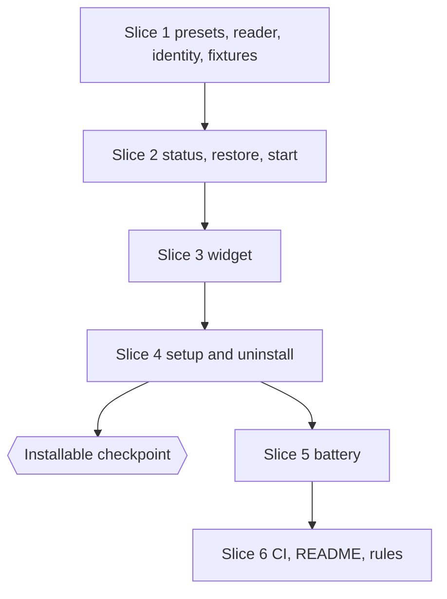

# Plan: Logitech Keys — keyboard presets (slim v0.4.0)

**Created**: 2026-11-19 (rewritten the same day for owner decision D19, "Slim, keep battery"; it replaces the nine-slice plan of rounds 1 to 6, which is in git history)
**Branch**: feat/logitech-keys-profiles
**Status**: draft — re-scoped by D19; Round 7 (one quick review pass) pending. There are no open owner questions.
**Gherkin persistence**: features
**Spec**: [docs/specs/logitech-keys-profiles.md](../docs/specs/logitech-keys-profiles.md) (69 criteria numbered AC1 to AC69 with AC3a; the plan numbers AC3a as AC23; 24 are "Deferred (D19)" and are not in this plan's checklist)
**Design review**: `.dev-team-reports/architect-review-2026-11-19.md` (not committed; M1, M2, M4, M5, M9 applied, M3, M6, M7 (most) and M8 (most) deferred by D19)
**ADRs**: [0005](../docs/adr/0005-device-profiles-for-other-keyboards.md) (simplified), [0006](../docs/adr/0006-rename-to-logitech-keys.md), [0007](../docs/adr/0007-battery-from-keyboard-notifications.md), [0008](../docs/adr/0008-swappable-input-backend.md) (Deferred), [0009](../docs/adr/0009-slim-v0-4-0-scope.md) (D19)

## Goal

Turn the single-keyboard POP Icon Keys plugin (v0.3.0) into **Logitech Keys** (`io.github.poornan.logitech-keys`, v0.4.0) with **presets**: a keyboard is a JSON file in `profiles/` (key name, control id, label, Omarchy command) read by one reader and matched to Solaar devices by exact model id, then exact names. Two presets ship: POP Icon Keys (key mapping tested on real hardware, MacOS OS mode) and MX Keys for Mac (device data recorded from real hardware, key presses untested). Setup and uninstall keep v0.3's consent, backups, marked blocks and stop-Solaar-before-config-write guarantees; the widget gets small: one icon, one state per keyboard, and buttons Restore, Start Solaar, Re-apply setup and Open Solaar; the battery is the keyboard's own report (ADR 0007). Solaar's own GUI already does diversion and rules by hand (D19), so none of the swappable-backend, action-table, applied-record or legacy-migration machinery is built; it is listed under Deferred.

## Plan rules (apply to every slice and every commit)

1. **Green after every step.** The tree, `bash tests/test_setup.sh`, every Python test and `omarchy-plugin-validate .` pass after each commit. A slice never leaves a deleted file the old code still reads.
2. **v0.3 safety tests are a requirement (AC10).** `bash tests/test_setup.sh` had 119 checks at v0.3 (`git show main:tests/test_setup.sh`); Step 4.6 records an inventory of every v0.3 check as kept, adapted or moved with a reason, and the total of the shell suite plus the moved Python checks is never lower than 119. A check is never deleted without a row in the inventory.
3. **One owner per fact.** Preset data and validation: `lib/profiles.py`. Identity (device and saved entry to preset): `lib/solaarcfg.py`. Status parsing, states, battery choice, restore: `lib/status.py`. Rules, Lua and **all escaping**: `lib/rules.py`. Consent plan text: `lib/plan.py`. File primitives and `config.yaml` diversion: `lib/edit.py` (kept from v0.3, made preset-driven). Plugin version: `manifest.json`. Keyboard names, key names and key text appear nowhere else; `Panel.qml` and bash know none.
4. **No two argument shapes under one `lib/edit.py` verb.** New verbs arrive in Step 4.2 under new names; the v0.3 verbs (and the `RULES` table, and the v0.3 `bin/pop-icon-keys-*` helpers) are deleted in Step 4.5 when the rewritten `setup` and `uninstall` no longer call them.
5. **Never run against the real `$HOME`.** Sandbox HOMEs with stubs (`pgrep`, `solaar`, `hyprctl`, `setsid`) only; never stop or restart the developer's running Solaar. The four real files (`~/.config/solaar/{rules,config}.yaml`, `~/.config/hypr/{bindings,autostart}.lua`) are checksummed before and after the whole build. Read-only `solaar show "<name>"` is allowed; **never `solaar show all`** (Solaar 1.1.20 crashes on this machine printing the MX Master 4).
6. **Solaar-dependent checks never silently skip on the dev machine.** The rules-evaluation test (and the optional key-table check) use the installed Solaar; `LK_REQUIRE_SOLAAR=1` turns a skip into a failure; CI has no Solaar and runs everything else.
7. **Imports.** Every `lib/` module imports on its own under `python3 -I`; every entry script (`lib/edit.py`, `lib/profiles.py`, `lib/status.py`) puts its own folder first on `sys.path` before importing a sibling (AC58).
8. **Disjoint files per wave.** Slice `Files` are exactly the union of the steps' `Files`; the slices are deliberately **linear** (each depends on the previous), because they share `tests/test_setup.sh`, `lib/edit.py` and the helpers and the point is the earliest installable state; `plan_waves.py` must report no collision or scope mismatch.
9. **One PR, kept** (the owner's workflow); no push without the owner's go-ahead; commit trailer `Co-Authored-By: Claude Opus 5.5 <noreply@anthropic.com>`.
10. **Marketplace baseline in every shipped file:** no `curl | sh`, no `sudo`, no `/tmp` process control, no hard-coded `/home` path.

## Approach stance (decision-defaults axes)

| Axis | Stance |
|---|---|
| Scope | **Slim (D19).** Kept and deferred lists are in the spec Intent and ADR 0009; deferred ideas are documented, not deleted |
| Replace vs merge (partial uncommitted work) | **Replace or reuse file by file** (table under Slice 1); nothing from the old shape is committed as is |
| Migrate vs edit-stub (v0.3 install) | **Simple cleanup:** remove marked `pop-icon-keys` blocks and the old helper with consent; no legacy-rule machinery |
| Auto-merge vs direct to trunk | PR with auto-merge after owner approval (D8); repo settings are owner items |
| Backend | **Solaar only**; no seam in the code |

## Acceptance Criteria

Numbered as in the spec; the spec's AC3a is AC23 here. Deferred (D19) criteria (AC16, AC17, AC24, AC35 to AC44, AC46 to AC48, AC59, AC60) are not listed; see Deferred. Ticked at PR review after behavioural verification.

- [ ] AC1 Plugin id `io.github.poornan.logitech-keys`, display name "Logitech Keys", manifest version 0.4.0; README and install commands use `github.com/poornan/omarchy-logitech-keys`; the old name only in the upgrade section
- [ ] AC2 With only the POP Icon Keys known to Solaar, behaviour matches POP spec AC1 to AC18, including a fresh install (AC21)
- [ ] AC3 MX Keys for Mac maps 225 Launchpad, 191 Screen Capture/Print Screen, 111 Screen Lock, 10 Calculator to commands; 224 and 13 undiverted; no `verified` block, a `note`; marked untested
- [ ] AC4 Both keyboards in one consent-gated setup; each keyboard's keys run its own commands, including a shared key name (synthetic preset)
- [ ] AC5 A keyboard is added by one preset, its one fixture and a README row; no script or QML change; a malformed preset or missing fixture fails a test
- [ ] AC6 One bar icon; popup lists every connected preset keyboard with battery and one state; icon warns for needs setup, dropped, stopped, mismatch, not unknown; untested labelled
- [ ] AC7 A keyboard that drops diversion is restored without touching the other; ambiguous selector skipped; no file written; nothing while Solaar is stopped
- [ ] AC8 Setup over v0.3 removes `pop-icon-keys` blocks and the old helper with consent, one copy of each rule, user rules intact, second run a no-op, uninstall removes both generations, warn about the old plugin
- [ ] AC9 README "Add your keyboard" in the fixed order with masking command, fixture recording, PR contents, the accepted risk (a preset can run any command; reviewed), Fn-swap and cid notes, rollback
- [ ] AC10 All v0.3 safety tests pass (adapted; at least 119 checks), plus preset, status, two-keyboard, cleanup and battery tests; dev-team review before release
- [ ] AC11 Identity by exact model id then exact name; "MX Keys Mini" and "MX Keys S" do not match; each block's `Model ID:` checked
- [ ] AC12 Diversion lines parsed in Python by exact name and cid (suffixed names right); `Panel.qml` holds no keyboard or key names
- [ ] AC13 Commands are argument lists; bad command, chord or unknown field fails; YAML, Lua and shell text only through `lib/rules.py` escaping
- [ ] AC14 Every rule has a `Device` condition and fires only for its keyboard (Solaar's own evaluator on the dev machine); other rules on a handled key are flagged
- [ ] AC15 A key in neither diversion line is `absent` and never warns; the state table is pinned
- [ ] AC18 The reader enforces the basic schema; every shipped preset passes; a mutation matrix covers each failure
- [ ] AC19 Tested only if `verified`; one recorded masked fixture per preset; synthetic never verifies
- [ ] AC20 CI workflow runs the tests and validates presets (SHA-pinned actions, `contents: read`); structural repo test
- [ ] AC21 Fresh install: the plan lists supported keyboards, setup applies what Solaar then records; exit 2 and no rules block when none
- [ ] AC22 Widget IPC target and QML module name are `logitech-keys`
- [ ] AC23 (spec AC3a) POP names and ids 110, 212, 259, 264, 266 pinned; the v0.3 `RULES` swap is gone
- [ ] AC25 Widget states are text first; untested label; stopped banner; failures say what to do; Re-apply pending line; Escape, Enter, Space and shortcuts
- [ ] AC26 Consent plan complete and ordered, with the Warnings group; the uninstall plan lists the ids it resets and the limit
- [ ] AC27 README requires MacOS OS mode, says the plugin never changes it; no "Linux mode" in shipped files
- [ ] AC28 Setup reads the OS mode read-only and warns without blocking on a mismatch
- [ ] AC29 The MX preset equals the recorded hardware facts and the masked recorded fixture; no `verified`
- [ ] AC30 Battery rules: ten bucket rules per preset with a battery feature, evaluated by Solaar's own rule code; none without
- [ ] AC31 `bin/logitech-keys-battery` validates, snaps to the bucket, writes `<lo>\n<epoch>\n` atomically; self-contained
- [ ] AC32 Status battery via the one `choose_battery(report, query)` (D18)
- [ ] AC33 Battery text "≈15%, 3 h ago", "Full?", "Battery unknown", tooltips, accessible name; README states the limitation
- [ ] AC34 Uninstall removes the plugin's state directory and nothing else
- [ ] AC45 `osMode` required top-level, closed list, not inside `verified`
- [ ] AC49 Solaar stopped: banner, warning icon, no auto-restore, Start Solaar when `canStart`; keys read "Not active (Solaar stopped)"; Restore hidden
- [ ] AC50 `bin/logitech-keys-start` starts Solaar hidden, writes nothing, refuses a second instance or no Solaar
- [ ] AC51 README: closing Solaar's window quits it; start hidden; the Start Solaar and Open Solaar buttons
- [ ] AC52 Only the battery helper writes the battery directory; a query is never persisted
- [ ] AC53 Per-device `solaar show "<selector>"` only, never `show all`; each block's identity verified
- [ ] AC54 Truncated, failed or timed-out output gives `unknown`, never disconnected or not set up; complete blocks kept
- [ ] AC55 Widget shows "Status unknown" and the refresh line; no icon warning, no restore for it
- [ ] AC56 Synthetic truncation fixture built in the test from the masked POP fixture and the traceback
- [ ] AC57 README known issue: Solaar host-name decode bug and the per-keyboard workaround
- [ ] AC58 Every `lib/` module imports alone under `-I`; entry scripts run under `-I` from another directory
- [ ] AC61 Widget honesty: OK only when routed; unknown, stopped and battery wording as specified
- [ ] AC62 Consent plan Warnings group directly above the prompt; no internal codes
- [ ] AC63 Hostile saved-entry names skipped as selectors
- [ ] AC64 Battery labelled "unverified until live-checked" until the owner's live check; live check 1 gates the tag
- [ ] AC65 Uninstall resets the control ids of the known presets on matching entries, lists them, states the limit
- [ ] AC66 Setup order (rules and helpers before diversion), Solaar stopped for the config write and restarted on every exit path
- [ ] AC67 `solaar -dd --window=hide` counts as the daemon; CLI subcommands do not
- [ ] AC68 The MX preset lists both "MX Keys for Mac" and "MX Keys Mac"; an entry saved under the codename matches
- [ ] AC69 Open Solaar button (`solaar --window=show`), disabled while Solaar is stopped

## Slices

Waves are derived by `plan_waves.py`, never hand-edited: the slices are linear (1, 2, 3, 4, 5, 6) because they share files (see plan rule 8). **INSTALLABLE CHECKPOINT: after Slice 4**, setup, restore and the widget work for the POP preset (and MX), so the owner can install from the branch path and press the keys. Battery wiring is **Slice 5**, right after the checkpoint (not inside Slice 4) so the checkpoint is not delayed. Slice 6 (CI, README, CLAUDE.md) is last.
Every `# test:` comment names the test that proves the scenario (`path::check group`).

### Slice 1: Presets, the reader, exact identity and fixtures

**Depends-on:** none
**Files:** `lib/profiles.py`, `lib/solaarcfg.py`, `profiles/pop-icon-keys.json`, `profiles/mx-keys-mac.json`, `tests/test_profiles.py`, `tests/fixtures_derive.py`, `tests/fixtures/README.md`, `tests/fixtures/pop-icon-keys/show.txt`, `tests/fixtures/pop-icon-keys/routed.txt`, `tests/fixtures/pop-icon-keys/dropped.txt`, `tests/fixtures/pop-icon-keys/not-setup.txt`, `tests/fixtures/mx-keys-mac/show.txt`, `tests/fixtures/mx-keys-mac/routed.txt`, `tests/fixtures/mx-keys-mac/dropped.txt`, `tests/fixtures/mx-keys-mac/not-setup.txt`, `tests/test_setup.sh`, `.gitignore`

**Partial uncommitted work, reused or replaced file by file** (inspected 2026-11-19 with `git status` and `git diff`; the tree holds these uncommitted; do not commit anything in the old shape):

| Partial file | Decision | Where it lands |
|---|---|---|
| `lib/profiles.py` (untracked) | **REWRITTEN.** Old schema: `solaarNames`, single `modelId`, `tested` boolean, `cap`, `hyprBindings`, directory from `LK_PROFILE_DIR`. Carries over only `BAD_CHARS`, the `_text()` helper, the slug regex, the `load_all` skeleton and the exit-4 `error: profile:` message | Steps 1.1, 1.2, 1.4 |
| `profiles/pop-icon-keys.json`, `profiles/mx-keys-mac.json` (untracked) | **REWRITTEN** in the slim schema (`schema`, `modelIds`, `names`, `osMode` MacOS, `command` argument lists, `bindings`, `battery`, `verified` without `osMode`, `note`; no `cap`, no `tested`). The POP file said `"osMode": "Linux"` inside `verified`, which is wrong (D10). Facts reused: names, cids, labels, commands, Lock chord | Step 1.1 |
| `tests/test_profiles.py` (untracked) | **REWRITTEN**; reuses the `check()` counter and `refused()` helper shape and the pinned POP pairs | Steps 1.1 to 1.4 |
| `tests/fixtures/README.md` (untracked) | **REWRITTEN** to the one-recorded-plus-derived rule; it said "Linux OS mode" | Step 1.3 |
| `tests/fixtures/mx-keys-mac/{routed,dropped,not-setup}.txt` (untracked, synthetic) | **DELETED**; replaced by the owner's masked recording as `show.txt` | Step 1.3 |
| `tests/fixtures/pop-icon-keys/{routed,dropped,not-setup}.txt` (staged renames of the v0.3 recordings) | **REUSED unchanged**; they stay committed as real recordings and the derived variants are tested equal to them | Step 1.3 |
| `tests/test_setup.sh` (one-line path edit), `.gitignore` (`.dev-team-reports/`) | **REUSED**, committed with the renames so every commit stays green | Step 1.3 |
| `README.md` (modified, supported-keyboards table, says "Linux OS mode") | **REPLACED in content, committed in Step 6.2 only**; Slices 1 to 5 do not read it | Step 6.2 |

**Behavior:**

```gherkin
Feature: Keyboards are preset files checked by one reader and matched by exact identity

  Scenario: The shipped presets are valid and tested only when verified
    # Still passes if: a key's label wording changes
    # test: tests/test_profiles.py::shipped_valid
    Given the profiles folder with the POP Icon Keys and MX Keys for Mac presets
    When the preset check runs
    Then both pass
    And POP Icon Keys counts as tested because it records where and when it was verified
    And MX Keys for Mac counts as untested because it records no verification and carries a note

  Scenario: POP uses Solaar's own names and ids and the Lock chord
    # Still passes if: a label differs from the printed keycap
    # test: tests/test_profiles.py::pop_pairs_lock
    Given the POP Icon Keys preset
    Then Show Desktop is 110, MultiPlatform Search is 212, Dictation is 259, Emoji is 264 and Screen Capture is 266
    And its Lock binding is the chord SUPER + CTRL + Q running omarchy-system-lock

  Scenario: MX Keys for Mac equals the recorded hardware facts and maps exactly four keys
    # Still passes if: the recording's battery percentage differs
    # test: tests/test_profiles.py::mx_matches_recording
    Given the owner's masked recording of the MX Keys for Mac
    Then the model id is B36140920000 and the names are "MX Keys for Mac" and "MX Keys Mac"
    And the keys are 225 Dashboard Launchpad/Action Center, 191 Screen Capture/Print Screen, 111 Screen Lock and 10 Calculator and no others
    And its OS mode is MacOS, its battery feature is BATTERY STATUS and the recording shows the same Set OS and feature
    And the synthetic MX fixture files are gone and the recorded one is masked

  Scenario Outline: A malformed preset is refused and the file and field are named
    # Still passes if: the reason text after the file and field changes
    # test: tests/test_profiles.py::mutation_matrix
    Given a valid preset changed so that <defect>
    When the preset check runs
    Then it fails naming that file and the field at fault

    Examples:
      | defect                                          |
      | the schema field is missing or is not 1         |
      | the slug differs from the file name             |
      | an unknown top-level field is present           |
      | modelIds, names or keys is empty, or a model id is lowercase hex or 11 digits |
      | a key has no cid or no label, or two keys share a cid or a name |
      | the battery feature is not a known feature      |
      | the verified block has a wrong type             |
      | the note holds a newline                        |
      | the file is not valid JSON or not an object     |
      | a second preset shares a model id or a name     |
      | osMode is missing, Ubuntu, lowercase macos or inside verified |

  Scenario Outline: A command is an argument list of clean strings
    # Still passes if: the helper placeholder is spelled differently in a test preset
    # test: tests/test_profiles.py::command_matrix
    Given a key whose command is <command>
    When the preset check runs
    Then <outcome>

    Examples:
      | command                                         | outcome                              |
      | a plain string                                  | it fails naming the key              |
      | an empty list                                   | it fails naming the key              |
      | a list holding a number                         | it fails naming the key              |
      | a list holding a newline                        | it fails naming the key              |
      | a list holding quotes, brackets, colons and # | it passes (the rules module escapes) |
      | the placeholder @show-desktop first             | it passes                            |
      | an unknown placeholder @other first             | it fails naming the key              |

  Scenario Outline: A binding chord must fully match the fixed pattern
    # Still passes if: the binding label changes
    # test: tests/test_profiles.py::chord_matrix
    Given a binding with the chord <chord>
    When the preset check runs
    Then the chord is <verdict>

    Examples:
      | chord                          | verdict  |
      | SUPER + CTRL + Q               | accepted |
      | SUPER + F5                     | accepted |
      | SHIFT + ALT + SUPER + CTRL + A | accepted |
      | Q alone                        | refused  |
      | SUPER + Q + W                  | refused  |
      | a chord ending in a newline    | refused  |
      | a chord holding a double quote | refused  |
      | a chord holding ]]             | refused  |

  Scenario: A preset without its recorded fixture fails
    # Still passes if: the fixture holds extra devices
    # test: tests/test_profiles.py::fixture_required
    Given a preset with no fixture folder
    When the preset check runs
    Then it fails naming the missing fixture

  Scenario Outline: A fixture must be masked, versioned and honestly labelled
    # Still passes if: the fixture has trailing blank lines
    # test: tests/test_profiles.py::fixture_rules
    Given a recorded fixture where <defect>
    When the fixture check runs
    Then it fails naming the fixture

    Examples:
      | defect                                                         |
      | the first line carries no Solaar version                       |
      | the version differs from the preset's verified version         |
      | a serial number is not masked                                  |
      | a unit id is not masked                                        |
      | a MAC address or a hid path is present                         |
      | the model id differs from the preset's                         |
      | the Set OS line differs from the preset's OS mode              |
      | it is marked synthetic yet its preset has a verified block     |

  Scenario: Fixture variants are derived from the preset and equal the recorded POP ones
    # Still passes if: the derived MX variants are spaced differently
    # test: tests/test_profiles.py::derived_variants
    Given the recorded fixture of a preset
    When the routed, dropped and not-set-up variants are derived
    Then routed has every mapped key diverted in both lines, dropped has them diverted when saved and regular live, and not-set-up has some keys regular when saved
    And for POP each derived variant equals the variant recorded in v0.3

  Scenario Outline: A Solaar device is matched to a preset by model id, then by exact name
    # Still passes if: the device's battery level differs
    # test: tests/test_profiles.py::identity_matcher
    Given a device with model id <model id> and name <name>
    When it is matched against the shipped presets
    Then it matches <preset>

    Examples:
      | model id                     | name                | preset          |
      | B38F00000000                 | a renamed keyboard  | POP Icon Keys   |
      | all zeros                    | POP Icon Keys       | POP Icon Keys   |
      | B36140920000                 | MX Keys for Mac     | MX Keys for Mac |
      | all zeros                    | MX Keys Mac         | MX Keys for Mac |
      | the name stored as model id  | MX Keys Mac         | MX Keys for Mac |
      | an unknown id                | MX Keys Mini        | no preset       |
      | an unknown id                | MX Keys S           | no preset       |
      | an unknown id                | MX Keys             | no preset       |
      | B04200000000                 | MX Master 4         | no preset       |

  Scenario: Bluetooth and Bolt entries of one keyboard both match
    # Still passes if: the entries appear in another order in the file
    # test: tests/test_profiles.py::two_entries
    Given Solaar's saved settings hold two entries for one keyboard under different names
    When the saved entries are matched
    Then both are returned with their line spans

  Scenario: The reader's command line validates and lists presets
    # Still passes if: presets are listed in another order
    # test: tests/test_profiles.py::cli
    Given the shipped presets
    When the validate and list commands run under the isolated interpreter from another working directory
    Then validate exits 0 and list prints one line per preset
    And a broken folder exits 4 naming the file

  Scenario: Key names are cross-checked against the installed Solaar when it can be imported
    # Still passes if: Solaar renames a key the presets do not use
    # test: tests/test_profiles.py::key_table_local
    Given Solaar's key table is importable on the dev machine
    When the optional key-table check runs
    Then every preset name and cid pair agrees with Solaar, and without Solaar the check prints a skip note and CI is unaffected
```

**Steps:**

#### Step 1.1: Presets in the slim schema and the loader

**Complexity**: standard
**IMPLEMENT**: Rewrite `lib/profiles.py` as pure data: `load_all(directory)` takes the folder as an argument (no environment variable); `tested` is derived from `verified`. Write the two presets (POP: model id B38F00000000, 110/212/259/264/266, `@show-desktop` for Show Desktop, the Lock binding, `osMode` MacOS, battery `UNIFIED BATTERY`, `verified` solaar 1.1.20, 2026-11-19, fnSwap true; MX: model id B36140920000, names `["MX Keys for Mac", "MX Keys Mac"]`, `osMode` MacOS, battery `BATTERY STATUS`, keys 225, 191, 111, 10 with Solaar's names, a `note`, no `verified`).
**TEST**: `shipped_valid`, `pop_pairs_lock`, `mx_matches_recording` (names part; the fixture part lands in 1.3).
**REFACTOR**: Drop `tested`, `cap`, `hyprBindings`, `solaarNames` and the directory variable of the partial shape; keep one `_text()` helper.
**Files**: `lib/profiles.py`, `profiles/pop-icon-keys.json`, `profiles/mx-keys-mac.json`, `tests/test_profiles.py`
**Covers**: AC3, AC23, AC29, AC68
**Commit**: `Describe keyboards as presets with commands`

#### Step 1.2: Basic validation and the mutation matrix

**Complexity**: complex
**IMPLEMENT**: Validation as `ProfileError(file, field, reason)` (message `error: profile: <file>: <field>: <reason>`): the rules in the spec Architecture "One reader" (required fields and types, slug equals file name, model id `[0-9A-F]{12}` by `fullmatch`, cid paired with name, unique cids and names, command argument list with the one `@show-desktop` placeholder, chord `fullmatch` of `(?:(?:SUPER|CTRL|ALT|SHIFT) \+ ){1,4}(?:[A-Z0-9]|F(?:[1-9]|1[0-2]))` with no repeated modifier, closed lists for `osMode` and battery feature, `verified` types, `note` one line, no model id or name shared by two presets, unknown top-level fields refused, invalid JSON never a traceback). `osMode` inside `verified` is refused. The shipped presets still pass.
**TEST**: `mutation_matrix`, `command_matrix`, `chord_matrix`, `fixture_required` (the check that every preset has `tests/fixtures/<slug>/show.txt`).
**REFACTOR**: One table of defects drives the test and mirrors the Examples above.
**Files**: `lib/profiles.py`, `tests/test_profiles.py`
**Covers**: AC5, AC13, AC18, AC45
**Commit**: `Validate presets with basic checks`

#### Step 1.3: One recorded fixture per preset, masking and derived variants

**Complexity**: standard
**IMPLEMENT**: Commit the staged v0.3 fixture renames (`tests/fixtures/pop-icon-keys/{routed,dropped,not-setup}.txt`, reused unchanged) with the one-line `tests/test_setup.sh` path edit and the `.gitignore` line. `tests/fixtures/pop-icon-keys/show.txt` is a byte copy of the recorded `routed.txt` (first line `solaar version 1.1.20`, masked). `tests/fixtures/mx-keys-mac/show.txt` is the owner's masked 2026-11-19 recording, **copied during the build from the orchestrator's scratch recording `scratchpad/mx/recorded.txt` (the masked file; never `raw.txt`)**; if it is gone, the owner re-records with the README masking command. Delete the three synthetic MX variant files. `tests/fixtures_derive.py` derives routed, dropped and not-set-up variants from a preset and its fixture (importable and `fixtures_derive.py <slug> <variant>`). Rewrite `tests/fixtures/README.md` (one recording plus derived variants; masking; synthetic labelled; no "Linux OS mode").
**TEST**: `fixture_rules` (version, masking of serials, unit ids, MAC addresses and hid paths, model id, Set OS equals `osMode`, synthetic never with `verified`; the MX fixture shows `BATTERY STATUS`, codename `MX Keys Mac`, `Set OS: MacOS`), `derived_variants` (derived POP variants equal the v0.3 files byte for byte).
**REFACTOR**: One diversion-line rewriter shared by the derive script and the tests.
**Files**: `tests/fixtures_derive.py`, `tests/fixtures/README.md`, `tests/fixtures/pop-icon-keys/show.txt`, `tests/fixtures/pop-icon-keys/routed.txt`, `tests/fixtures/pop-icon-keys/dropped.txt`, `tests/fixtures/pop-icon-keys/not-setup.txt`, `tests/fixtures/mx-keys-mac/show.txt`, `tests/fixtures/mx-keys-mac/routed.txt`, `tests/fixtures/mx-keys-mac/dropped.txt`, `tests/fixtures/mx-keys-mac/not-setup.txt`, `tests/test_setup.sh`, `.gitignore`, `tests/test_profiles.py`
**Covers**: AC19, AC27, AC29
**Commit**: `Record one fixture per preset and derive the variants`

#### Step 1.4: The identity module and the reader's command line

**Complexity**: standard
**IMPLEMENT**: `lib/solaarcfg.py` is the only place that decides which preset a Solaar device belongs to: `config_entries(text)` parses `config.yaml` into entries `{name (_NAME), model_id (_modelId), first, last}` with line spans (CRLF, block or flow style; an entry whose `_modelId` is not twelve hex digits is matched on that value as a name); `match_device(profiles, model_id, name)` is exact model id then exact name, never a substring; `known(profiles, config_text)` returns every Bluetooth and Bolt entry per preset; `ambiguous(selector, other_names)` is the shared "contained in another device's name" test. Reader command line: `profiles.py validate [dir]`, `profiles.py list [dir]` (`<slug>\t<displayName>\t<tested 0|1>`); a broken folder exits 4 naming the file; the script puts its own folder on `sys.path`. Add the optional local key-table check (runs when Solaar is importable, prints a skip note otherwise; `LK_REQUIRE_SOLAAR=1` makes a skip fail).
**TEST**: `identity_matcher` (including "MX Keys Mac" with all-zero model id, Mini, S, a mouse), `two_entries`, `cli`, `key_table_local`; a source check that no exact-name comparison against a preset name exists outside `lib/solaarcfg.py`.
**REFACTOR**: Remove the old `known()`, `matches()` and `config_entries()` shapes from `lib/profiles.py`.
**Files**: `lib/solaarcfg.py`, `lib/profiles.py`, `tests/test_profiles.py`
**Covers**: AC11, AC18, AC68
**Commit**: `Match Solaar devices to presets in one identity module`

### Slice 2: Status, restore and Start Solaar from per-device queries

**Depends-on:** 1
**Files:** `lib/status.py`, `lib/solaar-procs.sh`, `bin/logitech-keys-status`, `bin/logitech-keys-restore`, `bin/logitech-keys-start`, `bin/logitech-keys-show-desktop`, `tests/test_status.py`, `tests/test_imports.py`, `tests/qml/status-sample.json`, `tests/test_setup.sh`

**Behavior:**

```gherkin
Feature: Status and restore read each preset keyboard on its own and never crash on Solaar's bug

  Scenario: Only per-device queries run, never solaar show all
    # Still passes if: the timeout value changes
    # test: tests/test_status.py::per_device_argv
    Given the POP Icon Keys and MX Keys for Mac presets and a saved entry matched by model id
    When status is collected with a recording runner
    Then each call is solaar show with one exact selector from the preset names or the matched saved entries
    And no call is solaar show all and no solaar command other than show runs

  Scenario Outline: Each key's state follows the live and saved diversion lines
    # Still passes if: the keys appear in another order in the line
    # test: tests/test_status.py::state_table
    Given a key that is <live> in the live line and <saved> in the saved line
    When the state is read
    Then it is <state>

    Examples:
      | live        | saved       | state    |
      | diverted    | diverted    | routed   |
      | diverted    | regular     | notSetUp |
      | diverted    | not listed  | notSetUp |
      | regular     | diverted    | dropped  |
      | regular     | regular     | notSetUp |
      | not listed  | not listed  | absent   |
      | not listed  | diverted    | dropped  |
      | diverted    | no saved line at all (older Solaar) | routed |
      | regular     | no saved line at all (older Solaar) | notSetUp |

  Scenario: Suffixed key names are matched by cid, not by substring
    # Still passes if: a key label changes
    # test: tests/test_status.py::suffix_names
    Given a diversion line holding "Search / MultiPlatform Search" and "Screen Capture/Print Screen"
    When the POP and MX states are read
    Then the 212 and 191 keys get the states the line shows and no other key is confused with them

  Scenario: A block that is not this keyboard is not this device
    # Still passes if: the look-alike has a different battery level
    # test: tests/test_status.py::lookalike_block
    Given a selector whose output holds the POP Icon Keys block and a block of a device whose name contains it
    When the output is read
    Then the POP block is used, the other block is ignored and the selector is marked ambiguous

  Scenario Outline: Truncated, failed or timed-out output makes unread keyboards unknown
    # Still passes if: the traceback text differs
    # test: tests/test_status.py::truncated_unknown
    Given <situation>
    When status is built
    Then <outcome>

    Examples:
      | situation                                                                  | outcome                                                              |
      | output cut off after a complete POP block and the MX keyboard is saved     | POP keeps its states and the MX keyboard is unknown with solaarCrashed |
      | a call that times out and the keyboard has a saved entry                   | that keyboard is unknown with timeout                                |
      | a call that times out and the keyboard has no saved entry                  | no section for it                                                    |
      | empty output with exit 0 and a saved entry                                 | unknown with noOutput                                                |
      | the reply "no device found matching" and no saved entry                    | no section and no unknown                                            |
      | an unknown keyboard beside a routed one                                    | the unknown one is never restored and never counted toward a warning |

  Scenario: Saved-entry names that would be hostile selectors are skipped
    # Still passes if: a harmless saved name is added
    # test: tests/test_status.py::hostile_names
    Given saved entries named "-x", "a\"b" and one with a newline
    When selectors are chosen
    Then none of them appears in any solaar show call and the keyboard is still found by its preset names

  Scenario Outline: One state per keyboard, with a fixed precedence
    # Still passes if: the keys are listed in another order
    # test: tests/test_status.py::keyboard_state
    Given a keyboard whose keys are <keys> and Solaar is <daemon>
    When the keyboard state is built
    Then it is <state>

    Examples:
      | keys                              | daemon      | state      |
      | all routed                        | running     | ok         |
      | some routed, the rest absent      | running     | ok         |
      | one dropped                       | running     | dropped    |
      | one notSetUp and one dropped      | running     | needsSetup |
      | all absent                        | running     | mismatch   |
      | any unknown                       | running     | unknown    |
      | all routed or dropped             | not running | stopped    |
      | one notSetUp                      | not running | needsSetup |

  Scenario: With Solaar stopped the keyboards are still listed and the button is offered
    # Still passes if: the daemon was started a minute ago
    # test: tests/test_status.py::stopped_status
    Given Solaar is installed and not running and the per-device show still answers
    When status is built
    Then solaar.running is false, solaar.canStart is true and the keyboards are listed
    And with Solaar not installed canStart is false

  Scenario Outline: The battery figure follows the last-report rule
    # Still passes if: the level field is null
    # test: tests/test_status.py::choose_battery
    Given a stored report of <report> and a direct query of <query>
    When the battery is chosen
    Then the result is <result>

    Examples:
      | report                       | query            | result                                  |
      | 15% (bucket 10) 3 hours old  | 100%             | the report, value 15, source report     |
      | 15% (bucket 10)              | 12%              | the query, value 12, source query       |
      | 15% (bucket 10)              | 15%              | the report                              |
      | 15% (bucket 10) 30 days old  | 100%             | the report                              |
      | none                         | 100%             | the query, source query (shown "Full?") |
      | none                         | 62%              | the query, source query                 |
      | none                         | none             | no battery                              |
      | a damaged state file         | 62%              | the query                               |

  Scenario: A query is never persisted
    # Still passes if: the query value differs
    # test: tests/test_status.py::no_persist
    Given a state directory and a status run with a query figure
    When status finishes
    Then the state directory is byte-identical and only the battery helper opens that path for writing

  Scenario Outline: Restore re-applies saved diversion for dropped keys only
    # Still passes if: the log wording changes
    # test: tests/test_status.py::restore_plan
    Given <situation>
    When restore runs with the Solaar stand-in
    Then <outcome>

    Examples:
      | situation                                              | outcome                                                           |
      | the POP has two dropped keys                           | solaar config runs for those two with the block's exact name      |
      | the selector matches two devices                       | that keyboard is skipped                                          |
      | Solaar is not running                                  | nothing runs and the exit says to start Solaar                    |
      | the keyboard is unknown or the key is notSetUp or absent | nothing runs for it                                             |
      | a dropped POP key and a dropped MX key                 | only the named slug is restored when one is given                 |
      | any of the above                                       | no file under the home folder changes                             |

  Scenario Outline: Start Solaar starts it hidden once and says why when it cannot
    # Still passes if: the stand-in takes a moment to start
    # test: tests/test_setup.sh::start_helper
    Given <situation>
    When the start helper runs
    Then <outcome>

    Examples:
      | situation                  | outcome                                                          |
      | Solaar installed, not running | it runs setsid -f solaar --window=hide, writes nothing, exits 0 |
      | Solaar already running     | it exits non-zero with a sentence and starts no second instance  |
      | Solaar not installed       | it exits non-zero with a sentence and runs nothing               |

  Scenario Outline: The daemon is found whatever debug options it runs with
    # Still passes if: the daemon has extra unrelated options
    # test: tests/test_setup.sh::daemon_detection
    Given a process whose command line is <cmdline>
    When daemon detection runs
    Then it is <verdict>

    Examples:
      | cmdline                              | verdict         |
      | solaar -dd --window=hide             | the daemon      |
      | solaar --window hide                 | the daemon      |
      | solaar                               | the daemon      |
      | solaar show "POP Icon Keys"          | not the daemon  |
      | solaar config "POP Icon Keys" a b    | not the daemon  |
      | solaar -dd show all                  | not the daemon  |

  Scenario: Status always exits 0 with valid JSON and every lib module imports alone
    # Still passes if: a new module is added that also imports alone
    # test: tests/test_imports.py::imports_alone, tests/test_status.py::status_helper
    Given Solaar missing, a crashing show or a malformed saved config
    When the status helper runs, and each lib module is imported in a fresh isolated interpreter
    Then the helper prints one valid JSON object, exits 0 and every module and entry script imports and runs under the isolated interpreter
```

**Steps:**

#### Step 2.1: Per-device collection, block parsing, the state table and unknown

**Complexity**: complex
**IMPLEMENT**: `lib/status.py`: `collect(run, profiles, config_text)` is the **only** I/O function (`run(argv, timeout)` is injected; allow-list `solaar show "<selector>"` with the 20 second timeout); selectors from preset `names` and saved entries matched by model id via `lib/solaarcfg.py`, hostile names skipped; each returned block parsed on its own, identity checked by `Model ID:` (or exact name when all zero); exact diversion-line parsing by cid; the state table; completeness (a block is complete when the next header follows it or the call exited 0); `unknown` with `readProblem` only for a keyboard with a saved entry. Entry script under `-I`.
**TEST**: `per_device_argv`, `state_table`, `suffix_names`, `lookalike_block`, `truncated_unknown` (the synthetic truncation fixture is built in the test from the masked POP fixture, a second device header and the `UnicodeDecodeError` traceback, labelled synthetic), `hostile_names`.
**REFACTOR**: One parser for both diversion lines.
**Files**: `lib/status.py`, `tests/test_status.py`
**Covers**: AC12, AC15, AC53, AC54, AC56, AC63
**Commit**: `Read each preset keyboard on its own and treat truncated output as unknown`

#### Step 2.2: Battery choice, keyboard state and the status JSON

**Complexity**: standard
**IMPLEMENT**: `choose_battery(report, query)` (D18) and the state-file reader (two lines `<lo>\n<epoch>\n`; missing or damaged is no report; value = lo + 5); `keyboard_state(keys, running)` with the precedence unknown, needsSetup, stopped, dropped, mismatch, ok; `build_status(...)` produces `{schema: 1, solaar: {installed, running, canStart}, keyboards: [...]}` as in the spec; Slice 2 writes `tests/qml/status-sample.json` (POP ok with a report, MX unknown, Solaar running) for the widget tests. `build_status` takes `now` and never writes a file.
**TEST**: `keyboard_state`, `stopped_status`, `choose_battery`, `no_persist`; a JSON-shape check of the sample.
**REFACTOR**: None beyond keeping the status builder pure.
**Files**: `lib/status.py`, `tests/test_status.py`, `tests/qml/status-sample.json`
**Covers**: AC6, AC32, AC49, AC52
**Commit**: `Build the status JSON with one state per keyboard and the last-report battery rule`

#### Step 2.3: Restore and the Start Solaar helper

**Complexity**: standard
**IMPLEMENT**: `lib/status.py` verbs `status` and `restore [slug...]` (restore runs `solaar config "<exact block name>" divert-keys "<key>" Diverted` only for `dropped` keys of unambiguous, read keyboards while Solaar runs, through the same injected `run`; it writes no file). New bash helpers `bin/logitech-keys-status` (calls the verb; always exit 0, prints `{"schema":1,...}` fallback JSON on any failure), `bin/logitech-keys-restore`, `bin/logitech-keys-start` (`setsid -f solaar --window=hide`; sentences on refusal), `bin/logitech-keys-show-desktop` (copy of the v0.3 helper). The v0.3 `bin/pop-icon-keys-*` helpers stay until Step 4.5.
**TEST**: `restore_plan` and `status_helper` in `tests/test_status.py`; the start helper in the sandbox (`start_helper`, step 2.4).
**REFACTOR**: Restore and status share the collection and the exact-name addressing.
**Files**: `lib/status.py`, `bin/logitech-keys-status`, `bin/logitech-keys-restore`, `bin/logitech-keys-start`, `bin/logitech-keys-show-desktop`, `tests/test_status.py`
**Covers**: AC7, AC50
**Commit**: `Add status, restore and Start Solaar helpers`

#### Step 2.4: Daemon detection with debug flags, the moved v0.3 sections and the import test

**Complexity**: standard
**IMPLEMENT**: Pin `lib/solaar-procs.sh` for `-dd --window=hide` (the filter excludes only subcommands; options with values are skipped with their value; change code only if a case fails). In `tests/test_setup.sh`, move the v0.3 status-helper, restore and key-list sections to run the new helpers against derived fixtures (adapted: JSON assertions instead of `key=value`; the old helper sections stay for the old helpers until 4.5; record each moved check in the Step 4.6 inventory), add `start_helper` and `daemon_detection`. `tests/test_imports.py` imports each `lib/` module in a fresh `python3 -I` interpreter and runs each entry script from another working directory.
**TEST**: `daemon_detection`, `start_helper`, `imports_alone`; whole shell suite still green.
**REFACTOR**: One stand-in process table used by detection and start tests.
**Files**: `lib/solaar-procs.sh`, `tests/test_setup.sh`, `tests/test_imports.py`
**Covers**: AC58, AC67
**Commit**: `Pin daemon detection for debug flags and test that every module imports alone`

### Slice 3: The widget renders the status JSON only

**Depends-on:** 2
**Files:** `Panel.qml`, `manifest.json`, `tests/qml_logic.py`, `tests/qml/shell.qml`, `tests/test_setup.sh`

**Behavior:**

```gherkin
Feature: One small popup states each keyboard's condition in words and offers four buttons

  Scenario Outline: Each keyboard shows one state in words
    # Still passes if: the glyph beside the words changes
    # test: tests/qml_logic.py::states_in_words
    Given a keyboard whose state is <state>
    When the popup renders
    Then its row says <words>

    Examples:
      | state      | words                                          |
      | ok         | OK                                             |
      | dropped    | 2 keys dropped (the count comes from the JSON) |
      | needsSetup | Needs setup                                    |
      | stopped    | Not active (Solaar stopped)                    |
      | unknown    | Status unknown, then "Could not read this keyboard's status. Choose Refresh." |
      | mismatch   | Preset may not match this keyboard             |

  Scenario: An untested keyboard says so
    # Still passes if: the keyboard is renamed
    # test: tests/qml_logic.py::untested_label
    Given a keyboard with tested false
    When the popup renders
    Then it shows "Untested - may not match your keys" and a tested keyboard does not

  Scenario Outline: The icon warns only for conditions the user can act on
    # Still passes if: a keyboard is listed twice
    # test: tests/qml_logic.py::icon_warning
    Given keyboards in states <states>
    When the icon is drawn
    Then it is <icon>

    Examples:
      | states                  | icon      |
      | ok                      | OK        |
      | ok and unknown          | OK        |
      | ok and dropped          | attention |
      | needsSetup              | attention |
      | stopped                 | attention |
      | mismatch                | attention |

  Scenario: Solaar stopped leads the popup with a banner and a Start Solaar button
    # Still passes if: the banner colour changes
    # test: tests/qml_logic.py::stopped_banner
    Given solaar.running is false and canStart is true
    When the popup renders
    Then the first thing is "Solaar is not running, so these keys do nothing" with a Start Solaar button
    And Restore is hidden, no automatic restore runs and the icon shows even with hide-when-disconnected on
    And with Solaar not installed the banner says how to install it and has no button

  Scenario Outline: The buttons run the right helper or say what to do
    # Still passes if: a button's tooltip wording changes
    # test: tests/qml_logic.py::buttons
    Given <situation>
    When the button is used
    Then <outcome>

    Examples:
      | situation                              | outcome                                                              |
      | Start Solaar is clicked                | bin/logitech-keys-start runs, a pending line shows in place of the button, the popup stays open |
      | the start helper fails                 | its sentence shows                                                   |
      | Open Solaar is clicked with Solaar running | solaar --window=show runs; its tooltip says closing the window quits Solaar |
      | Open Solaar while Solaar is stopped    | it is disabled with "Start Solaar first"                             |
      | Re-apply setup is clicked              | a terminal runs setup, the label says it covers all keyboards, a pending line shows until the next read |
      | Restore is clicked with dropped keys   | bin/logitech-keys-restore runs and a re-read follows after Solaar's save delay |
      | the restore fails                      | the failure line tells what to do                                    |

  Scenario Outline: Battery text is honest about its source and age
    # Still passes if: the level field changes
    # test: tests/qml_logic.py::battery_text
    Given a battery of <battery> and the injected time <now>
    When it is shown
    Then the text is <text>

    Examples:
      | battery                               | text                                      |
      | report, value 15, 3 hours ago         | ≈15%, 3 h ago                             |
      | report, 20 seconds ago or in the future | ≈15%, just now                          |
      | report, 5 minutes ago and 4 days ago  | ≈15%, 5 min ago and ≈15%, 4 d ago         |
      | query 62                              | 62% with no age                           |
      | query 100                             | Full? with the tooltip "The keyboard has not reported its charge yet." |
      | none                                  | Battery unknown with the tooltip "Waiting for the keyboard's next battery report." |

  Scenario: Auto-restore is rate-limited and a manual restore holds it back
    # Still passes if: the interval constant changes by a few seconds
    # test: tests/qml_logic.py::auto_restore
    Given a keyboard that drops keys again and again
    When the status is read repeatedly
    Then at most one automatic restore runs per minute, none while Solaar is stopped or the keyboard is unknown, and a manual restore holds the automatic one back for a minute

  Scenario: Keyboard access and unreadable status
    # Still passes if: the popup width changes
    # test: tests/qml_logic.py::keys_and_errors
    Given the popup is open
    When Escape, Enter, Space and the letters r, s, k, t are pressed and the status is unreadable or has an unknown schema
    Then Escape closes the popup, Enter or Space activates a focused button, the letters run refresh, setup, restore and Start Solaar and are named in the tooltips
    And unreadable status says to refresh and an unknown schema says to reload the shell

  Scenario: The widget knows no keyboard and carries the new identity
    # Still passes if: the manifest description is reworded
    # test: tests/test_setup.sh::panel_no_names, tests/qml_logic.py::identity
    Given Panel.qml and manifest.json
    Then Panel.qml contains no preset key name and no keyboard name, only the status JSON drives it
    And the IPC target and QML module name are logitech-keys, the manifest id is io.github.poornan.logitech-keys, the name Logitech Keys and the version 0.4.0
```

**Steps:**

#### Step 3.1: Render the JSON with one state per keyboard, the banner and the battery text

**Complexity**: complex
**IMPLEMENT**: Rewrite `Panel.qml` to parse `bin/logitech-keys-status` JSON only: the icon (battery glyph plus OK or attention), the stopped banner, one row per keyboard (name, untested label, battery text, one state in words with a glyph), the unknown line; a pure age function of the report time and an injected `now`; the harness `tests/qml/shell.qml` feeds `tests/qml/status-sample.json` variants and a fake clock; `tests/qml_logic.py` temp-folder prefix renamed.
**TEST**: `states_in_words`, `untested_label`, `icon_warning`, `stopped_banner` (banner part), `battery_text`.
**REFACTOR**: Drop the v0.3 key list and per-key tick rows.
**Files**: `Panel.qml`, `tests/qml/shell.qml`, `tests/qml_logic.py`
**Covers**: AC6, AC25, AC33, AC55, AC61
**Commit**: `Render the status JSON as one state per keyboard`

#### Step 3.2: Buttons, shortcuts and rate-limited auto-restore

**Complexity**: standard
**IMPLEMENT**: Restore (hidden while Solaar is stopped or nothing is dropped), Start Solaar (banner), Re-apply setup (terminal; pending line), Open Solaar (`solaar --window=show`, disabled while stopped); tooltips; Escape, Enter, Space, `r`, `s`, `k`, `t`; the v0.3 auto-restore guards kept and extended (not while stopped, unknown or ambiguous); failure lines.
**TEST**: `stopped_banner` (button part), `buttons`, `auto_restore`, `keys_and_errors`.
**REFACTOR**: One process runner for all helper calls.
**Files**: `Panel.qml`, `tests/qml/shell.qml`
**Covers**: AC25, AC49, AC61, AC69
**Commit**: `Add Restore, Start Solaar, Re-apply setup and Open Solaar buttons`

#### Step 3.3: Plugin identity and the no-names check

**Complexity**: trivial
**IMPLEMENT**: `manifest.json` id `io.github.poornan.logitech-keys`, name "Logitech Keys", version 0.4.0, a description and settings text that name no single keyboard (keep `hideWhenDisconnected`, `showPercentage`, `autoRestore`); `Panel.qml` IPC target and module name `logitech-keys`. In `tests/test_setup.sh` replace "Panel.qml lists every mapped key" with a check that Panel.qml names no preset key or keyboard (read from the presets by the reader).
**TEST**: `identity`, `panel_no_names`; `omarchy-plugin-validate .`; `qmllint`.
**REFACTOR**: None.
**Files**: `manifest.json`, `Panel.qml`, `tests/test_setup.sh`, `tests/qml_logic.py`
**Covers**: AC1, AC12, AC22
**Commit**: `Rename the plugin to Logitech Keys 0.4.0`

### Slice 4: Setup and uninstall apply the presets (installable checkpoint)

**Depends-on:** 3
**Files:** `setup`, `uninstall`, `lib.sh`, `lib/edit.py`, `lib/rules.py`, `lib/plan.py`, `bin/pop-icon-keys-restore`, `bin/pop-icon-keys-show-desktop`, `bin/pop-icon-keys-status`, `tests/test_setup.sh`, `tests/test_rules.py`, `tests/test_plan.py`, `tests/test_edit.py`, `tests/test_imports.py`

**Behavior:**

```gherkin
Feature: Setup and uninstall put the presets' rules in place with consent and take them away again

  Scenario: Setup for the POP shows the plan, asks, then applies in a safe order
    # Still passes if: the plan lists the keys in another order
    # test: tests/test_setup.sh::pop_setup
    Given the sandbox with a running Solaar stand-in that has saved the POP Icon Keys
    When setup runs and the answer is y
    Then the plan shows the keyboard, its keys and commands, the file changes and the Solaar stop and restart notice before the prompt
    And the rules and helper are written, then Solaar is stopped, the diversion is written to its config, the Lock binding and the Solaar autostart are added in marked blocks and Solaar is restarted
    And a second run changes nothing and makes no backup

  Scenario Outline: Consent is required and dry runs write nothing
    # Still passes if: the prompt wording changes
    # test: tests/test_setup.sh::consent
    Given <situation>
    When setup runs
    Then <outcome>

    Examples:
      | situation                | outcome                                              |
      | the answer is n or empty | nothing changes and the exit is 0                    |
      | --dry-run                | diffs are shown and no file or backup is written     |
      | --yes                    | the plan is accepted and no package is installed     |
      | Solaar is not installed and --yes | it stops and says to install Solaar         |
      | damaged marker lines     | it aborts before any change                          |

  Scenario: Each keyboard's keys run its own commands, even a shared key name
    # Still passes if: a third keyboard is added
    # test: tests/test_setup.sh::two_keyboards, tests/test_rules.py::device_condition
    Given Solaar has saved the POP Icon Keys and a synthetic preset sharing a key name with it
    When setup runs
    Then each rule carries a Device condition over its own preset's names and no Model condition
    And Solaar's own evaluator fires only the rule of the keyboard that sent the key (dev machine)

  Scenario Outline: Preset text is escaped into YAML, Lua and shell text
    # Still passes if: a harmless argument is added
    # test: tests/test_rules.py::escaping
    Given a command argument holding <text>
    When the rules and the Lock binding are generated
    Then the YAML parses back to the same argument and the Lua binding is one string with the same shell words

    Examples:
      | text                                                    |
      | spaces, commas and square brackets                      |
      | a double quote and a backslash                          |
      | a hash and a colon                                      |
      | the closing long-string brackets ]] and a single quote  |

  Scenario Outline: A fresh install lists the supported keyboards and applies what Solaar then records
    # Still passes if: a third preset is added
    # test: tests/test_setup.sh::fresh_install
    Given Solaar has no entry for a supported keyboard and <later>
    When setup runs and the answer is y
    Then <outcome>

    Examples:
      | later                                        | outcome                                                                           |
      | Solaar records the POP after it is started once | the plan listed the supported keyboards and then the POP preset is applied         |
      | Solaar still records no supported keyboard      | exit 2, the supported keyboards and next steps are named, no rules block or binding |
      | declining                                    | exit 0 and no change                                                              |

  Scenario Outline: The OS mode is read-only and a mismatch only warns
    # Still passes if: the warning text changes
    # test: tests/test_setup.sh::os_mode
    Given the keyboard's Set OS is <mode>
    When setup runs
    Then <outcome>

    Examples:
      | mode                  | outcome                                                                            |
      | MacOS                 | no warning                                                                          |
      | Linux                 | the Warnings group names the keyboard, the expected MacOS and where to change it; setup continues; the mode is never changed |
      | not readable          | no warning                                                                          |

  Scenario Outline: Solaar is restarted on every way setup can end
    # Still passes if: the sleep length changes
    # test: tests/test_setup.sh::restart_guarantee
    Given setup has stopped Solaar and then <event>
    When setup ends
    Then Solaar is running again and a failure after the first change names the backups

    Examples:
      | event                                   |
      | the config write fails                  |
      | the terminal sends hangup               |
      | Ctrl-C is pressed                       |
      | Solaar does not stop in time            |

  Scenario: Other rules on handled keys are warned about, not edited
    # Still passes if: the user's rule is for a key no preset handles
    # test: tests/test_rules.py::classify_other, tests/test_setup.sh::other_rules
    Given rules.yaml holds a rule of the user's for a handled key that can fire on a handled keyboard, and one whose Device names another keyboard
    When setup runs
    Then the first is listed under Warnings as one that will also run, the second is not, and both are left untouched

  Scenario: A v0.3 install is cleaned up with consent
    # Still passes if: the old helper file has other content
    # test: tests/test_setup.sh::v03_cleanup
    Given pop-icon-keys marked blocks in rules.yaml and the Lua files, the old helper in the home bin folder and the old plugin folder present
    When setup runs and the answer is y
    Then the plan lists the old blocks and the old helper, they are removed, the logitech-keys blocks take their place with one copy of each rule and user rules are intact
    And the Warnings group says the old plugin is still installed and a second run changes nothing

  Scenario: Uninstall removes both generations and resets the known presets' ids
    # Still passes if: Solaar restarts a second later
    # test: tests/test_setup.sh::uninstall
    Given an installed POP setup, v0.3 blocks and a user diverted key on the same control id
    When uninstall runs and the answer is y
    Then the plan lists the control ids it will reset and says a key the user diverted on the same id is reset too
    And both generations' blocks and the helpers are removed, the ids are Regular in Solaar's config written while Solaar was stopped, Solaar is restarted only if uninstall stopped it, other keys, other keyboards and user rules are untouched
    And a preset with no saved entry is a no-op and dry run writes nothing

  Scenario: The v0.3 safety checks are kept
    # Still passes if: a new check is added
    # test: tests/test_setup.sh::inventory
    Given the v0.3 test inventory
    When the shell suite and the moved Python checks run
    Then every v0.3 check is kept, adapted or moved with a reason and the total is at least 119
```

**Steps:**

#### Step 4.1: Rules and Lua generation with escaping, classification and the Device condition

**Complexity**: complex
**IMPLEMENT**: `lib/rules.py`: `generate_rules(profiles, helper_dir)` emits per key `- Key: [<name>, pressed]`, a `Device` condition (an `Or` over the names; plain `Device` for one) and `- Execute: [...]` from the command (the `@show-desktop` placeholder resolved to `<helper_dir>/logitech-keys-show-desktop`); `generate_lua(profiles, bound_chords)` emits the `bindings` as `o.bind(...)` (command shell-joined), skipping a chord the user bound; **all escaping** lives here (`yaml_flow`, `lua_string`, `shell_join`, one function each). `classify(doc, profiles)` returns plugin or other with an overlap flag (an other rule can fire on a handled keyboard when it has no Device condition or one naming a preset name). On the dev machine the rules load and evaluate with Solaar's own rule code.
**TEST**: `device_condition`, `escaping`, `classify_other` in `tests/test_rules.py` (`LK_REQUIRE_SOLAAR=1` makes a skipped Solaar check fail).
**REFACTOR**: No escaping outside this module (a source check).
**Files**: `lib/rules.py`, `tests/test_rules.py`
**Covers**: AC13, AC14
**Commit**: `Generate rules and bindings from presets with a Device condition`

#### Step 4.2: Preset-driven edit.py verbs and the consent plan

**Complexity**: complex
**IMPLEMENT**: `lib/edit.py` keeps the v0.3 verbs and gains, under new names, `plan`, `rules-body`, `lua-body`, `divert-presets` (write each preset's cids to every matching `config.yaml` entry via `lib/solaarcfg.py`; exit 3 when no entry matches), `reset-presets` and `scan-others`; `lib/plan.py` builds the consent plan text from data (heading, a block per keyboard, tested or "Untested - may not match your keys", keys and commands, file changes, the Solaar stop and restart notice, cleanup items, uninstall's ids and limit, the Warnings group directly above the prompt, the fresh-install supported-keyboard list and the exit-2 text; no internal codes).
**TEST**: `tests/test_plan.py` (every plan section and the Warnings position, tested and untested labels, the uninstall limit line, no internal codes), `tests/test_edit.py` (the new verbs under `python3 -I`, no entry gives exit 3, the v0.3 verbs unchanged).
**REFACTOR**: None; the v0.3 verbs are deleted in 4.5.
**Files**: `lib/edit.py`, `lib/plan.py`, `tests/test_plan.py`, `tests/test_edit.py`
**Covers**: AC21, AC26, AC62
**Commit**: `Plan setup and uninstall from the presets`

#### Step 4.3: Rewrite setup: two phases, safe order, Lock binding, autostart, OS-mode warning

**Complexity**: complex
**IMPLEMENT**: `setup` and `lib.sh` (`MARK=logitech-keys`, helper `~/.local/bin/logitech-keys-show-desktop`, lock file `logitech-keys.lock`): print the plan, y/N, then phase 1 (stop Solaar, read saved entries; none matching: start once, wait, stop, read again) and phase 2 (rules block, helper, then divert while stopped, then Lock and autostart blocks, restart Solaar); the v0.3 exit-trap restart on every exit, backups only on change, exit 2 when no supported keyboard is recorded (helper and autostart block still applied; no rules block or Lock binding); OS mode read from `solaar show` or the saved entry, warn only.
**TEST**: `pop_setup`, `consent`, `two_keyboards`, `fresh_install`, `os_mode`, `restart_guarantee` in `tests/test_setup.sh` (the v0.3 safety checks adapted, not weakened).
**REFACTOR**: The consent prompt and the stop and restart functions stay in `lib.sh`, unchanged from v0.3.
**Files**: `setup`, `lib.sh`, `tests/test_setup.sh`
**Covers**: AC2, AC4, AC21, AC28, AC66
**Commit**: `Apply the presets in setup`

#### Step 4.4: Clean up v0.3 and warn about other rules and the old plugin

**Complexity**: standard
**IMPLEMENT**: Setup treats `pop-icon-keys` marked blocks (YAML and both Lua files) and the old helper as removable, with consent and listed in the plan, replaces them with the new blocks and helper; warns (Warnings group) when other rules sit on handled keys and when `$CONFIG_HOME/omarchy/plugins/io.github.poornan.pop-icon-keys` exists. Unmarked v0.3 rules are not deleted; they surface as "your own rules" and the README upgrade note says to delete them by hand (deferred, AC17).
**TEST**: `v03_cleanup`, `other_rules`; second run no-op with no backup.
**REFACTOR**: One marked-block function takes the mark as a parameter for both generations.
**Files**: `setup`, `lib/edit.py`, `lib/plan.py`, `tests/test_setup.sh`, `tests/test_plan.py`
**Covers**: AC8, AC14, AC26
**Commit**: `Clean up v0.3 blocks and the old helper in setup`

#### Step 4.5: Rewrite uninstall and retire the v0.3 single-keyboard code

**Complexity**: complex
**IMPLEMENT**: `uninstall` removes both generations' marked blocks, the helpers and (Slice 5) the state directory; `reset-presets` sets the known presets' cids to Regular on matching entries while Solaar is stopped; the plan lists the ids and the limit; restart Solaar only if stopped. Then delete the v0.3 `edit.py` verbs and `RULES` table and `bin/pop-icon-keys-restore`, `bin/pop-icon-keys-show-desktop`, `bin/pop-icon-keys-status` (the new helpers and the widget no longer need them).
**TEST**: `uninstall`; the moved v0.3 sections for the old helpers are gone with a row each in the inventory; `tests/test_edit.py` checks no v0.3 verb remains.
**REFACTOR**: One `lib.sh` stop and restart path for setup and uninstall.
**Files**: `uninstall`, `lib/edit.py`, `lib.sh`, `bin/pop-icon-keys-restore`, `bin/pop-icon-keys-show-desktop`, `bin/pop-icon-keys-status`, `tests/test_setup.sh`, `tests/test_edit.py`
**Covers**: AC8, AC26, AC65
**Commit**: `Rewrite uninstall and retire the v0.3 single-keyboard code`

#### Step 4.6: The v0.3 inventory and the import test

**Complexity**: standard
**IMPLEMENT**: A table at the top of `tests/test_setup.sh` (a comment block) maps every check of the v0.3 suite at `a96d251` to kept, adapted or moved (file and check name) with the reason; the suite prints its check count and the pre-PR gate compares the shell checks plus moved Python checks with 119. `tests/test_imports.py` covers `lib/rules.py` and `lib/plan.py`.
**TEST**: `inventory`, `imports_alone`.
**REFACTOR**: None.
**Files**: `tests/test_setup.sh`, `tests/test_imports.py`
**Covers**: AC10, AC58
**Commit**: `Record the v0.3 test inventory and test module isolation`

**INSTALLABLE CHECKPOINT.** After Slice 4 the owner can install from the branch path, run `setup`, press the POP keys, see the widget and run `uninstall` (owner item; non-blocking).

### Slice 5: Accurate battery (ADR 0007)

**Depends-on:** 4
**Files:** `bin/logitech-keys-battery`, `lib/rules.py`, `setup`, `uninstall`, `lib.sh`, `lib/plan.py`, `tests/test_battery.py`, `tests/test_rules.py`, `tests/test_setup.sh`, `tests/test_plan.py`

**Behavior:**

```gherkin
Feature: The battery comes from the keyboard's own reports, kept with their age

  Scenario Outline: Ten bucket rules turn a battery notification into a bucket
    # Still passes if: the helper path in the rule differs
    # test: tests/test_rules.py::battery_buckets
    Given the POP preset with feature UNIFIED BATTERY and a notification with byte 0 equal to <percent>
    When Solaar's own evaluator runs the generated rules
    Then only the rule for bucket <bucket> fires, for only that keyboard

    Examples:
      | percent | bucket |
      | 0       | 0      |
      | 15      | 10     |
      | 99      | 90     |
      | 100     | 90     |

  Scenario: The MX uses BATTERY STATUS and a preset without a battery gets no rules
    # Still passes if: the key rules change
    # test: tests/test_rules.py::battery_features
    Given the MX preset with feature BATTERY STATUS and a synthetic preset without a battery field
    When rules are generated and classified
    Then the MX gets ten rules matching its own notification, the other gets none and every battery rule is ours with no overlap
    And running setup again changes nothing and uninstall removes them

  Scenario Outline: The helper validates and snaps its input
    # Still passes if: the epoch value differs
    # test: tests/test_battery.py::helper_matrix
    Given the helper is run with <slug> and <percent>
    When it finishes
    Then <outcome>

    Examples:
      | slug          | percent | outcome                                                  |
      | pop-icon-keys | 15      | the file holds 10 then the epoch, written atomically     |
      | pop-icon-keys | 0, 95, 100 | the files hold 0, 90 and 90                           |
      | ../x          | 15      | non-zero exit and nothing written anywhere               |
      | Pop           | 15      | non-zero exit and nothing written                        |
      | pop-icon-keys | 101, -1, abc, 1.5 | non-zero exit and nothing written              |
      | no argument or three arguments | -  | non-zero exit and nothing written                 |

  Scenario: The helper's report reads back as the status battery and only the helper writes
    # Still passes if: the state folder is under a different XDG path
    # test: tests/test_battery.py::round_trip
    Given an unset or relative XDG_STATE_HOME and the helper run with bucket 10
    When status is built
    Then the battery is value 15 with source report, the file lives under the default state folder and never under /tmp
    And a source check finds no other writer of that folder

  Scenario: Setup installs the helper and uninstall removes it and the state directory
    # Still passes if: the state directory holds no files
    # test: tests/test_setup.sh::battery_install
    Given a setup with battery rules and a battery state file
    When uninstall runs
    Then the helper copy and the whole state directory are removed, the plan lists them, a dry run removes nothing and no other file is touched
```

**Steps:**

#### Step 5.1: The helper and its round trip

**Complexity**: standard
**IMPLEMENT**: `bin/logitech-keys-battery` (self-contained bash or Python without plugin imports): validates slug `^[a-z0-9]+(-[a-z0-9]+)*$`, integer 0-100, argument count; snaps to the bucket; writes `<lo>\n<epoch>\n` atomically to `$XDG_STATE_HOME/logitech-keys/battery/<slug>` (default `~/.local/state`; a relative value ignored); no `/tmp`.
**TEST**: `helper_matrix`, `round_trip` (reads through Slice 2's status code).
**REFACTOR**: None.
**Files**: `bin/logitech-keys-battery`, `tests/test_battery.py`
**Covers**: AC31, AC52
**Commit**: `Add the battery report helper`

#### Step 5.2: Battery rules in the managed block

**Complexity**: complex
**IMPLEMENT**: `lib/rules.py` emits, after a preset's key rules, ten rules `Device` + `Feature` (the preset's battery feature) + `Report: 0` + `TestBytes [0, 1, lo, hi]` + `Execute [<installed helper>, <slug>, <lo>]` (buckets 0-9 to 90-100); `classify` counts them as ours (also in CRLF); a preset without `battery` emits none.
**TEST**: `battery_buckets` (Solaar's own evaluator, `LK_REQUIRE_SOLAAR=1`), `battery_features`.
**REFACTOR**: Share the Device-condition builder with the key rules.
**Files**: `lib/rules.py`, `tests/test_rules.py`
**Covers**: AC30
**Commit**: `Generate the battery rules`

#### Step 5.3: Install and remove the helper and the state directory

**Complexity**: standard
**IMPLEMENT**: Setup installs the helper to `~/.local/bin/logitech-keys-battery` and the plan lists it; uninstall removes it and the state directory (`battery/` first) and lists both; dry run removes nothing.
**TEST**: `battery_install`; plan test lines.
**REFACTOR**: One helper-install function for both helpers.
**Files**: `setup`, `uninstall`, `lib.sh`, `lib/plan.py`, `tests/test_setup.sh`, `tests/test_plan.py`
**Covers**: AC34
**Commit**: `Install the battery helper and remove the state directory on uninstall`

### Slice 6: CI, README and project rules (last)

**Depends-on:** 5
**Files:** `.github/workflows/test.yml`, `tests/test_repo.py`, `README.md`, `.claude/CLAUDE.md`

**Behavior:**

```gherkin
Feature: The repository documents and gates what it ships

  Scenario: CI runs the tests with pinned actions and least privilege
    # Still passes if: a job is renamed
    # test: tests/test_repo.py::ci_workflow
    Given .github/workflows/test.yml
    Then every action is pinned by a full commit SHA, permissions are contents: read, and it validates the presets and runs the stdlib and sandbox tests but not the QML ones

  Scenario Outline: The README has each required topic in its own section
    # Still passes if: a sentence is reworded
    # test: tests/test_repo.py::readme_topics
    Given README.md
    Then the section <section> mentions <keywords>

    Examples:
      | section                    | keywords                                                                          |
      | supported keyboards        | POP Icon Keys, MX Keys for Mac, tested, untested, MacOS                           |
      | install and uninstall      | the new repository URL, setup, uninstall, consent                                 |
      | upgrading from v0.3        | the old repository name, delete unmarked old rules by hand, uninstall as rollback |
      | troubleshooting and known issues | closing Solaar's window quits it, solaar --window=hide, Start Solaar, Open Solaar, host-name decoding bug, per-keyboard queries, Status unknown, battery unverified until live-checked, a new report after new batteries |
      | add your keyboard          | solaar show with a name, the preset format, a masking command, recording a fixture, what the PR must contain, a preset can run any command so it is reviewed, Fn-swap, cid naming |

  Scenario: The README order and its claims about the OS mode
    # Still passes if: an extra section is added at the end
    # test: tests/test_repo.py::readme_order
    Given README.md
    Then its sections come in the fixed order, MacOS OS mode is required and never changed by the plugin, and no shipped file says Linux OS mode or Linux mode (allowlist: plan, ADRs, project rules)

  Scenario: The old repository name appears only where it should
    # Still passes if: the upgrade section grows
    # test: tests/test_repo.py::repo_names
    Given the README and the install commands in it
    Then omarchy-pop-icon-keys appears only in the upgrading section

  Scenario: The project rules describe the slim design
    # Still passes if: a rule is reordered
    # test: tests/test_repo.py::claude_rules
    Given .claude/CLAUDE.md
    Then it names presets, D19, the per-device show rule, the MX codename and the debug-flag note, and it no longer mentions an action table, applied.json or a backend
```

**Steps:**

#### Step 6.1: CI workflow and the structural repository test

**Complexity**: standard
**IMPLEMENT**: `.github/workflows/test.yml` (push and pull request; `permissions: contents: read`; actions pinned by full SHA looked up at build time; installs `python3-yaml`; runs `python3 -I tests/test_profiles.py`, `test_status.py`, `test_rules.py`, `test_plan.py`, `test_edit.py`, `test_battery.py`, `test_imports.py`, `test_repo.py` and `bash tests/test_setup.sh`; Solaar-dependent checks skip there). `tests/test_repo.py` checks structure only.
**TEST**: `ci_workflow`.
**REFACTOR**: None.
**Files**: `.github/workflows/test.yml`, `tests/test_repo.py`
**Covers**: AC20
**Commit**: `Run the tests in CI`

#### Step 6.2: README rewrite and "Add your keyboard"

**Complexity**: standard
**IMPLEMENT**: Rewrite `README.md` (the partial supported-keyboards table is the shape, content corrected: MacOS mode, MX untested with its note) in the fixed order: what it does, supported keyboards, install and uninstall, upgrading from v0.3, troubleshooting and known issues, Add your keyboard. Content as the table above, plus: users must set Solaar "Set OS" = MacOS; the battery is "unverified until live-checked" (owner removes the label with the live check, AC64); the accepted risk; the Fn-swap and cid notes; the preview image stays until the owner replaces it.
**TEST**: `readme_topics`, `readme_order`, `repo_names`.
**REFACTOR**: None.
**Files**: `README.md`, `tests/test_repo.py`
**Covers**: AC1, AC5, AC9, AC27, AC51, AC57, AC64
**Commit**: `Rewrite the README for Logitech Keys and add Add your keyboard`

#### Step 6.3: Refresh the project rules

**Complexity**: trivial
**IMPLEMENT**: `.claude/CLAUDE.md`: drop the applied.json, backend and action-table text; add the preset term and the D19 pointer; keep MacOS mode, battery, the per-device show rule, the MX codename, the `solaar -dd` note, the branch workflow and routing dev work through the dev-team orchestrator. (The same small fix is also committed on its own in this re-scope so builders see the slim rules now.)
**TEST**: `claude_rules`.
**REFACTOR**: None.
**Files**: `.claude/CLAUDE.md`, `tests/test_repo.py`
**Covers**: AC10
**Commit**: `Refresh the project rules for the slim design`

## Parallelization

Each slice declares `Depends-on`; the waves come from `plan_waves.py`. The chain is linear on purpose (plan rule 8): the slices share `tests/test_setup.sh`, `lib/edit.py` and the helpers, and the goal is the earliest installable state.



| Wave | Slices |
|------|--------|
| 1 | 1 |
| 2 | 2 |
| 3 | 3 |
| 4 | 4 |
| 5 | 5 |
| 6 | 6 |

## Complexity Classification

| Rating | Criteria | Review depth |
|--------|----------|--------------|
| `trivial` | Single-file rename, config change, documentation-only | Skip inline review; covered by final `/code-review` |
| `standard` | New function, test, module, or behavioural change within existing patterns | Spec-compliance + relevant quality agents |
| `complex` | Architectural change, security-sensitive, cross-cutting concern, new abstraction | Full agent suite |

Steps rated `complex`: 1.2, 2.1, 3.1, 4.1, 4.2, 4.3, 4.5, 5.2.

## Traceability

### Acceptance criteria to step and covering test

| AC | Step | Test |
|---|---|---|
| AC1 | 3.3, 6.2 | `qml_logic.py::identity`, `test_repo.py::repo_names` |
| AC2 | 4.3 | `test_setup.sh::pop_setup` (POP spec AC1 to AC18 inventory in 4.6) |
| AC3, AC23, AC29 | 1.1, 1.3 | `test_profiles.py::mx_matches_recording`, `pop_pairs_lock`, `fixture_rules` |
| AC4 | 4.3 | `test_setup.sh::two_keyboards` |
| AC5 | 1.2, 6.2 | `test_profiles.py::fixture_required`, `mutation_matrix`; README row check |
| AC6 | 2.2, 3.1 | `test_status.py::keyboard_state`, `qml_logic.py::icon_warning` |
| AC7 | 2.3 | `test_status.py::restore_plan` |
| AC8 | 4.4, 4.5 | `test_setup.sh::v03_cleanup`, `uninstall` |
| AC9, AC51, AC57, AC64 | 6.2 | `test_repo.py::readme_topics`, `readme_order` |
| AC10, AC58 | 2.4, 4.6, 6.3 | `test_setup.sh::inventory`, `test_imports.py::imports_alone` |
| AC11, AC68 | 1.4 | `test_profiles.py::identity_matcher` |
| AC12 | 2.1, 3.3 | `test_status.py::suffix_names`, `test_setup.sh::panel_no_names` |
| AC13 | 1.2, 4.1 | `command_matrix`, `chord_matrix`, `test_rules.py::escaping` |
| AC14 | 4.1, 4.4 | `test_rules.py::device_condition`, `classify_other` |
| AC15 | 2.1 | `test_status.py::state_table` |
| AC18, AC45 | 1.2, 1.4 | `mutation_matrix`, `key_table_local` |
| AC19, AC27 | 1.3, 6.2 | `fixture_rules`, `readme_order` |
| AC20 | 6.1 | `test_repo.py::ci_workflow` |
| AC21, AC62 | 4.2, 4.3 | `test_setup.sh::fresh_install`, `test_plan.py` |
| AC22 | 3.3 | `qml_logic.py::identity` |
| AC25, AC55, AC61 | 3.1, 3.2 | `qml_logic.py::states_in_words`, `buttons`, `keys_and_errors` |
| AC26 | 4.2, 4.4, 4.5 | `test_plan.py` |
| AC28 | 4.3 | `test_setup.sh::os_mode` |
| AC30 | 5.2 | `test_rules.py::battery_buckets` |
| AC31 | 5.1 | `test_battery.py::helper_matrix`, `round_trip` |
| AC32, AC52 | 2.2, 5.1 | `test_status.py::choose_battery`, `no_persist` |
| AC33 | 3.1 | `qml_logic.py::battery_text` |
| AC34 | 5.3 | `test_setup.sh::battery_install` |
| AC49 | 2.2, 3.2 | `test_status.py::stopped_status`, `qml_logic.py::stopped_banner` |
| AC50 | 2.3, 2.4 | `test_setup.sh::start_helper` |
| AC53, AC54, AC56, AC63 | 2.1 | `per_device_argv`, `truncated_unknown`, `hostile_names` |
| AC65 | 4.5 | `test_setup.sh::uninstall` |
| AC66 | 4.3 | `test_setup.sh::restart_guarantee` |
| AC67 | 2.4 | `test_setup.sh::daemon_detection` |
| AC69 | 3.2 | `qml_logic.py::buttons` |

### v0.3 test sections: where each goes

Step 4.6 writes the full inventory against `a96d251` (119 checks). Moves already planned: the status-helper, restore and key-list sections move to `tests/test_status.py` and the new helpers in Step 2.4 (the old helper sections stay for the old helpers until Step 4.5); "Panel.qml lists every mapped key" becomes `panel_no_names` in Step 3.3; the setup, uninstall, consent, dry-run, damaged-marker, backup, atomic-write, Solaar stop and restart and sandbox-guard sections are adapted in place in Slice 4 and never weakened.

## Pre-PR Quality Gate

Run from the repository root on the feature branch, never against the real `$HOME`; `shellcheck` is not installed here. Python tests run with `LK_REQUIRE_SOLAAR=1` on the dev machine: a skipped Solaar check is a failure.

- [ ] `omarchy-plugin-validate .`
- [ ] `for f in setup uninstall lib.sh bin/*; do bash -n "$f"; done`
- [ ] `LK_REQUIRE_SOLAAR=1 python3 -I tests/test_profiles.py`, `test_status.py`, `test_rules.py`, `test_battery.py` (0 skipped Solaar checks) and `python3 -I tests/test_plan.py`, `test_edit.py`, `test_imports.py`, `test_repo.py`
- [ ] `bash tests/test_setup.sh` (check count not below the v0.3 baseline of 119 counted with the moved Python checks, per the Step 4.6 inventory)
- [ ] `python3 tests/qml_logic.py` and `/usr/lib/qt6/bin/qmllint Panel.qml` (unresolved `qs.*` import warnings expected)
- [ ] `python3 "${CLAUDE_PLUGIN_ROOT}/scripts/plan_waves.py" plans/logitech-keys-profiles.md` exits 0 with no collisions or scope mismatches
- [ ] `python3 "${CLAUDE_PLUGIN_ROOT}/scripts/plan_falsifiers.py" plans/logitech-keys-profiles.md` reports an empty `missing`; `python3 "${CLAUDE_PLUGIN_ROOT}/scripts/feature_record.py" check plans/logitech-keys-profiles.md --spec docs/specs/logitech-keys-profiles.md` reports 0 violations; `features/` regenerated by `plan_gherkin_export.py` if the plan changed
- [ ] `sha256sum` of `~/.config/solaar/rules.yaml`, `~/.config/solaar/config.yaml`, `~/.config/hypr/bindings.lua` and `~/.config/hypr/autostart.lua` identical before and after the whole build; the developer's Solaar was never stopped or restarted
- [ ] `git grep -nE '/home/|curl .*\| *sh|sudo|/tmp'` over shipped files finds no hard-coded home path, `curl | sh`, `sudo` or `/tmp` process control; a `git grep -nE` for the developer's own home path and for the scratch-folder prefix (each written with one bracketed letter so this line does not match itself) over `HEAD`, excluding `.dev-team-reports`, is empty
- [ ] `/dev-team:code-review` passes (reports under `.dev-team-reports/`, not committed)
- [ ] README, CLAUDE.md, ADRs and spec updated (Slice 6); manifest version 0.4.0 in the same change
- [ ] `/dev-team:pr` against `main` (no push without the owner's go-ahead)

**Owner items (live checks the build cannot do):**

- [ ] **POP smoke test (installable checkpoint after Slice 4, non-blocking; repeated before the PR):** run `setup`, press Show Desktop, Dictation, Emoji, Screen Capture, Search and Lock, repeat after a Solaar restart, then `uninstall`.
- [ ] **Battery live check (precondition for tagging v0.4.0, AC64):** the battery rules write the state file on a real notification for the POP (UNIFIED BATTERY) and the MX (BATTERY STATUS over Unifying); then remove the README label "unverified until live-checked" and its test expectation.
- [ ] **MX key presses:** press the four mapped MX keys under Solaar; then add the `verified` block.
- [ ] **Start Solaar with Solaar quit:** close Solaar's window, confirm the banner and the Start Solaar button start it hidden; confirm Open Solaar shows the hidden window.
- [ ] Rename the GitHub repository to `poornan/omarchy-logitech-keys` **before** tagging or any marketplace submission.
- [ ] Replace `preview.png` with a real screenshot of the Logitech Keys widget (bar and popup only, no personal windows).
- [ ] Repo settings: allow auto-merge and protect `main` with the CI check as required (D8).
- [ ] Tag `v0.4.0` on `main` after the merge; submit to the marketplace only after the rename and the smoke test.

## Skipped (low value)

| Finding | Rationale |
|---|---|
| Full sandbox setup for the MX-only case; per-preset routed/dropped/not-set-up recordings | Same code path as POP; one recording plus derived variants |
| Schema-migration machinery for `"schema": 1` | Presets live in the repo; a schema change is one commit |
| A scaffold helper for new presets | README only |

## Deferred (not built in v0.4.0; owner decision D19, reasons in the spec Ambiguity Log row 67 and ADR 0009)

| Deferred | Spec criteria | Reason |
|---|---|---|
| Swappable backend, OpenLogi backend, switching (ADR 0008 -> Deferred); D15/Q1 `disable --now` path not built | AC35 to AC44, AC46 to AC48 | OpenLogi cannot remap keyboard keys on Linux; revisit then. The architect design file `.dev-team-reports/architect-backend-design-2026-11-19.md` stays as reference |
| Strict preset schema beyond basic validation (nested unknown fields, substring-name check, chord-conflict check, permanent-slug list, key-table snapshot in CI) | part of AC18 | Review and basic checks suffice for two keyboards |
| Action table (M3) | part of AC13 | **Accepted risk:** a preset PR can put a command that Solaar runs on a key press; mitigated only by maintainer review; the README says so; ADR 0005 |
| `applied.json`, reconcile, one writer of the record, typed plan steps | AC16, AC24, AC59, AC60 | v0.3's uninstall behaviour (reset the known presets' ids, limit stated) is enough |
| Legacy-rule migration machinery (unmarked v0.3 rules) | AC17 | The "your own rules" warning and a README note cover it |
| CODEOWNERS and PR template | part of AC20 | Single maintainer; the README states what a PR must contain |
| Solaar key-table cross-check in CI | part of AC18 | Optional local check only |
| Per-key widget UI, `unsupportedByBackend`, `otherRunning`, `liveKeyState` | part of AC6, AC25, AC39, AC40 | Belong to the full widget or the backend seam |
| LogiOps backend | spec row 40 | Already deferred |

## Risks & Open Questions

- **Commands in presets (accepted risk, D19).** A preset PR can put a command Solaar runs on a key press. Mitigations that stay: argument-list validation, the chord regex, one escaping module, maintainer review, and the README says so.
- **Uninstall resets known presets' ids.** A key the user diverted on the same control id is reset too, and a preset change that drops an id leaves it diverted until reset in Solaar. Stated in the plan (AC65, AC26); owner may override by restoring `applied.json`.
- **Unmarked v0.3 rules** (Solaar's editor rewrote them) are not deleted; they would double-fire. The "your own rules" warning shows them and the README says to delete them by hand. Only the owner installed v0.3.
- **Battery rules are unverified end to end** until the owner's live check (AC64); Solaar's rule evaluation is tested with Solaar's own code on the dev machine, not on a real notification. A stale low value shows after new batteries (D18, accepted).
- **Open Solaar** (`solaar --window=show`) activating a hidden instance is unverified; the live check covers it. Closing that window quits Solaar (known).
- **MX key presses are untested by design**; device data equals the owner's masked recording; the widget, plan and README say untested.
- **Solaar 1.1.20 `show all` crash** is avoided by per-device queries; a different crash inside a per-device call shows `unknown`, never a wrong state.
- **Scope drift.** Slices 1 to 4 reach the installable checkpoint; anything cut for time is cut from Slice 5 (battery) or Slice 6 documentation depth, never from the v0.3 safety tests.
- **`preview.png`** still shows the v0.3 widget (owner item).
- **CI action pinning:** Step 6.1 pins by full SHA looked up at build time; none is hard-coded here.
- **Owner fact-check:** `.claude/CLAUDE.md` says the plugin is prepared for marketplace submission and not yet submitted; please confirm.

## Plan Review Summary

Plan tier: complex (a security-relevant rewrite of config-editing scripts) — reviewers: none run on this rewrite yet.

**Round 7 (D19 slim): one quick review pass pending.** Carried over from rounds 1 to 6, reduced to what still applies: (1) sandbox and stub rules for every setup and uninstall test, and the checksums of the four real files (rule 5); (2) green after every step and no deleted file the old code still reads (rule 1, the verbs and old helpers retire only in 4.5); (3) one owner per fact, with identity, escaping and the reader as the single places (rule 3); (4) the v0.3 safety tests are an explicit requirement with an inventory (AC10, Step 4.6); (5) the stopped-Solaar banner, "Not active (Solaar stopped)" wording, Restore hidden while stopped and the honest `unknown` copy (AC49, AC55, AC61); (6) the Solaar-dependent checks never silently skip on the dev machine (rule 6); (7) per-device Solaar queries and hostile saved-entry names (AC53, AC63); (8) the Warnings group above the prompt and no internal codes (AC62); (9) the battery selection rule held in one function (AC32). Dropped with the deferred designs: the import-free backend contract, the one-writer applied record, typed plan steps, backend selection and switching, the OpenLogi fixtures and stubs.

Owner decision D19 (spec row 67) resolved the scope question the strategic reviewer raised in round 6 (nine slices, three of them for OpenLogi); no stakeholder question is open.

## Build Progress

This section is the machine-parseable recovery handle. `/build` updates checkboxes here via Edit tool so progress survives a `/clear` or session restart. `/continue` reads this section to determine the resume point.

### Slices (grouped by wave)

#### Wave 1
- [ ] Slice 1: Presets, the reader, exact identity and fixtures
  - [ ] Step 1.1: Presets in the slim schema and the loader
  - [ ] Step 1.2: Basic validation and the mutation matrix
  - [ ] Step 1.3: One recorded fixture per preset, masking and derived variants
  - [ ] Step 1.4: The identity module and the reader's command line

#### Wave 2
- [ ] Slice 2: Status, restore and Start Solaar from per-device queries
  - [ ] Step 2.1: Per-device collection, block parsing, the state table and unknown
  - [ ] Step 2.2: Battery choice, keyboard state and the status JSON
  - [ ] Step 2.3: Restore and the Start Solaar helper
  - [ ] Step 2.4: Daemon detection with debug flags, the moved v0.3 sections and the import test

#### Wave 3
- [ ] Slice 3: The widget renders the status JSON only
  - [ ] Step 3.1: Render the JSON with one state per keyboard, the banner and the battery text
  - [ ] Step 3.2: Buttons, shortcuts and rate-limited auto-restore
  - [ ] Step 3.3: Plugin identity and the no-names check

#### Wave 4
Installable checkpoint after this wave (owner item, not blocking): setup, restore and the widget work for the POP preset.
- [ ] Slice 4: Setup and uninstall apply the presets (installable checkpoint)
  - [ ] Step 4.1: Rules and Lua generation with escaping, classification and the Device condition
  - [ ] Step 4.2: Preset-driven edit.py verbs and the consent plan
  - [ ] Step 4.3: Rewrite setup: two phases, safe order, Lock binding, autostart, OS-mode warning
  - [ ] Step 4.4: Clean up v0.3 and warn about other rules and the old plugin
  - [ ] Step 4.5: Rewrite uninstall and retire the v0.3 single-keyboard code
  - [ ] Step 4.6: The v0.3 inventory and the import test

#### Wave 5
- [ ] Slice 5: Accurate battery (ADR 0007)
  - [ ] Step 5.1: The helper and its round trip
  - [ ] Step 5.2: Battery rules in the managed block
  - [ ] Step 5.3: Install and remove the helper and the state directory

#### Wave 6
- [ ] Slice 6: CI, README and project rules (last)
  - [ ] Step 6.1: CI workflow and the structural repository test
  - [ ] Step 6.2: README rewrite and "Add your keyboard"
  - [ ] Step 6.3: Refresh the project rules
