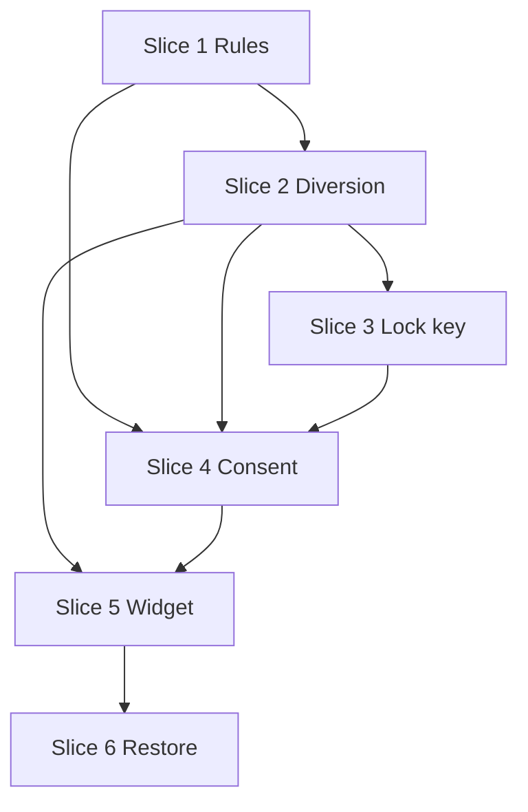

# Plan: POP Icon Keys plugin for Omarchy

**Created**: 2026-11-19 (retroactive — written after v0.2.0 was built; slices 1–6 record work already done)
**Branch**: main
**Status**: approved (retroactive record)
**Gherkin persistence**: features/
**Spec**: [docs/specs/pop-icon-keys-plugin.md](../docs/specs/pop-icon-keys-plugin.md)

## Goal

Make the Logitech POP Icon Keys top row behave as the owner asked (macOS-style
actions, F8 region capture by the owner's choice) on Omarchy, keep that mapping
working across Solaar restarts and keyboard sleep, and package it as an Omarchy
marketplace plugin that installs and uninstalls only with the user's consent.

## Acceptance Criteria

Copied from the spec. Ticked at release review after behavioural verification.

- [ ] AC1 F4 Show Desktop → empty workspace; again returns
- [ ] AC2 F5 Search → Omarchy app launcher
- [ ] AC3 F6 Dictation → `omarchy-dictation toggle` (selected backend)
- [ ] AC4 F7 Emoji → Omarchy emoji picker
- [ ] AC5 F8 Snip & Sketch → region screenshot (owner's choice over the macOS column)
- [ ] AC6 Lock (Fn + last key) → screen locks
- [ ] AC7 F9–F12, brightness and other keys unchanged
- [ ] AC8 Cmd sends Super, Opt sends Alt
- [ ] AC9 Mapping survives a Solaar restart and a reboot
- [ ] AC10 Dropped keys are routed again without user edits
- [ ] AC11 Installable with `omarchy plugin add <repo> --enable` then `setup`
- [ ] AC12 `setup` lists every change and asks first; declining changes nothing
- [ ] AC13 `uninstall` removes only what `setup` added
- [ ] AC14 No personal paths, names or owner scripts in shared code
- [ ] AC15 Bar widget shows battery, per-key routing, Solaar state, re-apply
- [ ] AC16 README shows the widget screenshot
- [ ] AC17 Passes `omarchy-plugin-validate` and the marketplace baseline patterns
- [ ] AC18 dev-team code review passes before release

## Slices

### Slice 1: Top-row rules through Solaar

**Depends-on:** none
**Files:** `setup`, `lib/edit.py`, `bin/pop-icon-keys-show-desktop`

**Behavior:**

```gherkin
Feature: Top-row keys run Omarchy actions

  Scenario Outline: A mapped key runs its Omarchy action
    # Still passes if: the key also still sends its built-in OS shortcut alongside the action
    Given the plugin is set up and Solaar is running
    When I press <key>
    Then <action> happens

    Examples:
      | key | action                                        |
      | F4  | an empty workspace is shown                   |
      | F5  | the Omarchy app launcher opens                |
      | F6  | dictation toggles with the selected backend   |
      | F7  | the Omarchy emoji picker opens                |
      | F8  | a region screenshot starts                    |

  Scenario: Show Desktop returns on a second press
    # Still passes if: the return goes to the most recent workspace rather than the one F4 left from
    Given I am on a workspace with windows
    And I pressed F4 and see an empty workspace
    When I press F4 again
    Then I am back on the workspace I left

  Scenario: Unmapped keys keep their behaviour
    # Still passes if: a shape key (Circle, Triangle, Diamond, Star) changes behaviour
    Given the plugin is set up
    When I press a media or brightness key
    Then it does what it did before the plugin was set up
```

**Steps:**

#### Step 1.1: Write the five Solaar rules in a marked block

**Complexity**: standard
**IMPLEMENT**: Rules for Show Desktop, MultiPlatform Search, Dictation, Emoji, Screen Capture in `rules.yaml`
**TEST**: `tests/test_setup.sh` rules block present once after two runs
**REFACTOR**: Rules body generated from one key table
**Files**: `setup`, `lib/edit.py`
**Covers**: AC1, AC2, AC3, AC4, AC5, AC7
**Commit**: `Add Solaar rules for the POP Icon Keys top row`

#### Step 1.2: Show Desktop helper with return toggle

**Complexity**: trivial
**IMPLEMENT**: `bin/pop-icon-keys-show-desktop` switches to an empty workspace, or back when already on one
**TEST**: Manual on the real bar (owner confirmed "F4 yes")
**REFACTOR**: No hard-coded paths
**Files**: `bin/pop-icon-keys-show-desktop`
**Covers**: AC1
**Commit**: `Add Show Desktop toggle helper`

### Slice 2: Persistent diversion

**Depends-on:** 1
**Files:** `setup`, `lib.sh`, `lib/edit.py`

**Behavior:**

```gherkin
Feature: Key diversion survives restarts

  Scenario: Diversion persists across a Solaar restart
    # Still passes if: only some of the five keys are checked after the restart
    Given setup has run
    When Solaar is restarted
    Then all five mapped keys are still diverted

  Scenario: Setup does not lose diversion to a running Solaar
    # Still passes if: Solaar's deferred save lands later than the wait allows
    Given Solaar is running
    When setup writes the diversion
    Then Solaar was stopped before the write
    And Solaar is running again afterwards

  Scenario: Keyboard not yet known to Solaar
    # Still passes if: the message wording changes
    Given Solaar has no saved entry for the keyboard
    When setup runs
    Then setup reports the keys as not diverted and exits non-zero
```

**Steps:**

#### Step 2.1: Write divert-keys with Solaar stopped

**Complexity**: complex
**IMPLEMENT**: Stop Solaar, set ids 110, 266, 259, 264, 212 to 1 for every "POP Icon Keys" entry, start Solaar
**TEST**: Sandbox tests for multi-entry and block-style divert-keys; stop-timeout and signal paths
**REFACTOR**: One stop/start helper with a guaranteed restart
**Files**: `lib.sh`, `lib/edit.py`, `setup`
**Covers**: AC9
**Commit**: `Persist key diversion with Solaar stopped`

### Slice 3: Lock key

**Depends-on:** 2
**Files:** `setup`, `uninstall`

**Behavior:**

```gherkin
Feature: Lock key locks the screen

  Scenario: Lock key locks
    # Still passes if: Super+Ctrl+Q typed by hand also locks
    Given the plugin is set up
    When I press Fn + the last key
    Then the screen locks

  Scenario: An existing binding is respected
    # Still passes if: the existing binding uses different spacing
    Given Super+Ctrl+Q is already bound in my Hyprland bindings
    When setup runs
    Then my bindings file is not changed
```

**Steps:**

#### Step 3.1: Bind Super+Ctrl+Q to omarchy-system-lock

**Complexity**: trivial
**IMPLEMENT**: Marked Lua block in `bindings.lua` unless already bound
**TEST**: Sandbox test for skip-if-bound
**REFACTOR**: Shared block writer
**Files**: `setup`, `uninstall`
**Covers**: AC6
**Commit**: `Bind the Lock key to omarchy-system-lock`

### Slice 4: Consent-gated setup and uninstall

**Depends-on:** 1, 2, 3
**Files:** `setup`, `uninstall`, `lib.sh`, `lib/edit.py`, `README.md`, `tests/test_setup.sh`

**Behavior:**

```gherkin
Feature: Setup and uninstall change config only with consent

  Scenario: Setup shows the plan and asks
    # Still passes if: the plan omits the Hyprland reload
    Given a fresh Omarchy user with Solaar installed
    When I run setup and answer no
    Then every file setup would change was listed
    And no file changed
    And setup exits 0

  Scenario: --yes never installs packages
    # Still passes if: --yes is accepted but the install prompt text changes
    Given Solaar is not installed
    When I run setup --yes
    Then setup stops and tells me to install Solaar
    And no package is installed

  Scenario: Damaged markers stop setup safely
    # Still passes if: the abort message names the wrong file
    Given my rules file has a BEGIN marker without its END marker
    When I run setup and answer yes
    Then setup stops with an error
    And none of my files changed

  Scenario: Uninstall removes only the plugin's changes
    # Still passes if: an unrelated rule's comment is reformatted
    Given setup has run and I have my own Solaar rules
    When I run uninstall and answer yes
    Then the plugin's rules, binding and helper are gone
    And my own rules are still there

  Scenario: Shared code has no personal data
    # Still passes if: a personal path appears in a test fixture comment
    Given the published repository
    When I search it for home paths and the owner's scripts
    Then nothing is found
```

**Steps:**

#### Step 4.1: Plan, consent prompt and dry run

**Complexity**: standard
**IMPLEMENT**: Print plan first; y/N default No; `--yes`; `--dry-run` shows diffs
**TEST**: Sandbox decline, non-TTY and `--yes` cases
**REFACTOR**: One plan builder for setup and uninstall
**Files**: `setup`, `uninstall`, `lib.sh`
**Covers**: AC11, AC12
**Commit**: `Ask before changing config`

#### Step 4.2: Safe marked-block edits

**Complexity**: complex
**IMPLEMENT**: Exact markers, abort on damage, in-place replace, atomic write, keep line endings, backups on change only
**TEST**: Orphan BEGIN/END, CRLF, symlink, read-only dir, non-UTF-8
**REFACTOR**: All edits through `lib/edit.py`
**Files**: `lib/edit.py`, `tests/test_setup.sh`
**Covers**: AC12, AC13
**Commit**: `Make config edits atomic and abort on damaged markers`

#### Step 4.3: Uninstall and README

**Complexity**: standard
**IMPLEMENT**: Remove blocks, unmarked exact plugin copies, helper; reset diversion; document install, removal, dependencies
**TEST**: Sandbox round trip leaves user rules intact
**REFACTOR**: Reuse setup's key table
**Files**: `uninstall`, `README.md`
**Covers**: AC13, AC14, AC17
**Commit**: `Add uninstall and document install and removal`

### Slice 5: Bar widget

**Depends-on:** 2, 4
**Files:** `Panel.qml`, `manifest.json`, `bin/pop-icon-keys-status`, `tests/qml_logic.py`, `preview.png`, `README.md`

**Behavior:**

```gherkin
Feature: Bar widget shows keyboard state

  Scenario: Routed keyboard
    # Still passes if: the battery figure is a few minutes stale
    Given the keyboard is connected and all keys are routed
    When I open the widget
    Then I see the battery level, a tick for each key and Solaar running

  Scenario: Keys need setup
    # Still passes if: the icon colour is the same urgent colour used elsewhere
    Given a mapped key is not diverted in Solaar's saved settings
    When the widget reads the status
    Then the icon shows it needs attention
    And the popup offers Re-apply setup, which asks before changing anything

  Scenario: Keyboard disconnected
    # Still passes if: the hide setting is ignored when Solaar is not installed
    Given hideWhenDisconnected is on
    And the keyboard is not connected
    Then the widget is hidden
```

**Steps:**

#### Step 5.1: Status helper and widget

**Complexity**: standard
**IMPLEMENT**: `bin/pop-icon-keys-status` key=value output; `Panel.qml` icon, popup, buttons
**TEST**: `tests/qml_logic.py` with canned real `solaar show` fixtures
**REFACTOR**: Poll at most every 2 minutes
**Files**: `Panel.qml`, `manifest.json`, `bin/pop-icon-keys-status`, `tests/qml_logic.py`
**Covers**: AC15
**Commit**: `Add bar widget with battery and routing status`

#### Step 5.2: Marketplace preview

**Complexity**: trivial
**IMPLEMENT**: `preview.png` cropped to bar and popup; shown in README
**TEST**: Manual check for personal data in the image
**REFACTOR**: n/a — image only
**Files**: `preview.png`, `README.md`
**Covers**: AC16
**Commit**: `Add marketplace preview screenshot`

### Slice 6: Dropped-key restore

**Depends-on:** 5
**Files:** `bin/pop-icon-keys-restore`, `bin/pop-icon-keys-status`, `Panel.qml`, `manifest.json`, `tests/fixtures/`

**Behavior:**

```gherkin
Feature: Dropped keys are restored

  Scenario: Keyboard drops diversion
    # Still passes if: the restore happens on the second poll instead of the first
    Given Solaar's saved settings divert the five keys
    And the keyboard reports them as Regular
    When the widget reads the status
    Then it shows the keys as dropped
    And it restores them without changing any config file

  Scenario: Auto-restore is rate limited
    # Still passes if: the limit is 90 seconds instead of 60
    Given a restore ran less than a minute ago
    When the keys are dropped again
    Then no automatic restore runs until the minute has passed

  Scenario: Auto-restore turned off
    # Still passes if: the manual Restore button label changes
    Given autoRestore is off
    When the keys are dropped
    Then the widget shows a Restore button and does not restore by itself
```

**Steps:**

#### Step 6.1: Live vs saved status and restore helper

**Complexity**: standard
**IMPLEMENT**: Status reports `inactive=`; `bin/pop-icon-keys-restore` re-applies runtime diversion
**TEST**: Fixtures for routed, dropped, not-set-up; verified once on the real keyboard
**REFACTOR**: Re-check 8 s after restore (after Solaar's deferred save)
**Files**: `bin/pop-icon-keys-status`, `bin/pop-icon-keys-restore`, `Panel.qml`, `manifest.json`, `tests/fixtures/`
**Covers**: AC10
**Commit**: `Restore keys the keyboard dropped`

## Parallelization



| Wave | Slices (parallel) |
|------|-------------------|
| 1 | 1 |
| 2 | 2 |
| 3 | 3 |
| 4 | 4 |
| 5 | 5 |
| 6 | 6 |

## Complexity Classification

Ratings are on each step. Slices 2 and 4.2 are `complex`: they edit live
config and control the Solaar process.

## Pre-PR Quality Gate

- [ ] `bash tests/test_setup.sh` passes
- [ ] `python3 tests/qml_logic.py` passes
- [ ] `omarchy-plugin-validate .` passes
- [ ] `bash -n` on all scripts; `qmllint Panel.qml` has no errors
- [ ] dev-team `/code-review` passes (AC18)
- [ ] README matches behaviour

## Skipped (low value)

| Finding | Rationale (one line) |
|---|---|
| AC8 Cmd = Super, Opt = Alt | The keyboard's Linux OS mode already does this; the plugin changes nothing, so there is no behaviour to build or test. |

## Risks & Open Questions

- **Extensibility and plugin id (decide before marketplace submission).** The
  plugin hard-codes one device ("POP Icon Keys"), its Solaar control ids and
  key names in several files. Other Logitech keyboards would need a device
  profile structure. Marketplace plugin ids are permanent, so a rename to a
  device-neutral id must happen before the first submission. See
  [ADR 0005](../docs/adr/0005-device-profiles-for-other-keyboards.md).
- Key names and ids verified only on Solaar 1.1.20.
- The trigger for the keyboard dropping diversion (sleep or reconnect) is a
  guess; the restore covers it whatever the cause.
- Widget appearance in the dropped-key state has not been seen on a real bar.

## Build Progress

### Slices (grouped by wave)

#### Wave 1
- [x] Slice 1: Top-row rules through Solaar
  - [x] Step 1.1: Write the five Solaar rules in a marked block
  - [x] Step 1.2: Show Desktop helper with return toggle

#### Wave 2
- [x] Slice 2: Persistent diversion
  - [x] Step 2.1: Write divert-keys with Solaar stopped

#### Wave 3
- [x] Slice 3: Lock key
  - [x] Step 3.1: Bind Super+Ctrl+Q to omarchy-system-lock

#### Wave 4
- [x] Slice 4: Consent-gated setup and uninstall
  - [x] Step 4.1: Plan, consent prompt and dry run
  - [x] Step 4.2: Safe marked-block edits
  - [x] Step 4.3: Uninstall and README

#### Wave 5
- [x] Slice 5: Bar widget
  - [x] Step 5.1: Status helper and widget
  - [x] Step 5.2: Marketplace preview

#### Wave 6
- [x] Slice 6: Dropped-key restore
  - [x] Step 6.1: Live vs saved status and restore helper
